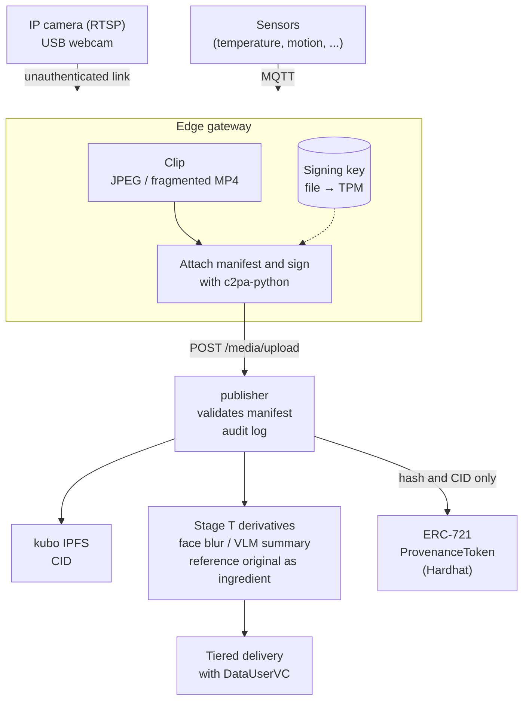
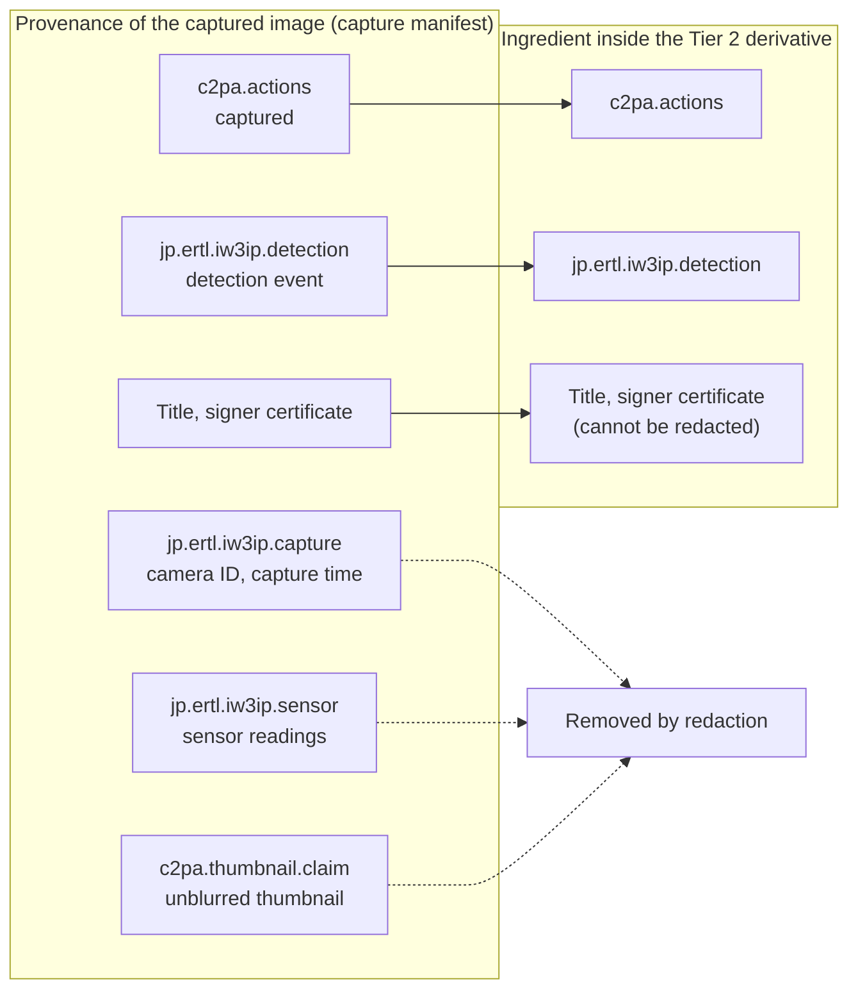

# C2PA provenance pipeline — provenance for camera footage and sensor data (Stage P design spec)

!!! abstract "Where this document fits"
    This is the design spec for **Stage P** (Provenance), which attaches provenance information that follows the C2PA (Coalition for Content Provenance and Authenticity) standard [1] to footage from low-cost commercial IP cameras and USB webcams, and to sensor data.
    Signing uses the Rust SDK [2] and Python SDK [3] published by the CAI (Content Authenticity Initiative), and the provenance hashes are recorded on chain as NFTs. It is a draft written before implementation.
    "Stage" in this document refers to the step numbers of the Phase 2 hands-on series (listed in the "Hands-on stages" section (§5) of the [VC architecture overview](vc-architecture-overview.md)).
    Stage P builds on the tiered access of Stage T ([Tiered access design spec](../hands-on/data-user-vc-tiered-spec.md)) and the SellerVC of Stage 7 ([SellerVC design spec](seller-vc-spec.md)). The P0 part can be run locally in the hands-on [Prove where an image came from](../hands-on/c2pa-provenance.md).
    P0–P5 in this document refer to the implementation steps of this spec (listed in §10). The MVP (Minimum Viable Product, the minimal implementation run in the hands-on) corresponds to P0–P2.

This spec is a design for adding to IW3IP a mechanism that **attaches to each photo or video a record of who took it, when, how, and how it was processed, and signs that record electronically**. Tampering with the record breaks the signature, so whoever receives the file can check for themselves whether it is genuine.

## What this page covers

- What C2PA lets you check, and what it does not
- What goes into the provenance of a captured image (capture manifest) and of a face-blurred image (derivative manifest)
- How to keep the original face and camera ID from leaking through the provenance of a face-blurred image
- How the signing certificate and key are handled, and how this fits into the publisher and the chain

## Before you read

- It is easier to follow after finishing "Process data before sharing" in Part 2 of the hands-on (such as [Tier the response by trust](../hands-on/data-user-vc-tiered.md)). Tiers 1–3, DataUserVC, the publisher, and `/media/upload` are used without explanation
- Basic knowledge of DIDs and VCs ([SSI/DID/VC basics](../foundations/ssi-did-vc-basics.md)) is assumed. §2 explains C2PA signing by comparing it with VCs

## Common pitfalls

- What C2PA guarantees is "this signer signed this content", not "what the footage shows is true" (§4)
- A validation result of `Valid` does not mean the signer is trusted. Only a trusted signer yields `Trusted` (§7.1)
- Attaching the original image to a face-blurred image as an "ingredient" also brings along, by default, a thumbnail of the unblurred face (§5.3)
- "Redaction" in this spec is an operation that removes provenance information, and is different from the face blurring of Stage T (image processing)

## 1. Motivation

### Current state (up to Stage T)

The publisher's media gateway computes the sha256 of each uploaded image and video, and also returns a CID when IPFS is enabled (§8–§9 of [Deliver images and video with tiered access](../hands-on/data-user-vc-tiered-media.md)).
This lets anyone check that the content has not been changed **after it was uploaded**.

Nobody can check the following, however:

- Which camera took the file, and when
- Whether anything was composited or swapped before the upload
- Which original a Tier 2 face-blurred image or a Tier 1 summary text was made from
- Whether the content of a Merchandise sold on the marketplace is what the seller claims

Sharing surveillance footage as crime leads or disaster information presupposes being able to answer "is this footage real?".
Generative AI can now produce convincing footage, which makes the question more important.

Recording a sha256 on chain does not answer this question. A sha256 only shows that "this file has not changed since it was recorded"; it does not show who made the file or how.
C2PA attaches to the file an electronic signature made with the capturing device's key, plus the processing history (which file it was made from and what was done). That lets the recipient check both "who made it" and "where it came from".

### What Stage P does

1. An edge gateway placed next to the camera attaches a C2PA manifest to captured images and video and signs them
2. The capture time, camera ID, detection event, and sensor readings go into the manifest as custom assertions
3. The publisher attaches a manifest to each Stage T derivative (such as a face-blurred image) that references the original as an "ingredient", linking the processing history
4. The publisher validates the manifest at upload time and records the result in the audit log
5. The manifest hash and CID are recorded on chain as an ERC-721 [10] token (raw data never goes on chain)

Compatibility with the existing path is preserved. Media without a manifest is handled by the same path as up to Stage T.

## 2. C2PA basics

### 2.1 What C2PA is

C2PA (Coalition for Content Provenance and Authenticity) is a standard for attaching provenance (a record of where a file came from) to files such as images, video, and audio. It is defined by an organization whose members include camera makers, news organizations, and IT companies [1].
The CAI (Content Authenticity Initiative) is an organization that publishes open-source SDKs (Software Development Kits, libraries used from programs) implementing the C2PA standard [2][3]. This spec uses c2pa-python, the Python version.

Provenance is **embedded inside the file**, the JPEG or MP4 itself. Handing over the file therefore hands over its provenance too.

### 2.2 Structure of a manifest

The bundle of provenance embedded in a file is called a manifest. A manifest is made up as follows:

```
Signed JPEG file
├─ Pixel data (the photo itself)
└─ Manifest
    ├─ Assertion 1: "captured" (c2pa.actions)
    ├─ Assertion 2: camera ID and capture time (jp.ertl.iw3ip.capture)
    ├─ Assertion 3: sensor readings (jp.ertl.iw3ip.sensor)
    ├─ Claim: the hashes of assertions 1–3 and of the pixel data, listed together
    └─ Signature: an electronic signature over the claim, plus the signer's certificate
```

What gets signed is the claim, and the claim contains the hashes of every assertion and of the pixel data. Changing a single pixel or a single character of an assertion therefore makes a hash mismatch, and validation fails.

| Term | Meaning |
| --- | --- |
| Manifest | The bundle of provenance information attached to one file. Consists of assertions, a claim, and a signature |
| Assertion | One individual provenance statement, such as a capture or processing action, an ingredient, or custom data |
| Claim | The collection of assertion and pixel-data hashes that is the target of the signature |
| Hard binding | Including a hash of the pixel data in the claim. Changing even one byte makes validation fail |
| Ingredient | A file that processing started from. Its manifest can be imported into the processed file, which links "which file this was made from" |
| Signer | The party that signed the claim, represented by an X.509 certificate (§2.3) |
| Edge gateway | The device next to the camera (Raspberry Pi or PC) that receives the footage and signs it |
| Redaction | Removing specific assertions from an ingredient's manifest (§5.3). Different from processing that hides faces in the image (face blurring) |

### 2.3 Signatures and certificates (compared with VCs)

C2PA signing works much like the VCs used in the hands-on. In both, the signer signs with a private key and the recipient checks with the public key. The difference is how they show "whose public key this is".

| Aspect | VC (hands-on) | C2PA (this spec) |
| --- | --- | --- |
| Who signs | issuer | signer |
| Signer's identifier | DID (`did:jwk:...`) | X.509 certificate |
| Who vouches for the identifier | Nobody (you create a DID yourself) | A CA (Certificate Authority) |
| How trust is decided | The verifier decides whether it trusts the issuer's DID | The validator decides whether it trusts the CA |

An X.509 certificate is the same kind of certificate used for HTTPS websites: a CA signs it to vouch that "this public key belongs to the holder of this name".
A validator keeps a list of CAs it trusts. If the signer's certificate was issued by one of those CAs, the signer is trusted. A certificate from a CA not on the list is not trusted even if the signature itself is correct (the difference between `Valid` and `Trusted` in §7.1).

## 3. Overall architecture



Terms in the diagram:

- RTSP (Real Time Streaming Protocol): the standard way an IP camera streams video over the network
- Fragmented MP4: an MP4 format that stores video in fragments of a few seconds each, so each fragment can be signed while recording continues
- TPM (Trusted Platform Module): a component that signs while keeping the private key locked inside the device (§6.2)
- kubo: the standard IPFS implementation, used in §9 of [Deliver images and video with tiered access](../hands-on/data-user-vc-tiered-media.md)

Low-cost commercial IP cameras and webcams have neither a signing key nor a signing function (cameras that support C2PA are limited to some expensive models). In this spec, therefore, the first device that signs is the **edge gateway** placed next to the camera. Authenticity at capture time can be guaranteed only up to the edge gateway. §4 deals with this limitation.

## 4. Trust boundaries

| Segment | Threat considered | Handling in this spec |
| --- | --- | --- |
| Camera → gateway (RTSP / USB) | Swapped footage, replayed recordings | Not addressed in the MVP. Assumes a closed LAN. Later, compare with cameras that support ONVIF Media Signing [5][6] |
| Inside the gateway | Stolen signing key, tampering before signing | MVP keeps the key in a file. P4 moves it to a TPM 2.0 or a secure element (such as ATECC608) |
| Gateway → publisher | Tampering in transit | Detected by the hard binding. An attacker does not have the gateway's private key, so they cannot re-sign the tampered file as the same signer |
| Inside the publisher | Fabricated derivatives | Derivatives are also signed with the publisher's key and reference the original as an ingredient |
| Chain | Rewriting provenance after the fact | The manifest hash is recorded in a token |

Terms in the table:

- ONVIF Media Signing: a mechanism, defined by the surveillance-camera industry standard ONVIF, in which the camera itself signs the video [5][6]. With a supporting camera, swaps between camera and gateway can also be detected
- Secure element: like a TPM, a small component that signs without letting the private key out. The ATECC608 is an example that can be attached to a Raspberry Pi

What C2PA guarantees is "this signer signed this content", not "what the footage shows is true".
For example, if the gateway operator feeds fake footage into the gateway, the fake footage also gets a valid signature. As long as the link between camera and gateway is unauthenticated, authenticity at capture time rests on trusting whoever runs the gateway. The hands-on and papers will state this explicitly.

## 5. Manifest design

### 5.1 Labels for custom assertions

The C2PA specification requires custom assertion labels to start with a namespace made of a reversed domain name [1].
This spec uses the prefix `jp.ertl.iw3ip.`. Custom assertions mean something only within IW3IP; other validators may not interpret or display their content.

| Label | Content | Attached to |
| --- | --- | --- |
| `jp.ertl.iw3ip.capture` | Camera ID, model, capture time, gateway DID | Captured files |
| `jp.ertl.iw3ip.detection` | Detection event label, score, detection model | Files clipped on detection |
| `jp.ertl.iw3ip.sensor` | Sensor readings around the capture time | Captured files |
| `jp.ertl.iw3ip.derivation` | Stage T tier and kind of processing | Derived files |

### 5.2 Capture manifest

Attached by the gateway to files it captures. In c2pa-python, the manifest content is written as JSON and passed to the Builder (the class that assembles and signs a manifest). The following is an example definition.

```json
{
  "claim_generator_info": [{ "name": "iw3ip-gateway", "version": "0.1.0" }],
  "title": "capture.jpg",
  "assertions": [
    {
      "label": "c2pa.actions",
      "data": {
        "actions": [{
          "action": "c2pa.created",
          "digitalSourceType": "http://cv.iptc.org/newscodes/digitalsourcetype/digitalCapture"
        }]
      }
    },
    {
      "label": "jp.ertl.iw3ip.capture",
      "data": {
        "camera_id": "cam01",
        "camera_model": "generic-rtsp",
        "captured_at": "2026-10-22T10:15:00Z",
        "gateway_did": "did:jwk:<gateway>"
      }
    },
    {
      "label": "jp.ertl.iw3ip.detection",
      "data": { "label": "person", "score": 0.91, "model": "yolov8n" }
    },
    {
      "label": "jp.ertl.iw3ip.sensor",
      "data": {
        "window": ["2026-10-22T10:14:30Z", "2026-10-22T10:15:30Z"],
        "readings": [{ "topic": "home/env/temperature", "value": 22.4, "unit": "Cel" }]
      }
    }
  ]
}
```

`c2pa.actions` is an assertion defined by C2PA that lists the operations performed on the file. `c2pa.created` means "this file was newly created".
`digitalSourceType` uses `digitalCapture` from the vocabulary of IPTC, an industry body of news organizations [9], to indicate that a camera captured the file (an image made with generative AI uses a different value).

`gateway_did` is only an attribute saying "which gateway captured this". The key used for signing is the X.509 certificate's key, not the DID's key (§6.3).

`title` must not carry meaningful values such as the camera ID or the capture time, because the capture manifest's title cannot be redacted from derived files (§5.3). Put the camera ID and capture time in `jp.ertl.iw3ip.capture`, which can be redacted.

### 5.3 Derivative manifests (mapping to Stage T)

The publisher attaches to each Stage T derivative a manifest that references the original as an ingredient.

| Tier | Derivative | Action | Ingredient |
| --- | --- | --- | --- |
| 3 Full | Raw image / video | (capture manifest as is) | — |
| 2 Access | Face-blurred image | `c2pa.opened`, `c2pa.edited`, `c2pa.redacted`, in that order | Raw image |
| 1 Summary | Summary text | — (§5.5) | — |

The three Tier 2 actions mean the following:

1. `c2pa.opened`: an existing file (the ingredient) was opened. It shows that this file was made from an existing file. C2PA requires the list of actions to start with "created" or "opened", and the SDK refuses to sign a manifest that starts otherwise (§13)
2. `c2pa.edited`: the content was processed. The kind of processing (`face_blur`) is recorded in `jp.ertl.iw3ip.derivation`
3. `c2pa.redacted`: information was removed from the ingredient's manifest (see the steps below)

The following diagram shows how each part of the captured image's provenance carries over into the Tier 2 derivative (solid lines: kept; dotted lines: removed by redaction).



There is an **easily overlooked privacy problem** here. By default, importing an ingredient also puts the following two things into the derived file (confirmed in §13):

- A thumbnail of the unblurred image. The specification recommends referencing the thumbnail in the ingredient's manifest [1], and the SDK uses the original manifest's `c2pa.thumbnail.claim` as the ingredient thumbnail. A thumbnail of the unblurred face ends up in the face-blurred image
- The assertions in the ingredient's manifest. The camera ID and sensor readings become visible to Tier 2 recipients as well

Tier 2 derivatives therefore do the following:

1. Remove `c2pa.thumbnail.claim`, `jp.ertl.iw3ip.capture`, and `jp.ertl.iw3ip.sensor` from the ingredient's manifest using C2PA assertion redaction [1]. List them in `redactions` of the manifest definition in the form `self#jumbf=/c2pa/<ingredient manifest identifier>/c2pa.assertions/<label>`. This notation points to the position of an assertion inside the file (JUMBF is the format C2PA uses to store provenance inside a file)
2. Add the `c2pa.redacted` action yourself. The SDK does not add it automatically
3. The ingredient manifest's signature still validates after redaction, so Tier 2 recipients can be shown only that "this was made from the Tier 3 original"

The signature survives redaction because the ingredient's claim contains **only the hashes** of its assertions. Removing an assertion's content leaves the claim and its signature unchanged. The validator reads the derivative manifest's record of "which assertions were redacted" and treats the assertions without content as legitimately redacted.
The redacted values remain in the claim as hashes, but the SDK mixes a random value (salt) into each assertion before hashing, so the original values cannot be guessed from the hashes (§13).

The definition of a Tier 2 derivative manifest looks like this (`<capture>` is the identifier of the ingredient's manifest):

```json
{
  "claim_generator_info": [{ "name": "iw3ip-publisher", "version": "0.1.0" }],
  "title": "tier2.jpg",
  "assertions": [
    {
      "label": "c2pa.actions",
      "data": {
        "actions": [
          { "action": "c2pa.opened", "parameters": { "ingredientIds": ["capture"] } },
          { "action": "c2pa.edited", "parameters": { "description": "face_blur" } },
          { "action": "c2pa.redacted", "reason": "c2pa.PII.present",
            "parameters": { "redacted": "self#jumbf=/c2pa/<capture>/c2pa.assertions/jp.ertl.iw3ip.capture" } }
        ]
      }
    },
    { "label": "jp.ertl.iw3ip.derivation", "data": { "tier": 2, "kind": "face_blur" } }
  ],
  "redactions": [
    "self#jumbf=/c2pa/<capture>/c2pa.assertions/c2pa.thumbnail.claim",
    "self#jumbf=/c2pa/<capture>/c2pa.assertions/jp.ertl.iw3ip.capture",
    "self#jumbf=/c2pa/<capture>/c2pa.assertions/jp.ertl.iw3ip.sensor"
  ]
}
```

Add one `c2pa.redacted` action per redacted assertion (the example above shows only one). The ingredient file itself is passed separately with `add_ingredient`.

The derivative manifest's own thumbnail is made from the blurred image, so it can stay.

`jp.ertl.iw3ip.detection` in the ingredient's manifest (the detection event label, score, and detection model) is not redacted and stays in the Tier 2 derivative. In Stage T, detection events reach recipients of every tier (including Tier 0, which receives events only), so nothing new leaks when Tier 2 recipients see them. Knowing "what was detected to cut out this image" also helps Tier 2 recipients judge the image.
If a detection event carries values that identify a person, such as a name or a licence plate number, this assumption no longer holds, so add `jp.ertl.iw3ip.detection` to the redaction targets as well.

The following two things, however, cannot be removed by redaction and remain in Tier 2 derived files (confirmed in §13). A derived file imports the ingredient manifest's claim and signature as they are.

- The title of the ingredient's manifest (`title`). It remains even when the ingredient title (the `title` passed to `add_ingredient`) is omitted
- The signer's certificate. Its name (CN) and serial number remain

Both are fixed at capture time, so the gateway keeps meaningful values out of the title (§5.2) and keeps the camera ID out of the certificate name (§6.1).
The certificate serial number, however, remains with the same value in every derived file from the same gateway, so Tier 2 recipients can tell which files were captured by the same gateway. This is left as an open question in §11.

!!! warning "Check the result of redaction"
    Always read the derived file back and check that the redacted assertions and thumbnail are gone. Trusting the manifest definition alone can miss a leak.

### 5.4 Handling sensor data

C2PA is a standard for media such as images, video, and audio, and defines no format for signing sensor time series (JSON or CSV) directly. Three options are compared.

| Option | Approach | Pros | Cons |
| --- | --- | --- | --- |
| A | Put readings in `jp.ertl.iw3ip.sensor` of the capture manifest (§5.2) | Self-contained in C2PA. Footage and readings are bound by one signature | Cannot cover readings from times with no capture |
| B | Put the hash of each interval's readings into the manifest of a periodic snapshot | Continuous data can also be linked to the footage provenance | Raw readings must be stored separately and matched by hash |
| C | Skip C2PA and distribute readings as a VC signed with the gateway's DID | Reuses the existing SSI mechanism (the ServiceVC given to devices, §6.3) | A verification path separate from the footage provenance |

Recommendation: in the MVP, handle readings tied to detection events with option A. Compare options B and C for continuous time series in P3.

### 5.5 Text derivatives (Tier 1)

The VLM summary text is not one of the media formats C2PA covers.
In the MVP, each `/platform/data` row carries the identifier of the original's manifest and the sha256 of the summary text, and the publisher's audit log links them (§7).
Whether this can be handled within the C2PA specification is left as an open question in §11.

## 6. Signing and keys

### 6.1 Certificates

As described in §2.3, a signer is represented by an X.509 certificate issued by a CA. During research, we create our own CA and use it to issue the gateway's certificate.

| Phase | Certificate | Shown on validation |
| --- | --- | --- |
| MVP | A private CA and an ES256 signing certificate | Untrusted signer (trusted once the private CA is registered with the validator) |
| Production (assumed) | A certificate issued by a CA on the C2PA Trust List [7] | Trusted signer |

ES256 is a signature scheme that combines elliptic-curve cryptography (P-256) with SHA-256.
The C2PA Trust List is the list of CAs that C2PA has approved as "certificates from this CA may be trusted", the counterpart of the list of HTTPS CAs a browser trusts. A provisional list (the Interim Trust List) was used before, but it stopped receiving updates on January 1, 2026, and was replaced by the C2PA Trust List based on a review scheme (the Conformance Program) [7][8]. The research implementation does not obtain a production certificate; it checks the validation flow with a private CA.

Certificates made with the private CA must meet the following conditions (otherwise the SDK refuses to sign). `make_test_certs.py` in the main repository creates certificates that meet them.

- The certificates themselves are signed with SHA-256 or stronger. SHA-1 is an older hash scheme considered insecure. The `openssl` on macOS (LibreSSL underneath) signs with SHA-1 unless `-sha256` is given, which the SDK rejects
- The signing certificate is issued by the CA, not signed by itself (self-signed)
- The signing certificate carries an extended key usage (EKU, a declaration of what the key may be used for) such as `emailProtection`
- The certificates carry key identifiers (SKI and AKI, numbers used to follow the parent–child links between certificates) and the CA carries a key usage (a declaration that its key issues certificates) (a chain without them was rejected)

Apart from the SDK's conditions, the signing certificate's name (CN) must not contain the camera ID (for example, `iw3ip-gateway`), because the certificate name cannot be redacted from Tier 2 derived files either (§5.3).

### 6.2 Key storage

c2pa-python lets the caller perform signing in its own function (a callback) [3]. This is used to move the key step by step.

1. P0–P2: keep the key as a PEM file (a file format that stores the key as text). Stealing the file steals the key, so the SDK documentation also says this is for development only
2. P4: sign with a TPM 2.0 or secure element so the key never leaves the device

### 6.3 Relation to DIDs

ServiceVC is a VC stating that a device or service may write continuously ([Authenticate machines](../hands-on/ha-ssi-service.md)). Making the gateway a ServiceVC holder gives it a `did:jwk`. A C2PA signer is represented by an X.509 certificate, so these are two separate identifiers.

The identity assertion of CAWG (Creator Assertions Working Group, the working group defining how to add the creator's identity to C2PA provenance) [4] is one way to bind the two.
The CAWG identity assertion has a mode signed with an X.509 certificate and a mode that aggregates VCs (identity claims aggregation).
SellerVC is a VC, so the latter, which handles VCs as they are, suits using SellerVC as proof of "who provided this". The CAI SDK, however, can only validate the latter, not sign it [2].
The MVP therefore only puts `gateway_did` in `jp.ertl.iw3ip.capture`, and integration with CAWG is considered in P3.

## 7. Publisher extensions

### 7.1 Response of `POST /media/upload`

Adds `c2pa` to the existing response (`{url, sha256, content_type, byte_size, cid, ipfs_gateway_url}`).

```json
{
  "url": "http://<HOST_IP>:8080/media/<sha256>.jpg",
  "sha256": "...",
  "cid": "...",
  "c2pa": {
    "present": true,
    "manifest_label": "urn:c2pa:...",
    "validation_state": "Valid",
    "signer": "CN=iw3ip-gateway",
    "trusted": false
  }
}
```

The publisher reads the manifest with the c2pa-python Reader (the class that reads and validates a manifest) and records the validation result. The SDK reports the result as one of three states: `Invalid`, `Valid`, or `Trusted`.

!!! note "`Valid` does not mean \"trustworthy\""
    `Valid` means "the signature and hashes are correct"; it says nothing about whether the signer can be trusted. Anyone who creates their own CA can produce a `Valid` signature. Only a signer holding a certificate from a trusted CA yields `Trusted`.

| Validation result | SDK state | Handling in the MVP |
| --- | --- | --- |
| No manifest | — | Accepted as before (`present: false`) |
| Valid signature, untrusted signer | `Valid` (failure code `signingCredential.untrusted`) | Accepted (`trusted: false`) |
| Valid signature, trusted signer | `Trusted` | Accepted (`trusted: true`) |
| Hash mismatch or broken signature | `Invalid` | Rejected with 400 (`c2pa_invalid`) |

The CA that the publisher trusts is registered in the SDK setting `trust.user_anchors`.

### 7.2 `/platform/data` rows

Adds `provenance` to each row. What is shown depends on the tier.

| Key | Content | Exposed to tier |
| --- | --- | --- |
| `provenance.manifest_label` | Identifier of the original's manifest | All tiers |
| `provenance.validation_state` | Validation result at the publisher | All tiers |
| `provenance.token_id` | ID of the token in §8 | All tiers |
| `provenance.derived_sha256` | sha256 of the summary text (§5.5) | 1 + 2 + 3 |
| `provenance.signer` | Signer name | 2 + 3 |

### 7.3 Audit log

Adds new `raw_topic` values:

- `provenance/verified` — the manifest was validated at upload time
- `provenance/derived` — a manifest was attached to a derivative
- `provenance/anchored` — a token was issued on chain

## 8. Chain integration (NFTs)

### 8.1 What goes on chain

The NFT in this spec (ProvenanceToken) is used to record in a public place that "this provenance existed at this time", and is not traded. In the MVP, the publisher issues and holds it and does not transfer it.

Putting surveillance footage on a public chain as is would contradict IW3IP's policy of sharing in stages. Only the following values are recorded on chain.

| Field | Content |
| --- | --- |
| `manifestLabel` | Identifier of the manifest |
| `assetSha256` | sha256 of the signed file |
| `cid` | IPFS CID (only recipients authorized through DataUserVC can get the content itself) |
| `sellerDid` | DID of the SellerVC holder (Stage 7) |

`manifestLabel` identifies "which provenance" and `assetSha256` identifies "which file". With `assetSha256`, even someone without C2PA tools can check that a file is the same just by comparing its sha256.
The token's `tokenURI` (the ERC-721 field pointing to where the JSON describing the token lives) points to JSON metadata containing these values.

Putting `sellerDid` on a public chain lets anyone link records from the same seller. This is left as an open question in §11.

### 8.2 Issuance granularity

Issuing a token per frame makes transaction fees and processing time a problem. The MVP issues **one token per detection event**.
For segments of continuous recording, a Merkle root built from the hashes of the segments over a fixed period is combined into one token (P3). A Merkle root is the single hash left after repeatedly pairing hashes and hashing each pair. Recording that one value is enough to prove later which segments were included.

### 8.3 Circular reference

The token ID is not known until the token is issued, so it cannot go into the capture manifest. The MVP uses a **one-way binding in which the chain references the manifest**.
If the manifest should also reference the token, adding it later with a C2PA update manifest (a manifest for appending provenance without changing the content) [1] is considered in P3.

### 8.4 Relation to the existing Merchandise

The existing Merchandise lists per dataset, such as a temperature time series or camera events. One dataset contains many images and videos, and a ProvenanceToken represents the provenance of one of them. Combining things of different granularity in one contract would require changing how Merchandise is traded, so ProvenanceToken is a separate contract.
The address of the ProvenanceToken contract goes into the Merchandise's additional info to link the two.

## 9. Evaluation plan

### 9.1 Tamper detection

Pixel changes and re-encoding are detected by the hard binding of §2.2 (the pixel-data hash in the claim).

| Experiment | Expected result |
| --- | --- |
| Change one pixel of a signed image | Detected by hash mismatch |
| Re-encode | Detected by hash mismatch |
| Strip metadata | Becomes a file with no manifest (the absence of provenance is visible) |
| Swap a segment of a fragmented MP4 | Detected by the per-segment hash mismatch |
| Swap the RTSP footage before the gateway | Not detected (an experiment that shows the limit in §4) |

Stripping metadata loses the provenance, but it cannot attach false provenance. The recipient sees "a file without provenance". IW3IP distinguishes media without provenance as `present: false` (§7.1), so the absence of provenance can itself inform a judgment.
C2PA also has a mechanism for finding stripped provenance again from the pixels, using watermarks and similar techniques (soft binding), but this spec does not cover it.

### 9.2 Load

- Time to sign one JPEG and one fragmented-MP4 segment on a Raspberry Pi
- Increase in file size from the manifest
- Time for the publisher to validate

## 10. Milestones

| ID | Content | Equipment |
| --- | --- | --- |
| **P0** | Take a still with a webcam, sign it with c2pa-python, and validate it with Content Credentials Verify [11] (CAI's website that shows a file's provenance) and c2patool (CAI's command-line validator) | Mac only |
| **P1** | Produce a signed JPEG only on detection events, validate it at `/media/upload`, and record it in the audit log (§7) | USB webcam |
| **P2** | Tier 2 derivative manifests (§5.3) and ProvenanceToken issuance (§8) | + Hardhat |
| **P3** | Fragmented MP4, sensor options B and C, CAWG and SellerVC integration, update manifests | + sensors |
| **P4** | RTSP IP camera and Raspberry Pi, TPM signing, evaluation in §9 | Commercial IP camera, Raspberry Pi |
| **P5** | Hands-on (JA + EN) | — |

## 11. Open questions

1. **Continuous recording**
   - C2PA 2.3 added handling of time ranges for live video whose end time is undefined [1]. How far the CAI SDK supports this is checked when P3 starts
   - Recommendation: limit the MVP to clips cut on detection events
2. **Provenance of the Tier 1 summary text**
   - Handle it within C2PA, or link it through the audit log as in §5.5?
   - Recommendation: link it through the audit log in the MVP
3. **Action that represents face blurring**
   - Which is more appropriate, `c2pa.edited` or `c2pa.filtered`? Does hiding faces count as an editorial change?
   - Recommendation: use `c2pa.edited` and state the kind of processing in `jp.ertl.iw3ip.derivation`
4. **Whether to accept media from untrusted signers**
   - Recommendation: accept them in the MVP and record `trusted: false`. In production, let a publisher setting reject them
5. **Who issues the gateway's X.509 certificate**
   - Should the publisher also act as the CA, or a separate authority?
   - Recommendation: the publisher acts as the CA in the MVP (the same policy as SellerVC issuance)
6. **Linking derived files through the certificate serial number**
   - The signer's certificate cannot be redacted from derived files (§5.3), so recipients can use the serial number to tell which Tier 2 files the same gateway captured
   - Issue a short-lived certificate per capture, or use a scheme that hides the signer?
   - Recommendation: no countermeasure in the MVP; state this limitation in the hands-on
7. **Whether to put `sellerDid` on a public chain**
   - Doing so lets anyone link records from the same seller (§8.1)
   - Recommendation: put it on chain in the MVP, which uses only a local Hardhat chain. For a public chain, consider replacing it with a hash of the DID

## 12. Related

- [VC architecture overview](vc-architecture-overview.md) (§5 lists the Stage numbers)
- [SellerVC design spec (Stage 7)](seller-vc-spec.md)
- [Tiered access design spec (Stage T)](../hands-on/data-user-vc-tiered-spec.md)
- [Deliver images and video with tiered access (Stage T)](../hands-on/data-user-vc-tiered-media.md)
- [Detect with a USB webcam (OpenCV)](../hands-on/webcam.md)
- [Authenticate machines (Service VC / Stage 4 prep)](../hands-on/ha-ssi-service.md)

## 13. Preliminary verification

Before P0, we checked on a Mac whether §5.2, §5.3, §6, and §7.1 of this spec can be realized with the SDK (October 22, 2026). We used c2pa-python 0.38.1 (with c2pa-rs 0.91.3 inside). A generated dummy JPEG stood in for camera images.

| What was checked | Result |
| --- | --- |
| ES256 certificate issued by a private CA, signing through a callback | Signing worked. Without registering the CA in `trust.user_anchors` the state is `Valid` (`signingCredential.untrusted`); with it registered the state is `Trusted` |
| Custom assertions such as `jp.ertl.iw3ip.capture` | Included in the manifest and readable |
| Derivative manifest referencing an ingredient | With `c2pa.edited` as the first action, signing was refused with `assertion.action.malformed`. Starting with `c2pa.opened` worked |
| Derived file without countermeasures | The original `jp.ertl.iw3ip.capture`, `jp.ertl.iw3ip.sensor`, and the unblurred thumbnail all remained (confirms the problem in §5.3) |
| Assertion redaction | All three were removed and the derived file stayed `Trusted` |
| Tamper detection | Changing one byte of the derived file's pixel data made it `Invalid` (`assertion.dataHash.mismatch`) |
| Information redaction cannot remove | With the capture manifest titled `cam01-20261022T101500Z.jpg`, the title remained in the Tier 2 derived file even after redacting the ingredient's assertions and omitting the ingredient title. The certificate name `iw3ip-gateway-cam01` and serial number also remained (the countermeasures in §5.2 and §6.1 were added) |
| Salt on redacted values | The SDK adds a 16-byte salt to each assertion, so redacted values cannot be brute-forced from the hashes left in the derived file |

The check program is in `examples/hands_on/c2pa_provenance/` of the main repository.

Checking with Content Credentials Verify [11], RTSP cameras, fragmented MP4, and measurements on a Raspberry Pi have not been done yet (they are done in P0–P4).

## References

[1] C2PA, "C2PA Technical Specification, Version 2.3," <https://spec.c2pa.org/specifications/specifications/2.3/specs/C2PA_Specification.html>

[2] Content Authenticity Initiative, "c2pa-rs: Rust SDK for C2PA," GitHub, <https://github.com/contentauth/c2pa-rs>

[3] Content Authenticity Initiative, "c2pa-python: Python binding for the C2PA SDK," GitHub, <https://github.com/contentauth/c2pa-python>

[4] Creator Assertions Working Group, "Identity Assertion, Version 1.1," <https://cawg.io/identity/1.1/>

[5] ONVIF, "ONVIF Media Signing Specification," <https://www.onvif.org/specs/stream/ONVIF-MediaSigning-Spec.pdf>

[6] ONVIF, "media-signing-framework," GitHub, <https://github.com/onvif/media-signing-framework>

[7] C2PA, "C2PA Conformance Program," <https://c2pa.org/conformance/>

[8] C2PA, "FAQ," <https://c2pa.org/faq/>

[9] IPTC, "Digital Source Type," NewsCodes vocabulary, <https://cv.iptc.org/newscodes/digitalsourcetype/>

[10] W. Entriken, D. Shirley, J. Evans, N. Sachs, "ERC-721: Non-Fungible Token Standard," Ethereum Improvement Proposals, no. 721, 2018, <https://eips.ethereum.org/EIPS/eip-721>

[11] Content Authenticity Initiative, "Content Credentials Verify," <https://contentcredentials.org/verify>
