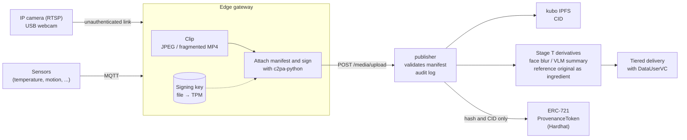

# C2PA provenance pipeline — provenance for camera footage and sensor data (Stage P design spec)

!!! abstract "Where this document fits"
    This is the design spec for **Stage P** (Provenance), which attaches provenance information that follows the C2PA (Coalition for Content Provenance and Authenticity) standard [1] to footage from low-cost commercial IP cameras and USB webcams, and to sensor data.
    Signing uses the Rust SDK [2] and Python SDK [3] published by the CAI (Content Authenticity Initiative), and the provenance hashes are recorded on chain as NFTs. It is a draft written before implementation.
    "Stage" in this document refers to the step numbers of the Phase 2 hands-on series (listed in the "Hands-on stages" section (§5) of the [VC architecture overview](vc-architecture-overview.md)).
    Stage P builds on the tiered access of Stage T ([Tiered access design spec](../hands-on/data-user-vc-tiered-spec.md)) and the SellerVC of Stage 7 ([SellerVC design spec](seller-vc-spec.md)). It has no hands-on yet.

## 1. Motivation

### Current state (up to Stage T)

The publisher's media gateway computes the sha256 of each uploaded image and video, and also returns a CID when IPFS is enabled (§8–§9 of [Deliver images and video with tiered access](../hands-on/data-user-vc-tiered-media.md)).
This lets anyone check that the content has not been changed **after it was uploaded**.

Nobody can check the following, however:

- Which camera took the file, and when
- Whether anything was composited or swapped before the upload
- Which original a Tier 2 face-blurred image or a Tier 1 summary text was made from
- Whether the content of a Merchandise sold on the marketplace is what the seller claims

Sharing surveillance footage as crime leads or disaster information presupposes being able to answer "is this footage real?".
Generative AI can now produce convincing footage, which makes the question more important.

### What Stage P does

1. An edge gateway placed next to the camera attaches a C2PA manifest to captured images and video and signs them
2. The capture time, camera ID, detection event, and sensor readings go into the manifest as custom assertions
3. The publisher attaches a manifest to each Stage T derivative (such as a face-blurred image) that references the original as an "ingredient", linking the processing history
4. The publisher validates the manifest at upload time and records the result in the audit log
5. The manifest hash and CID are recorded on chain as an ERC-721 [10] token (raw data never goes on chain)

Compatibility with the existing path is preserved. Media without a manifest is handled by the same path as up to Stage T.

## 2. Terms

| Term | Meaning |
| --- | --- |
| Manifest | The bundle of provenance information attached to one file. Consists of assertions, a claim, and a signature |
| Assertion | One individual provenance statement, such as a capture action, an ingredient, or custom data |
| Claim | The collection of assertion hashes that is the target of the signature |
| Hard binding | Including a hash of the file content in the claim. Changing even one byte makes validation fail |
| Ingredient | A file that processing started from. Its manifest can be imported along with it |
| Signer | The party that signed the claim, represented by an X.509 certificate |
| Edge gateway | The device next to the camera (Raspberry Pi or PC) that receives the footage and signs it |

## 3. Overall architecture



Because the camera itself cannot sign, **the root of trust is the edge gateway, not the camera**. §4 deals with this limitation.

## 4. Trust boundaries

| Segment | Threat considered | Handling in this spec |
| --- | --- | --- |
| Camera → gateway (RTSP / USB) | Swapped footage, replayed recordings | Not addressed in the MVP. Assumes a closed LAN. Later, compare with cameras that support ONVIF Media Signing [5][6] |
| Inside the gateway | Stolen signing key, tampering before signing | MVP keeps the key in a file. P4 moves it to a TPM 2.0 or a secure element (such as ATECC608) |
| Gateway → publisher | Tampering in transit | Detected by the hard binding |
| Inside the publisher | Fabricated derivatives | Derivatives are also signed with the publisher's key and reference the original as an ingredient |
| Chain | Rewriting provenance after the fact | The manifest hash is recorded in a token |

What C2PA guarantees is "this signer signed this content", not "what the footage shows is true".
As long as the link between camera and gateway is unauthenticated, authenticity at capture time rests on trusting whoever runs the gateway. The hands-on and papers will state this explicitly.

## 5. Manifest design

### 5.1 Labels for custom assertions

The C2PA specification requires custom assertion labels to start with a namespace made of a reversed domain name [1].
This spec uses the prefix `jp.ertl.iw3ip.`.

| Label | Content | Attached to |
| --- | --- | --- |
| `jp.ertl.iw3ip.capture` | Camera ID, model, capture time, gateway DID | Captured files |
| `jp.ertl.iw3ip.detection` | Detection event label, score, detection model | Files clipped on detection |
| `jp.ertl.iw3ip.sensor` | Sensor readings around the capture time | Captured files |
| `jp.ertl.iw3ip.derivation` | Stage T tier and kind of processing | Derived files |

### 5.2 Capture manifest

Attached by the gateway to files it captures. The following is an example definition passed to the c2pa-python Builder.

```json
{
  "claim_generator_info": [{ "name": "iw3ip-gateway", "version": "0.1.0" }],
  "title": "cam01-20261022T101500Z.jpg",
  "assertions": [
    {
      "label": "c2pa.actions",
      "data": {
        "actions": [{
          "action": "c2pa.created",
          "digitalSourceType": "http://cv.iptc.org/newscodes/digitalsourcetype/digitalCapture"
        }]
      }
    },
    {
      "label": "jp.ertl.iw3ip.capture",
      "data": {
        "camera_id": "cam01",
        "camera_model": "generic-rtsp",
        "captured_at": "2026-10-22T10:15:00Z",
        "gateway_did": "did:jwk:<gateway>"
      }
    },
    {
      "label": "jp.ertl.iw3ip.detection",
      "data": { "label": "person", "score": 0.91, "model": "yolov8n" }
    },
    {
      "label": "jp.ertl.iw3ip.sensor",
      "data": {
        "window": ["2026-10-22T10:14:30Z", "2026-10-22T10:15:30Z"],
        "readings": [{ "topic": "home/env/temperature", "value": 22.4, "unit": "Cel" }]
      }
    }
  ]
}
```

`digitalSourceType` uses `digitalCapture` from the IPTC vocabulary [9] to indicate that a camera captured the file.

### 5.3 Derivative manifests (mapping to Stage T)

The publisher attaches to each Stage T derivative a manifest that references the original as an ingredient.

| Tier | Derivative | Action | Ingredient |
| --- | --- | --- | --- |
| 3 Full | Raw image / video | (capture manifest as is) | — |
| 2 Access | Face-blurred image | `c2pa.edited` (recorded as `face_blur` in `jp.ertl.iw3ip.derivation`) | Raw image |
| 1 Summary | Summary text | — (§5.5) | — |

There is a **privacy pitfall** here. By default, importing an ingredient also puts the following two things into the derived file:

- The ingredient's thumbnail (`c2pa.thumbnail.ingredient`). The specification recommends referencing the ingredient's thumbnail or generating a new one [1], so a thumbnail of the unblurred face ends up in the face-blurred image
- The assertions in the ingredient's manifest. The camera ID and sensor readings become visible to Tier 2 recipients as well

Tier 2 derivatives therefore do the following:

1. Leave out the ingredient thumbnail
2. Remove `jp.ertl.iw3ip.capture` and `jp.ertl.iw3ip.sensor` from the ingredient's manifest using C2PA assertion redaction [1], and record a `c2pa.redacted` action
3. The ingredient manifest's signature still validates after redaction, so Tier 2 recipients can be shown only that "this was made from the Tier 3 original"

### 5.4 Handling sensor data

C2PA is a standard for media such as images, video, and audio, and defines no format for signing sensor time series (JSON or CSV) directly. Three options are compared.

| Option | Approach | Pros | Cons |
| --- | --- | --- | --- |
| A | Put readings in `jp.ertl.iw3ip.sensor` of the capture manifest (§5.2) | Self-contained in C2PA. Footage and readings are bound by one signature | Cannot cover readings from times with no capture |
| B | Put the hash of each interval's readings into the manifest of a periodic snapshot | Continuous data can also be linked to the footage provenance | Raw readings must be stored separately and matched by hash |
| C | Skip C2PA and distribute readings as a VC signed with the gateway's DID | Reuses the existing SSI mechanism (ServiceVC) | A verification path separate from the footage provenance |

Recommendation: in the MVP, handle readings tied to detection events with option A. Compare options B and C for continuous time series in P3.

### 5.5 Text derivatives (Tier 1)

The VLM summary text is not one of the media formats C2PA covers.
In the MVP, each `/platform/data` row carries the identifier of the original's manifest and the sha256 of the summary text, and the publisher's audit log links them (§7).
Whether this can be handled within the C2PA specification is left as an open question in §11.

## 6. Signing and keys

### 6.1 Certificates

| Phase | Certificate | Shown on validation |
| --- | --- | --- |
| MVP | A private CA made with OpenSSL and an ES256 signing certificate | Untrusted signer (trusted once the private CA is registered with the validator) |
| Production (assumed) | A certificate issued by a CA on the C2PA Trust List [7] | Trusted signer |

The C2PA Interim Trust List stopped receiving updates on January 1, 2026, and was replaced by the C2PA Trust List based on the Conformance Program [7][8]. The research implementation does not obtain a production certificate; it checks the validation flow with a private CA.

### 6.2 Key storage

c2pa-python lets the caller perform signing in its own function (a callback) [3]. This is used to move the key step by step.

1. P0–P2: keep the key as a PEM file (the SDK documentation also says this is for development only)
2. P4: sign with a TPM 2.0 or secure element so the key never leaves the device

### 6.3 Relation to DIDs

The gateway holds a `did:jwk` as the ServiceVC holder ([Authenticate machines](../hands-on/ha-ssi-service.md)). A C2PA signer is represented by an X.509 certificate, so these are two separate identifiers.

The CAWG (Creator Assertions Working Group) identity assertion [4] is one way to bind the two.
The CAWG identity assertion has a mode signed with an X.509 certificate and a mode that aggregates VCs (identity claims aggregation).
The latter suits using SellerVC as proof of "who provided this", but the CAI SDK can only validate the latter, not sign it [2].
The MVP therefore only puts `gateway_did` in `jp.ertl.iw3ip.capture`, and integration with CAWG is considered in P3.

## 7. Publisher extensions

### 7.1 Response of `POST /media/upload`

Adds `c2pa` to the existing response (`{url, sha256, content_type, byte_size, cid, ipfs_gateway_url}`).

```json
{
  "url": "http://<HOST_IP>:8080/media/<sha256>.jpg",
  "sha256": "...",
  "cid": "...",
  "c2pa": {
    "present": true,
    "manifest_label": "urn:c2pa:...",
    "validation_state": "Valid",
    "signer": "CN=iw3ip-gateway-cam01",
    "trusted": false
  }
}
```

The publisher reads the manifest with the c2pa-python Reader and records the validation result.

| Validation result | Handling in the MVP |
| --- | --- |
| No manifest | Accepted as before (`present: false`) |
| Valid signature, untrusted signer | Accepted (`trusted: false`) |
| Hash mismatch or broken signature | Rejected with 400 (`c2pa_invalid`) |

### 7.2 `/platform/data` rows

Adds `provenance` to each row. What is shown depends on the tier.

| Key | Content | Exposed to tier |
| --- | --- | --- |
| `provenance.manifest_label` | Identifier of the original's manifest | All tiers |
| `provenance.validation_state` | Validation result at the publisher | All tiers |
| `provenance.token_id` | ID of the token in §8 | All tiers |
| `provenance.derived_sha256` | sha256 of the summary text (§5.5) | 1 + 2 + 3 |
| `provenance.signer` | Signer name | 2 + 3 |

### 7.3 Audit log

Adds new `raw_topic` values:

- `provenance/verified` — the manifest was validated at upload time
- `provenance/derived` — a manifest was attached to a derivative
- `provenance/anchored` — a token was issued on chain

## 8. Chain integration (NFTs)

### 8.1 What goes on chain

Putting surveillance footage on a public chain as is would contradict IW3IP's policy of sharing in stages. Only the following values are recorded on chain.

| Field | Content |
| --- | --- |
| `manifestLabel` | Identifier of the manifest |
| `assetSha256` | sha256 of the signed file |
| `cid` | IPFS CID (the content itself stays behind DataUserVC) |
| `sellerDid` | DID of the SellerVC holder (Stage 7) |

The token's `tokenURI` points to JSON metadata containing these values.

### 8.2 Issuance granularity

Issuing a token per frame makes transaction fees and processing time a problem. The MVP issues **one token per detection event**.
For segments of continuous recording, a Merkle root built from the hashes of the segments over a fixed period is combined into one token (P3).

### 8.3 Circular reference

The token ID is not known until the token is issued, so it cannot go into the capture manifest. The MVP uses a **one-way binding in which the chain references the manifest**.
If the manifest should also reference the token, adding it later with a C2PA update manifest [1] is considered in P3.

### 8.4 Relation to the existing Merchandise

The existing Merchandise lists per dataset. ProvenanceToken represents the provenance of individual media, so it is a separate contract from Merchandise.
The address of the ProvenanceToken contract goes into the Merchandise's additional info to link the two.

## 9. Evaluation plan

### 9.1 Tamper detection

| Experiment | Expected result |
| --- | --- |
| Change one pixel of a signed image | Detected by hash mismatch |
| Re-encode | Detected by hash mismatch |
| Strip metadata | Becomes a file with no manifest (the absence of provenance is visible) |
| Swap a segment of a fragmented MP4 | Detected by the per-segment hash mismatch |
| Swap the RTSP footage before the gateway | Not detected (an experiment that shows the limit in §4) |

### 9.2 Load

- Time to sign one JPEG and one fragmented-MP4 segment on a Raspberry Pi
- Increase in file size from the manifest
- Time for the publisher to validate

## 10. Milestones

| ID | Content | Equipment |
| --- | --- | --- |
| **P0** | Take a still with a webcam, sign it with c2pa-python, and validate it with Content Credentials Verify [11] and c2patool | Mac only |
| **P1** | Produce a signed JPEG only on detection events, validate it at `/media/upload`, and record it in the audit log (§7) | USB webcam |
| **P2** | Tier 2 derivative manifests (§5.3) and ProvenanceToken issuance (§8) | + Hardhat |
| **P3** | Fragmented MP4, sensor options B and C, CAWG and SellerVC integration, update manifests | + sensors |
| **P4** | RTSP IP camera and Raspberry Pi, TPM signing, evaluation in §9 | Commercial IP camera, Raspberry Pi |
| **P5** | Hands-on (JA + EN) | — |

## 11. Open questions

1. **Continuous recording**
   - C2PA 2.3 added handling of time ranges for live video whose end time is undefined [1]. How far the CAI SDK supports this is checked when P3 starts
   - Recommendation: limit the MVP to clips cut on detection events
2. **Provenance of the Tier 1 summary text**
   - Handle it within C2PA, or link it through the audit log as in §5.5?
   - Recommendation: link it through the audit log in the MVP
3. **Action that represents face blurring**
   - Which is more appropriate, `c2pa.edited` or `c2pa.filtered`? Does hiding faces count as an editorial change?
   - Recommendation: use `c2pa.edited` and state the kind of processing in `jp.ertl.iw3ip.derivation`
4. **Whether to accept media from untrusted signers**
   - Recommendation: accept them in the MVP and record `trusted: false`. In production, let a publisher setting reject them
5. **Who issues the gateway's X.509 certificate**
   - Should the publisher also act as the CA, or a separate authority?
   - Recommendation: the publisher acts as the CA in the MVP (the same policy as SellerVC issuance)

## 12. Related

- [VC architecture overview](vc-architecture-overview.md) (§5 lists the Stage numbers)
- [SellerVC design spec (Stage 7)](seller-vc-spec.md)
- [Tiered access design spec (Stage T)](../hands-on/data-user-vc-tiered-spec.md)
- [Deliver images and video with tiered access (Stage T)](../hands-on/data-user-vc-tiered-media.md)
- [Detect with a USB webcam (OpenCV)](../hands-on/webcam.md)
- [Authenticate machines (Service VC / Stage 4 prep)](../hands-on/ha-ssi-service.md)

## References

[1] C2PA, "C2PA Technical Specification, Version 2.3," <https://spec.c2pa.org/specifications/specifications/2.3/specs/C2PA_Specification.html>

[2] Content Authenticity Initiative, "c2pa-rs: Rust SDK for C2PA," GitHub, <https://github.com/contentauth/c2pa-rs>

[3] Content Authenticity Initiative, "c2pa-python: Python binding for the C2PA SDK," GitHub, <https://github.com/contentauth/c2pa-python>

[4] Creator Assertions Working Group, "Identity Assertion, Version 1.1," <https://cawg.io/identity/1.1/>

[5] ONVIF, "ONVIF Media Signing Specification," <https://www.onvif.org/specs/stream/ONVIF-MediaSigning-Spec.pdf>

[6] ONVIF, "media-signing-framework," GitHub, <https://github.com/onvif/media-signing-framework>

[7] C2PA, "C2PA Conformance Program," <https://c2pa.org/conformance/>

[8] C2PA, "FAQ," <https://c2pa.org/faq/>

[9] IPTC, "Digital Source Type," NewsCodes vocabulary, <https://cv.iptc.org/newscodes/digitalsourcetype/>

[10] W. Entriken, D. Shirley, J. Evans, N. Sachs, "ERC-721: Non-Fungible Token Standard," Ethereum Improvement Proposals, no. 721, 2018, <https://eips.ethereum.org/EIPS/eip-721>

[11] Content Authenticity Initiative, "Content Credentials Verify," <https://contentcredentials.org/verify>
