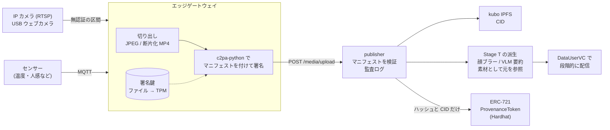

# C2PA 来歴パイプライン — カメラ映像とセンサーデータの来歴証明 (Stage P 設計仕様)

!!! abstract "このドキュメントの位置付け"
    市販の安価な IP カメラや USB ウェブカメラの映像と、センサーデータに、C2PA (Coalition for Content Provenance and Authenticity) [1] の規格に沿った来歴情報を付ける **Stage P** (Provenance) の設計仕様である。
    署名には CAI (Content Authenticity Initiative) が公開している Rust の SDK [2] と Python の SDK [3] を使い、来歴のハッシュを NFT としてチェーンに記録する。実装前に書いた草稿である。
    本文中の Stage は Phase 2 のハンズオンの段階番号を指す (一覧は [VC アーキテクチャ全体像](vc-architecture-overview.md) の §5)。
    Stage P は、Stage T の段階アクセス ([段階アクセスの設計仕様](../hands-on/data-user-vc-tiered-spec.md)) と Stage 7 の SellerVC ([SellerVC 設計仕様](seller-vc-spec.md)) の上に載せる。ハンズオンはまだ無い。

## 1. 動機

### 現状 (Stage T まで)

publisher のメディアゲートウェイは、アップロードされた画像と動画の sha256 を計算し、IPFS が有効な場合は CID も返す ([画像・動画を段階アクセスで配信する](../hands-on/data-user-vc-tiered-media.md) の §8〜§9)。
これにより、**アップロードした後に**中身が書き換えられていないことは確かめられる。

しかし、次のことは誰も確かめられない。

- そのファイルを、どのカメラが、いつ撮影したか
- アップロードされるまでの間に、合成や差し替えが無かったか
- Tier 2 の顔ブラー画像や Tier 1 の要約テキストが、どの元データから作られたか
- marketplace で売られている Merchandise の中身が、出品者の主張どおりのデータか

監視カメラの映像を、犯罪の手がかりや防災の情報として共有するには、「この映像は本物か」に答えられることが前提になる。
生成 AI で映像をもっともらしく作れるようになったため、この問いの重要性は増している。

### Stage P でやること

1. カメラの隣に置いたエッジゲートウェイで、撮影した画像と映像に C2PA マニフェストを付けて署名する
2. 撮影時刻、カメラ ID、検知イベント、センサー値を、独自のアサーションとしてマニフェストに入れる
3. Stage T の派生データ (顔ブラー画像など) に、元データを「素材 (ingredient)」として参照するマニフェストを付け、加工の履歴をつなぐ
4. publisher がアップロードの時点でマニフェストを検証し、結果を監査ログに記録する
5. マニフェストのハッシュと CID を ERC-721 [10] のトークンとしてチェーンに記録する (生データはチェーンに載せない)

既存の経路との互換性は保つ。マニフェストの無いメディアは、Stage T までと同じ経路で扱う。

## 2. 用語

| 用語 | 意味 |
| --- | --- |
| マニフェスト (manifest) | 1 つのファイルに付ける来歴情報のまとまり。アサーション、クレーム、署名からなる |
| アサーション (assertion) | 来歴の個々の主張。撮影の操作、素材、独自のデータなど |
| クレーム (claim) | アサーションのハッシュを集めて署名の対象にしたもの |
| ハードバインディング | ファイルの中身のハッシュをクレームに含めること。中身を 1 バイトでも変えると検証に失敗する |
| 素材 (ingredient) | 加工の元になったファイル。そのファイルのマニフェストも一緒に取り込める |
| 署名者 (signer) | クレームに署名した主体。X.509 証明書で表す |
| エッジゲートウェイ | カメラの映像を受け取って署名する、カメラの隣の機器 (Raspberry Pi や PC) |

## 3. 全体構成



カメラ自体は署名できないため、**信頼の起点はカメラではなくエッジゲートウェイ**になる。この制約は §4 で扱う。

## 4. 信頼の境界

| 区間 | 想定する脅威 | 本仕様での扱い |
| --- | --- | --- |
| カメラ → ゲートウェイ (RTSP / USB) | 映像の差し替え、録画の再送 | MVP では対策しない。閉じた LAN に置くことを前提にする。将来は ONVIF Media Signing [5][6] に対応したカメラと比べる |
| ゲートウェイの内部 | 署名鍵の盗難、署名前の改ざん | MVP では鍵をファイルに置く。P4 で TPM 2.0 またはセキュアエレメント (ATECC608 など) に移す |
| ゲートウェイ → publisher | 転送中の改ざん | ハードバインディングで検出できる |
| publisher の内部 | 派生データの捏造 | 派生データにも publisher の鍵で署名し、元データを素材として参照する |
| チェーン | 来歴の事後の書き換え | マニフェストのハッシュをトークンに記録する |

C2PA が保証するのは「この署名者がこの中身に署名した」ことであり、「写っている内容が事実である」ことではない。
カメラとゲートウェイの間が無認証である限り、撮影時点の真正性はゲートウェイの運用者を信頼することで成り立つ。この点はハンズオンと論文で明記する。

## 5. マニフェストの設計

### 5.1 独自アサーションのラベル

C2PA の仕様では、独自のアサーションのラベルはドメイン名を逆順にした名前空間で始める [1]。
本仕様では `jp.ertl.iw3ip.` を接頭辞にする。

| ラベル | 内容 | 付ける対象 |
| --- | --- | --- |
| `jp.ertl.iw3ip.capture` | カメラ ID、機種、撮影時刻、ゲートウェイの DID | 撮影したファイル |
| `jp.ertl.iw3ip.detection` | 検知イベントのラベル、スコア、検知モデル | 検知で切り出したファイル |
| `jp.ertl.iw3ip.sensor` | 撮影時刻の前後のセンサー値 | 撮影したファイル |
| `jp.ertl.iw3ip.derivation` | Stage T の Tier と、加工の種類 | 派生ファイル |

### 5.2 撮影マニフェスト

ゲートウェイが撮影したファイルに付ける。c2pa-python の Builder に渡す定義の例を示す。

```json
{
  "claim_generator_info": [{ "name": "iw3ip-gateway", "version": "0.1.0" }],
  "title": "cam01-20261022T101500Z.jpg",
  "assertions": [
    {
      "label": "c2pa.actions",
      "data": {
        "actions": [{
          "action": "c2pa.created",
          "digitalSourceType": "http://cv.iptc.org/newscodes/digitalsourcetype/digitalCapture"
        }]
      }
    },
    {
      "label": "jp.ertl.iw3ip.capture",
      "data": {
        "camera_id": "cam01",
        "camera_model": "generic-rtsp",
        "captured_at": "2026-10-22T10:15:00Z",
        "gateway_did": "did:jwk:<gateway>"
      }
    },
    {
      "label": "jp.ertl.iw3ip.detection",
      "data": { "label": "person", "score": 0.91, "model": "yolov8n" }
    },
    {
      "label": "jp.ertl.iw3ip.sensor",
      "data": {
        "window": ["2026-10-22T10:14:30Z", "2026-10-22T10:15:30Z"],
        "readings": [{ "topic": "home/env/temperature", "value": 22.4, "unit": "Cel" }]
      }
    }
  ]
}
```

`digitalSourceType` には IPTC の語彙 [9] の `digitalCapture` を使い、カメラで撮影したことを示す。

### 5.3 派生マニフェスト (Stage T との対応)

Stage T の派生データに、元データを素材として参照するマニフェストを publisher が付ける。

| Tier | 派生データ | アクション | 素材 |
| --- | --- | --- | --- |
| 3 Full | 生の画像・動画 | (撮影マニフェストのまま) | — |
| 2 Access | 顔ブラー画像 | `c2pa.edited` (`jp.ertl.iw3ip.derivation` で `face_blur` と記録) | 生の画像 |
| 1 Summary | 要約テキスト | — (§5.5) | — |

ここには**プライバシー上の落とし穴**がある。素材を取り込むと、既定では次の 2 つも派生ファイルに入る。

- 素材のサムネイル (`c2pa.thumbnail.ingredient`)。仕様では、素材のサムネイルを参照するか新しく作ることが推奨されている [1]。顔ブラー画像に、ブラー前の顔のサムネイルが入ってしまう
- 素材のマニフェストにあるアサーション。カメラ ID やセンサー値が、Tier 2 の受信者にも見える

そこで、Tier 2 の派生では次のようにする。

1. 素材のサムネイルを入れない
2. 素材のマニフェストの `jp.ertl.iw3ip.capture` と `jp.ertl.iw3ip.sensor` を、C2PA のアサーションの削除 (redaction) [1] で取り除き、`c2pa.redacted` アクションを記録する
3. 削除しても素材のマニフェストの署名は検証できる。そのため「Tier 3 の元データから作られた」ことだけを Tier 2 の受信者に示せる

### 5.4 センサーデータの扱い

C2PA は画像・動画・音声などのメディアを対象にした規格であり、センサーの時系列データ (JSON や CSV) をそのまま署名する形式は定めていない。次の 3 案を比べる。

| 案 | 方式 | 利点 | 欠点 |
| --- | --- | --- | --- |
| A | 撮影マニフェストの `jp.ertl.iw3ip.sensor` に入れる (§5.2) | C2PA だけで完結する。映像とセンサー値が 1 つの署名で結び付く | 撮影していない時間のセンサー値を扱えない |
| B | 一定時間ごとのセンサー値のハッシュを、定期的に撮るスナップショットのマニフェストに入れる | 連続したデータも、映像の来歴とつなげられる | 生のセンサー値は別に保管し、ハッシュで照合する必要がある |
| C | C2PA を使わず、ゲートウェイの DID で署名した VC としてセンサー値を配る | 既存の SSI の仕組み (ServiceVC) を使える | 映像の来歴とは別の検証経路になる |

推奨: MVP では検知イベントに結び付く値を案 A で扱う。連続した時系列は案 B と案 C を P3 で比べる。

### 5.5 テキストの派生 (Tier 1)

VLM の要約テキストは、C2PA が対象とするメディアの形式に当たらない。
MVP では、`/platform/data` の行に元データのマニフェストの識別子と、要約テキストの sha256 を入れ、publisher の監査ログで結び付ける (§7)。
C2PA の仕様の範囲で扱えるかどうかは §11 のオープンクエスチョンとする。

## 6. 署名と鍵

### 6.1 証明書

| 段階 | 証明書 | 検証したときの表示 |
| --- | --- | --- |
| MVP | OpenSSL で作った自前の CA と、ES256 の署名用証明書 | 信頼されていない署名者 (検証ツールに自前の CA を登録すれば信頼される) |
| 本番想定 | C2PA Trust List [7] に載った CA が発行した証明書 | 信頼される署名者 |

C2PA の Interim Trust List は 2026 年 1 月 1 日から更新が止まり、Conformance Program に基づく C2PA Trust List に移った [7][8]。研究用の実装では本番の証明書を取らず、自前の CA で検証の流れを確かめる。

### 6.2 鍵の保管

c2pa-python は、署名の処理を呼び出し側の関数 (コールバック) で行える [3]。この仕組みを使って、鍵の置き場所を段階的に移す。

1. P0〜P2: 鍵を PEM ファイルとして置く (SDK の文書でも開発用に限るとされている)
2. P4: TPM 2.0 またはセキュアエレメントで署名し、鍵を機器の外に出さない

### 6.3 DID との関係

ゲートウェイは ServiceVC の holder として `did:jwk` を持つ ([機器間での連携認証](../hands-on/ha-ssi-service.md))。C2PA の署名者は X.509 証明書で表すため、この 2 つは別の識別子になる。

2 つを結び付ける方法として、CAWG (Creator Assertions Working Group) の identity assertion [4] がある。
CAWG の identity assertion には、X.509 証明書で署名する方式と、VC を集約する方式 (identity claims aggregation) がある。
SellerVC を「誰が提供したか」の証明として使うには後者が向いているが、CAI の SDK は後者の検証にだけ対応し、署名には対応していない [2]。
そのため MVP では `jp.ertl.iw3ip.capture` に `gateway_did` を入れるだけにして、CAWG との統合は P3 で検討する。

## 7. publisher の拡張

### 7.1 `POST /media/upload` の応答

既存の応答 (`{url, sha256, content_type, byte_size, cid, ipfs_gateway_url}`) に `c2pa` を加える。

```json
{
  "url": "http://<HOST_IP>:8080/media/<sha256>.jpg",
  "sha256": "...",
  "cid": "...",
  "c2pa": {
    "present": true,
    "manifest_label": "urn:c2pa:...",
    "validation_state": "Valid",
    "signer": "CN=iw3ip-gateway-cam01",
    "trusted": false
  }
}
```

publisher は c2pa-python の Reader でマニフェストを読み、検証の結果を記録する。

| 検証の結果 | MVP での扱い |
| --- | --- |
| マニフェストが無い | 従来どおり受け付ける (`present: false`) |
| 署名は正しいが、署名者が信頼されていない | 受け付ける (`trusted: false`) |
| ハッシュが一致しない、署名が壊れている | 400 (`c2pa_invalid`) で拒否する |

### 7.2 `/platform/data` の行

各行に `provenance` を加える。Tier によって見せる範囲を変える。

| キー | 内容 | 露出する tier |
| --- | --- | --- |
| `provenance.manifest_label` | 元データのマニフェストの識別子 | 全 tier |
| `provenance.validation_state` | publisher での検証の結果 | 全 tier |
| `provenance.token_id` | §8 のトークンの ID | 全 tier |
| `provenance.derived_sha256` | 要約テキストの sha256 (§5.5) | 1 + 2 + 3 |
| `provenance.signer` | 署名者の名前 | 2 + 3 |

### 7.3 監査ログ

新しい `raw_topic` を加える。

- `provenance/verified` — アップロードの時点でマニフェストを検証した
- `provenance/derived` — 派生データにマニフェストを付けた
- `provenance/anchored` — チェーンにトークンを発行した

## 8. チェーンとの連携 (NFT 化)

### 8.1 チェーンに載せるもの

監視カメラの映像をそのまま公開チェーンに載せることは、IW3IP の段階的に共有する方針に反する。チェーンには次の値だけを記録する。

| 項目 | 内容 |
| --- | --- |
| `manifestLabel` | マニフェストの識別子 |
| `assetSha256` | 署名済みファイルの sha256 |
| `cid` | IPFS の CID (中身は DataUserVC の向こう側に置く) |
| `sellerDid` | SellerVC の holder の DID (Stage 7) |

トークンの `tokenURI` は、これらを入れた JSON のメタデータを指す。

### 8.2 発行の単位

1 フレームごとに発行すると、取引の手数料と処理時間が問題になる。MVP では**検知イベント 1 件につき 1 トークン**とする。
常時録画の断片を扱う場合は、一定時間分の断片のハッシュから Merkle 根を作って 1 トークンにまとめる (P3)。

### 8.3 循環参照

トークンの ID は発行するまで決まらないため、撮影マニフェストにトークンの ID は入れられない。MVP では**チェーン側からマニフェストを参照する一方向の結び付け**とする。
マニフェストからトークンを参照させたい場合は、C2PA の update manifest [1] で後から追記する方法を P3 で検討する。

### 8.4 既存の Merchandise との関係

既存の Merchandise は dataset 単位で出品する。ProvenanceToken は個々のメディアの来歴を表すため、Merchandise とは別のコントラクトにする。
Merchandise の追加情報に ProvenanceToken のコントラクトのアドレスを入れて、2 つを結び付ける。

## 9. 評価計画

### 9.1 改ざんの検出

| 実験 | 期待する結果 |
| --- | --- |
| 署名後の画像の画素を 1 つ変える | ハッシュの不一致で検出する |
| 再エンコードする | ハッシュの不一致で検出する |
| メタデータを取り除く | マニフェストが無いファイルになる (来歴が無いことは分かる) |
| 断片化 MP4 の断片を差し替える | 断片ごとのハッシュの不一致で検出する |
| RTSP の映像をゲートウェイの前で差し替える | 検出できない (§4 の限界を示す実験) |

### 9.2 負荷

- Raspberry Pi で、JPEG 1 枚と断片化 MP4 の断片 1 つに署名するのにかかる時間
- マニフェストを付けたことによるファイルの大きさの増加
- publisher での検証にかかる時間

## 10. マイルストーン

| ID | 内容 | 機材 |
| --- | --- | --- |
| **P0** | ウェブカメラで静止画を撮り、c2pa-python で署名する。Content Credentials Verify [11] と c2patool で検証する | Mac だけ |
| **P1** | 検知イベントのときだけ署名付きの JPEG を作り、`/media/upload` で検証して監査ログに記録する (§7) | USB ウェブカメラ |
| **P2** | Tier 2 の派生マニフェスト (§5.3) と、ProvenanceToken の発行 (§8) | ＋Hardhat |
| **P3** | 断片化 MP4、センサーデータの案 B と案 C、CAWG と SellerVC の統合、update manifest | ＋センサー |
| **P4** | RTSP の IP カメラと Raspberry Pi、TPM での署名、§9 の評価 | 市販 IP カメラ・Raspberry Pi |
| **P5** | ハンズオン (JA + EN) | — |

## 11. オープンクエスチョン

1. **常時録画の扱い**
   - C2PA 2.3 では、終わりの時刻が決まっていないライブ映像での時間範囲の扱いが加わった [1]。CAI の SDK がどこまで対応しているかを P3 の着手時に確かめる
   - 推奨: MVP は検知イベントの切り出しに限る
2. **Tier 1 の要約テキストの来歴**
   - C2PA の範囲で扱うか、§5.5 のように監査ログで結び付けるか
   - 推奨: MVP は監査ログで結び付ける
3. **顔ブラーを表すアクション**
   - `c2pa.edited` と `c2pa.filtered` のどちらが適切か。顔を隠す加工は編集上の変更に当たるか
   - 推奨: `c2pa.edited` にして、`jp.ertl.iw3ip.derivation` で加工の種類を明示する
4. **信頼されていない署名者のメディアを受け付けるか**
   - 推奨: MVP では受け付けて `trusted: false` と記録する。本番では publisher の設定で拒否できるようにする
5. **ゲートウェイの X.509 証明書を誰が発行するか**
   - publisher が CA を兼ねるか、別の機関にするか
   - 推奨: MVP では publisher が兼ねる (SellerVC の発行と同じ方針)

## 12. 関連

- [VC アーキテクチャ全体像](vc-architecture-overview.md) (Stage 番号の一覧は §5)
- [SellerVC 設計仕様 (Stage 7)](seller-vc-spec.md)
- [段階アクセスの設計仕様 (Stage T)](../hands-on/data-user-vc-tiered-spec.md)
- [画像・動画を段階アクセスで配信する (Stage T)](../hands-on/data-user-vc-tiered-media.md)
- [USB カメラでポイ捨てを検知する (OpenCV)](../hands-on/webcam.md)
- [機器間での連携認証 (Service VC / Stage 4 prep)](../hands-on/ha-ssi-service.md)

## 参考文献

[1] C2PA, "C2PA Technical Specification, Version 2.3," <https://spec.c2pa.org/specifications/specifications/2.3/specs/C2PA_Specification.html>

[2] Content Authenticity Initiative, "c2pa-rs: Rust SDK for C2PA," GitHub, <https://github.com/contentauth/c2pa-rs>

[3] Content Authenticity Initiative, "c2pa-python: Python binding for the C2PA SDK," GitHub, <https://github.com/contentauth/c2pa-python>

[4] Creator Assertions Working Group, "Identity Assertion, Version 1.1," <https://cawg.io/identity/1.1/>

[5] ONVIF, "ONVIF Media Signing Specification," <https://www.onvif.org/specs/stream/ONVIF-MediaSigning-Spec.pdf>

[6] ONVIF, "media-signing-framework," GitHub, <https://github.com/onvif/media-signing-framework>

[7] C2PA, "C2PA Conformance Program," <https://c2pa.org/conformance/>

[8] C2PA, "FAQ," <https://c2pa.org/faq/>

[9] IPTC, "Digital Source Type," NewsCodes vocabulary, <https://cv.iptc.org/newscodes/digitalsourcetype/>

[10] W. Entriken, D. Shirley, J. Evans, N. Sachs, "ERC-721: Non-Fungible Token Standard," Ethereum Improvement Proposals, no. 721, 2018, <https://eips.ethereum.org/EIPS/eip-721>

[11] Content Authenticity Initiative, "Content Credentials Verify," <https://contentcredentials.org/verify>
