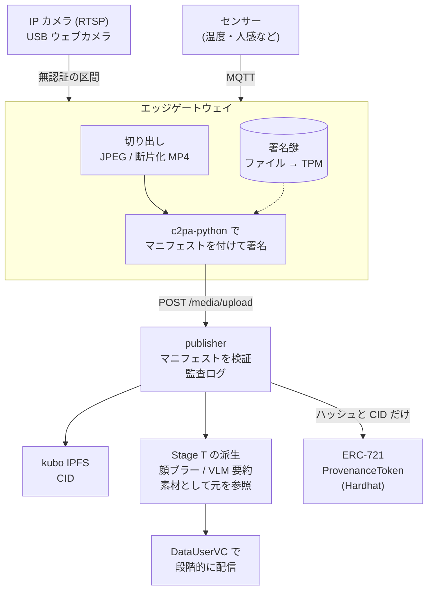
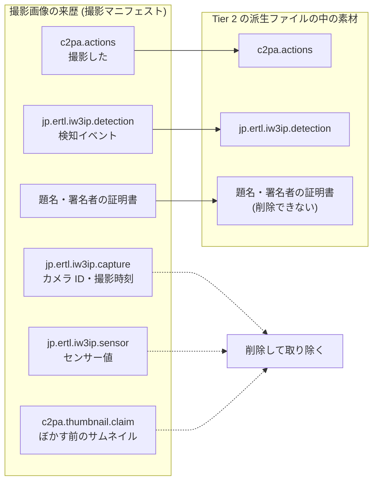

# C2PA 来歴パイプライン — カメラ映像とセンサーデータの来歴証明 (Stage P 設計仕様)

!!! abstract "このページの位置付け"
    [設計](index.md) の章の設計仕様です。
    市販の安価な IP カメラや USB ウェブカメラの映像と、センサーデータに、C2PA (Coalition for Content Provenance and Authenticity) [1] の規格に沿った来歴情報を付ける **Stage P** (Provenance) の設計仕様である。
    署名には CAI (Content Authenticity Initiative) が公開している Rust の SDK [2] と Python の SDK [3] を使い、来歴のハッシュを NFT としてチェーンに記録する。実装前に書いた設計であり、そのうち P0 の署名と検証は実装した (§10 の注記。Content Credentials Verify と c2patool での確認はまだ)。
    本文中の Stage は Phase 2 のハンズオンの段階番号を指す (一覧は [VC アーキテクチャ全体像](vc-architecture-overview.md) の §5)。
    Stage P は、Stage T の段階アクセス ([段階アクセスの設計仕様](../hands-on/data-user-vc-tiered-spec.md)) と Stage 7 の SellerVC ([SellerVC 設計仕様](seller-vc-spec.md)) の上に載せる。P0 の部分は、ハンズオン [画像の来歴を証明する](../hands-on/c2pa-provenance.md) で手元で動かせる。
    本文中の P0〜P5 は、本仕様の実装の段階を指す (一覧は §10)。MVP (Minimum Viable Product、最初に作る最小限の実装) は P0〜P2 に当たる。ハンズオンで動かすのは P0 (と、P2 に含まれる Tier 2 の派生マニフェストの確認) で、P1 と、P2 の残り (ProvenanceToken など) はまだ実装していない。

本仕様は、写真や映像に**「誰が、いつ、どう撮って、どう加工したか」の記録を付け、その記録に電子署名をする**仕組みを IW3IP に組み込むための設計である。記録を改ざんすると署名が合わなくなるため、受け取った人が自分で本物かどうかを確かめられる。

## このページで分かること

- C2PA で何が確かめられるようになり、何は確かめられないか
- 撮影した画像に付ける来歴 (撮影マニフェスト) と、顔ブラー画像に付ける来歴 (派生マニフェスト) の中身
- 顔ブラー画像の来歴から、元の顔やカメラ ID が漏れないようにする方法
- 署名に使う証明書と鍵の扱い、publisher とチェーンへの組み込み方

## 読む前に

- ハンズオンの Part 2 の「データ処理を入れてみよう」([信頼度に応じて見せる中身を変える](../hands-on/data-user-vc-tiered.md) など) を終えていると読みやすい。Tier 1〜3、DataUserVC、publisher、`/media/upload` は説明なしで使う
- DID と VC の基本 ([SSI/DID/VC 基礎](../foundations/ssi-did-vc-basics.md)) を前提にする。C2PA の署名の仕組みは、§2 で VC と対応させて説明する

## つまずきやすい点

- C2PA が保証するのは「この署名者がこの中身に署名した」ことであり、「写っている内容が事実である」ことではない (§4)
- 検証の結果が `Valid` でも、署名者が信頼されているとは限らない。信頼されている署名者のときだけ `Trusted` になる (§7.1)
- 顔ブラー画像に元の画像を「素材」として付けると、既定ではブラー前の顔のサムネイルまで付いてくる (§5.3)
- 本仕様の「削除 (redaction)」は来歴の情報を取り除く操作であり、Stage T の顔ブラー (画像の加工) とは別のものである

## 1. 動機

### 現状 (Stage T まで)

publisher のメディアゲートウェイは、アップロードされた画像と動画の sha256 を計算し、IPFS が有効な場合は CID も返す ([画像・動画を段階アクセスで配信する](../hands-on/data-user-vc-tiered-media.md) の §8〜§9)。
これにより、**アップロードした後に**中身が書き換えられていないことは確かめられる。

しかし、次のことは誰も確かめられない。

- そのファイルを、どのカメラが、いつ撮影したか
- アップロードされるまでの間に、合成や差し替えが無かったか
- Tier 2 の顔ブラー画像や Tier 1 の要約テキストが、どの元データから作られたか
- marketplace で売られている Merchandise の中身が、出品者の主張どおりのデータか

監視カメラの映像を、犯罪の手がかりや防災の情報として共有するには、「この映像は本物か」に答えられることが前提になる。
生成 AI で映像をもっともらしく作れるようになったため、この問いの重要性は増している。

sha256 をチェーンに記録するだけでは、この問いに答えられない。sha256 は「このファイルが記録したときから変わっていない」ことしか示さず、誰がどのような経緯で作ったファイルかは示さないからである。
C2PA では、撮影した機器の鍵による電子署名と、加工の履歴 (どのファイルから何をして作ったか) をファイルに付ける。そのため「誰が作ったか」と「どこから来たか」を、受け取った人が確かめられる。

### Stage P でやること

1. カメラの隣に置いたエッジゲートウェイで、撮影した画像と映像に C2PA マニフェストを付けて署名する
2. 撮影時刻、カメラ ID、検知イベント、センサー値を、独自のアサーションとしてマニフェストに入れる
3. Stage T の派生データ (顔ブラー画像など) に、元データを「素材 (ingredient)」として参照するマニフェストを付け、加工の履歴をつなぐ
4. publisher がアップロードの時点でマニフェストを検証し、結果を監査ログに記録する
5. マニフェストのハッシュと CID を ERC-721 [4] のトークンとしてチェーンに記録する (生データはチェーンに載せない)

既存の経路との互換性は保つ。マニフェストの無いメディアは、Stage T までと同じ経路で扱う。

## 2. C2PA の基本

### 2.1 C2PA とは

C2PA (Coalition for Content Provenance and Authenticity) は、画像・動画・音声などのファイルに来歴 (provenance、そのファイルがどこから来たかの記録) を付けるための規格であり、カメラメーカーや報道機関、IT 企業が参加する団体が定めている [1]。
CAI (Content Authenticity Initiative) は、C2PA の規格を実装したオープンソースの SDK (Software Development Kit、プログラムから使う部品集) を公開している団体である [2][3]。本仕様では、その Python 版の c2pa-python を使う。

来歴は、JPEG や MP4 の**ファイルの中に埋め込む**。そのため、ファイルを渡すと来歴も一緒に渡る。

### 2.2 マニフェストの構造

ファイルに埋め込む来歴のまとまりを、マニフェストと呼ぶ。マニフェストの構成は次のとおりである。

```
署名済みの JPEG ファイル
├─ 画素のデータ (写真そのもの)
└─ マニフェスト
    ├─ アサーション 1: 「撮影した」(c2pa.actions)
    ├─ アサーション 2: カメラ ID と撮影時刻 (jp.ertl.iw3ip.capture)
    ├─ アサーション 3: センサー値 (jp.ertl.iw3ip.sensor)
    ├─ クレーム: アサーション 1〜3 のハッシュと、画素のデータのハッシュを並べたもの
    └─ 署名: クレームへの電子署名と、署名者の証明書
```

署名の対象はクレームであり、クレームには各アサーションと画素のデータのハッシュが入っている。そのため、画素を 1 画素変えても、アサーションを 1 文字変えても、ハッシュが合わなくなり、検証に失敗する。

| 用語 | 意味 |
| --- | --- |
| マニフェスト (manifest) | 1 つのファイルに付ける来歴情報のまとまり。アサーション、クレーム、署名からなる |
| アサーション (assertion) | 来歴の個々の主張。撮影や加工の操作、素材、独自のデータなど |
| クレーム (claim) | アサーションと画素のデータのハッシュを集め、署名の対象にしたもの |
| ハードバインディング | 画素のデータのハッシュをクレームに含めること。中身を 1 バイトでも変えると検証に失敗する |
| 素材 (ingredient) | 加工の元になったファイル。加工後のファイルに、元のファイルのマニフェストを取り込める。これで「どのファイルから作ったか」がつながる |
| 署名者 (signer) | クレームに署名した主体。X.509 証明書 (§2.3) で表す |
| エッジゲートウェイ | カメラの映像を受け取って署名する、カメラの隣の機器 (Raspberry Pi や PC) |
| 削除 (redaction) | 素材のマニフェストから、特定のアサーションを取り除く操作 (§5.3)。画像の顔を隠す加工 (顔ブラー) とは別のもの |

### 2.3 署名と証明書 (VC との対応)

C2PA の署名の仕組みは、ハンズオンで使った VC とよく似ている。どちらも、秘密鍵で署名し、受け取った側が公開鍵で確かめる。違いは「その公開鍵が誰のものか」の示し方である。

| 観点 | VC (ハンズオン) | C2PA (本仕様) |
| --- | --- | --- |
| 署名する人 | issuer | 署名者 (signer) |
| 署名する人の識別子 | DID (`did:jwk:...`) | X.509 証明書 |
| 識別子を保証する人 | なし (DID は自分で作る) | CA (Certificate Authority、認証局) |
| 信頼してよいかの判断 | verifier が issuer の DID を信頼するかどうかで決める | 検証する側が CA を信頼するかどうかで決める |

X.509 証明書は、Web サイトの HTTPS で使われているのと同じ形式の証明書であり、「この公開鍵はこの名前の持ち主のもの」と CA が署名して保証する。
検証する側は、信頼する CA の一覧を持っている。署名者の証明書がその CA から発行されていれば、署名者を信頼する。一覧に無い CA の証明書は、署名自体が正しくても信頼されない (§7.1 の `Valid` と `Trusted` の違い)。

## 3. 全体構成



図の用語は次のとおりである。

- RTSP (Real Time Streaming Protocol): IP カメラが映像をネットワークに流すときの標準的な方式
- 断片化 MP4: 映像を数秒ずつの断片に分けて保存する MP4 の形式。録画を続けながら、断片ごとに署名できる
- TPM (Trusted Platform Module): 秘密鍵を機器の中に閉じ込めたまま署名できる部品 (§6.2)
- kubo: IPFS の標準的な実装。[画像・動画を段階アクセスで配信する](../hands-on/data-user-vc-tiered-media.md) の §9 で使った

市販の安価な IP カメラやウェブカメラは、署名用の鍵も署名の機能も持っていない (C2PA に対応したカメラは一部の高価な機種に限られる)。そのため、本仕様で最初に署名する機器は、カメラの隣に置く**エッジゲートウェイ**である。撮影の時点の真正性は、エッジゲートウェイまでしか保証できない。この制約は §4 で扱う。

## 4. 信頼の境界

| 区間 | 想定する脅威 | 本仕様での扱い |
| --- | --- | --- |
| カメラ → ゲートウェイ (RTSP / USB) | 映像の差し替え、録画の再送 | MVP では対策しない。閉じた LAN に置くことを前提にする。将来は ONVIF Media Signing [5][6] に対応したカメラと比べる |
| ゲートウェイの内部 | 署名鍵の盗難、署名前の改ざん | MVP では鍵をファイルに置く。P4 で TPM 2.0 またはセキュアエレメント (ATECC608 など) に移す |
| ゲートウェイ → publisher | 転送中の改ざん | ハードバインディングで検出できる。攻撃者はゲートウェイの秘密鍵を持たないため、改ざんした後に同じ署名者として署名し直せない |
| publisher の内部 | 派生データの捏造 | 派生データにも publisher の鍵で署名し、元データを素材として参照する |
| チェーン | 来歴の事後の書き換え | マニフェストのハッシュをトークンに記録する |

表の用語は次のとおりである。

- ONVIF Media Signing: 監視カメラの業界規格 ONVIF が定める、カメラ自身が映像に署名する仕組み [5][6]。対応したカメラなら、カメラとゲートウェイの間の差し替えも検出できる
- セキュアエレメント: TPM と同じく、秘密鍵を外に出さずに署名できる小さな部品。ATECC608 は Raspberry Pi に付けられる製品の例

C2PA が保証するのは「この署名者がこの中身に署名した」ことであり、「写っている内容が事実である」ことではない。
たとえば、ゲートウェイの運用者が偽の映像をゲートウェイに流し込めば、その偽の映像にも正しい署名が付く。カメラとゲートウェイの間が無認証である限り、撮影時点の真正性は、ゲートウェイの運用者を信頼することで成り立つ。この点はハンズオンと論文で明記する。

## 5. マニフェストの設計

### 5.1 独自アサーションのラベル

C2PA の仕様では、独自のアサーションのラベルはドメイン名を逆順にした名前空間で始める [1]。
本仕様では `jp.ertl.iw3ip.` を接頭辞にする。独自のアサーションは IW3IP の中でだけ意味を持つ。ほかの検証ツールでは、中身が解釈されずに表示されないことがある。

| ラベル | 内容 | 付ける対象 |
| --- | --- | --- |
| `jp.ertl.iw3ip.capture` | カメラ ID、機種、撮影時刻、ゲートウェイの DID | 撮影したファイル |
| `jp.ertl.iw3ip.detection` | 検知イベントのラベル、スコア、検知モデル | 検知で切り出したファイル |
| `jp.ertl.iw3ip.sensor` | 撮影時刻の前後のセンサー値 | 撮影したファイル |
| `jp.ertl.iw3ip.derivation` | Stage T の Tier と、加工の種類 | 派生ファイル |

### 5.2 撮影マニフェスト

ゲートウェイが撮影したファイルに付ける。c2pa-python では、マニフェストの中身を JSON で書いて Builder (マニフェストを組み立てて署名するクラス) に渡す。その定義の例を示す。

```json
{
  "claim_generator_info": [{ "name": "iw3ip-gateway", "version": "0.1.0" }],
  "title": "capture.jpg",
  "assertions": [
    {
      "label": "c2pa.actions",
      "data": {
        "actions": [{
          "action": "c2pa.created",
          "digitalSourceType": "http://cv.iptc.org/newscodes/digitalsourcetype/digitalCapture"
        }]
      }
    },
    {
      "label": "jp.ertl.iw3ip.capture",
      "data": {
        "camera_id": "cam01",
        "camera_model": "generic-rtsp",
        "captured_at": "2026-10-22T10:15:00Z",
        "gateway_did": "did:jwk:<gateway>"
      }
    },
    {
      "label": "jp.ertl.iw3ip.detection",
      "data": { "label": "person", "score": 0.91, "model": "yolov8n" }
    },
    {
      "label": "jp.ertl.iw3ip.sensor",
      "data": {
        "window": ["2026-10-22T10:14:30Z", "2026-10-22T10:15:30Z"],
        "readings": [{ "topic": "home/env/temperature", "value": 22.4, "unit": "Cel" }]
      }
    }
  ]
}
```

`c2pa.actions` は C2PA が定めるアサーションで、ファイルに対して行った操作を並べる。`c2pa.created` は「このファイルを新しく作った」ことを表す。
`digitalSourceType` には、報道機関の業界団体 IPTC が定める語彙 [7] の `digitalCapture` を使い、カメラで撮影したことを示す (生成 AI で作った画像には、別の値を使う)。

`gateway_did` は「どのゲートウェイが撮ったか」を示す属性にすぎない。署名に使う鍵は X.509 証明書の鍵であり、DID の鍵ではない (§6.3)。

→ 実装 (`examples/hands_on/c2pa_provenance/p0_sign_verify.py`) の撮影マニフェストには、上の例のうち `jp.ertl.iw3ip.capture` の `camera_model`、`jp.ertl.iw3ip.detection` のアサーション、`jp.ertl.iw3ip.sensor` の `window` が無い。P0 では検知を行わず、センサー値も固定の 1 件だけを書く。

`title` には、カメラ ID や撮影時刻のような意味を持つ値を入れない。撮影マニフェストの題名は、派生ファイルでも削除できないためである (§5.3)。カメラ ID と撮影時刻は、削除できる `jp.ertl.iw3ip.capture` に入れる。

### 5.3 派生マニフェスト (Stage T との対応)

Stage T の派生データに、元データを素材として参照するマニフェストを publisher が付ける。

| Tier | 派生データ | アクション | 素材 |
| --- | --- | --- | --- |
| 3 Full | 生の画像・動画 | (撮影マニフェストのまま) | — |
| 2 Access | 顔ブラー画像 | `c2pa.opened`、`c2pa.edited`、`c2pa.redacted` の順 | 生の画像 |
| 1 Summary | 要約テキスト | — (§5.5) | — |

Tier 2 の 3 つのアクションの意味は次のとおりである。

1. `c2pa.opened`: 既存のファイル (素材) を開いた。このファイルが、既存のファイルから作られたことを表す。C2PA では、操作の並びを「作った」か「開いた」で始める決まりがあり、SDK はこれ以外で始まるマニフェストに署名しない (§13)
2. `c2pa.edited`: 中身を加工した。加工の種類 (`face_blur`) は `jp.ertl.iw3ip.derivation` に記録する
3. `c2pa.redacted`: 素材のマニフェストから情報を削除した (下の手順を参照)

撮影画像の来歴の各部分が、Tier 2 の派生ファイルにどう引き継がれるかを、次の図に示す (実線は残るもの、点線は削除で取り除くもの)。



ここで、**プライバシー上の見落としやすい問題**がある。素材を取り込むと、既定では次の 2 つも派生ファイルに入る (§13 で確かめた)。

- ブラー前の画像のサムネイル。仕様では、素材のマニフェストにあるサムネイルを参照することが推奨されている [1]。SDK も素材のサムネイルとして、元のマニフェストの `c2pa.thumbnail.claim` を参照する。顔ブラー画像に、ブラー前の顔のサムネイルが入ってしまう
- 素材のマニフェストにあるアサーション。カメラ ID やセンサー値が、Tier 2 の受信者にも見える

そこで、Tier 2 の派生では次のようにする。

1. 素材のマニフェストの `c2pa.thumbnail.claim`、`jp.ertl.iw3ip.capture`、`jp.ertl.iw3ip.sensor` を、C2PA のアサーションの削除 (redaction) [1] で取り除く。マニフェストの定義の `redactions` に、`self#jumbf=/c2pa/<素材のマニフェストの識別子>/c2pa.assertions/<ラベル>` の形で指定する。これはファイルの中のアサーションの位置を指す書き方である (JUMBF は、C2PA がファイルの中に来歴を格納するときの形式)
2. `c2pa.redacted` アクションを自分で加える。SDK は自動では加えない
3. 削除しても素材のマニフェストの署名は検証できる。そのため「Tier 3 の元データから作られた」ことだけを Tier 2 の受信者に示せる

削除しても署名が壊れないのは、素材のクレームには各アサーションの**ハッシュだけ**が入っているからである。アサーションの中身を取り除いても、クレームとその署名は変わらない。検証する側は、派生マニフェストの「どのアサーションを削除したか」の記録を見て、中身が無いアサーションを正当な削除として扱う。
削除した値はハッシュとしてクレームに残るが、SDK は各アサーションにランダムな値 (salt) を混ぜてからハッシュを計算するため、ハッシュから元の値を推測することはできない (§13)。

Tier 2 の派生マニフェストの定義は、次のようになる (`<capture>` は素材のマニフェストの識別子)。

```json
{
  "claim_generator_info": [{ "name": "iw3ip-publisher", "version": "0.1.0" }],
  "title": "tier2.jpg",
  "assertions": [
    {
      "label": "c2pa.actions",
      "data": {
        "actions": [
          { "action": "c2pa.opened", "parameters": { "ingredientIds": ["capture"] } },
          { "action": "c2pa.edited", "parameters": { "description": "face_blur" } },
          { "action": "c2pa.redacted", "reason": "c2pa.PII.present",
            "parameters": { "redacted": "self#jumbf=/c2pa/<capture>/c2pa.assertions/jp.ertl.iw3ip.capture" } }
        ]
      }
    },
    { "label": "jp.ertl.iw3ip.derivation", "data": { "tier": 2, "kind": "face_blur" } }
  ],
  "redactions": [
    "self#jumbf=/c2pa/<capture>/c2pa.assertions/c2pa.thumbnail.claim",
    "self#jumbf=/c2pa/<capture>/c2pa.assertions/jp.ertl.iw3ip.capture",
    "self#jumbf=/c2pa/<capture>/c2pa.assertions/jp.ertl.iw3ip.sensor"
  ]
}
```

`c2pa.redacted` は、削除するアサーションごとに 1 つずつ加える (上の例では 1 つだけ示した)。素材のファイルは、この定義とは別に `add_ingredient` で渡す。

派生マニフェスト自身のサムネイルはブラー後の画像から作られるため、残してよい。

素材のマニフェストの `jp.ertl.iw3ip.detection` (検知イベントのラベル、スコア、検知モデル) は削除せず、Tier 2 の派生ファイルに残す。検知イベントは、Stage T ではどの Tier の受信者にも届く情報であり (イベントだけを受け取る Tier 0 を含む)、Tier 2 の受信者に見えても新たに漏れる情報は無いからである。むしろ「何を検知して切り出した画像か」が分かることは、Tier 2 の受信者が画像を判断する手がかりになる。
ただし、検知イベントに人名や車のナンバーのような個人を特定できる値を入れる場合は、この前提が崩れるため、`jp.ertl.iw3ip.detection` も削除の対象に加える。

一方、次の 2 つは削除では取り除けず、Tier 2 の派生ファイルに残る (§13 で確かめた)。派生ファイルは、素材のマニフェストのクレームと署名をそのまま取り込むためである。

- 素材のマニフェストの題名 (`title`)。素材の題名 (`add_ingredient` に渡す `title`) を省略しても残る
- 署名者の証明書。名前 (CN) と通し番号が残る

どちらも撮影の時点で決まるため、ゲートウェイの側で、題名に意味を持つ値を入れず (§5.2)、証明書の名前にカメラ ID を入れない (§6.1)。
ただし、証明書の通し番号は同じゲートウェイのすべての派生ファイルに同じ値で残るため、Tier 2 の受信者は、同じゲートウェイが撮ったファイル同士を突き合わせられる。これは §11 のオープンクエスチョンとする。

!!! warning "削除の結果を確かめる"
    削除したはずのアサーションとサムネイルが残っていないことを、派生ファイルを読み直して必ず確かめる。マニフェストの定義を信じるだけでは、漏れを見逃す。

### 5.4 センサーデータの扱い

C2PA は画像・動画・音声などのメディアを対象にした規格であり、センサーの時系列データ (JSON や CSV) をそのまま署名する形式は定めていない。次の 3 案を比べる。

| 案 | 方式 | 利点 | 欠点 |
| --- | --- | --- | --- |
| A | 撮影マニフェストの `jp.ertl.iw3ip.sensor` に入れる (§5.2) | C2PA だけで完結する。映像とセンサー値が 1 つの署名で結び付く | 撮影していない時間のセンサー値を扱えない |
| B | 一定時間ごとのセンサー値のハッシュを、定期的に撮るスナップショットのマニフェストに入れる | 連続したデータも、映像の来歴とつなげられる | 生のセンサー値は別に保管し、ハッシュで照合する必要がある |
| C | C2PA を使わず、ゲートウェイの DID で署名した VC としてセンサー値を配る | 既存の SSI の仕組み (機器に持たせる ServiceVC、§6.3) を使える | 映像の来歴とは別の検証経路になる |

推奨: MVP では検知イベントに結び付く値を案 A で扱う。連続した時系列は案 B と案 C を P3 で比べる。

### 5.5 テキストの派生 (Tier 1)

VLM の要約テキストは、C2PA が対象とするメディアの形式に当たらない。
MVP では、`/platform/data` の行に元データのマニフェストの識別子と、要約テキストの sha256 を入れ、publisher の監査ログで結び付ける (§7)。
C2PA の仕様の範囲で扱えるかどうかは §11 のオープンクエスチョンとする。

## 6. 署名と鍵

### 6.1 証明書

§2.3 のとおり、署名者は CA が発行した X.509 証明書で表す。研究の段階では、自分で CA を作り、その CA でゲートウェイの証明書を発行する。

| 段階 | 証明書 | 検証したときの表示 |
| --- | --- | --- |
| MVP | 自前の CA と、ES256 の署名用証明書 | 信頼されていない署名者 (検証ツールに自前の CA を登録すれば信頼される) |
| 本番想定 | C2PA Trust List [8] に載った CA が発行した証明書 | 信頼される署名者 |

ES256 は、楕円曲線暗号 (P-256) と SHA-256 を組み合わせた署名の方式である。
C2PA Trust List は、C2PA が「この CA が発行した証明書は信頼してよい」と認めた CA の一覧であり、ブラウザが信頼する HTTPS の CA の一覧に当たる。以前は暫定の一覧 (Interim Trust List) が使われていたが、2026 年 1 月 1 日から更新が止まり、審査の制度 (Conformance Program) に基づく C2PA Trust List に移った [8][9]。研究用の実装では本番の証明書を取らず、自前の CA で検証の流れを確かめる。

自前の CA で作る証明書は、次の条件を満たす必要がある (満たさないと SDK が署名を拒む)。本体リポジトリの `make_test_certs.py` は、これらを満たす証明書を作る。

- 証明書自体の署名に SHA-256 以上を使う。SHA-1 は古いハッシュの方式で、安全でないとされている。macOS の `openssl` (中身は LibreSSL) は `-sha256` を付けないと SHA-1 で署名し、SDK に拒まれる
- 署名用の証明書は、自分で自分に署名した証明書 (自己署名) にせず、CA から発行する
- 署名用の証明書に、拡張鍵用途 (EKU、その鍵を何に使ってよいかの宣言) として `emailProtection` などを付ける
- 鍵識別子 (SKI と AKI、証明書どうしの親子関係をたどるための番号) と、CA の鍵用途 (証明書の発行に使う鍵であることの宣言) を付ける (付けない証明書の組は拒まれた)

SDK の条件とは別に、署名用の証明書の名前 (CN) にはカメラ ID を入れない (例: `iw3ip-gateway`)。証明書の名前は、Tier 2 の派生ファイルからも削除できないためである (§5.3)。

### 6.2 鍵の保管

c2pa-python は、署名の処理を呼び出し側の関数 (コールバック) で行える [3]。この仕組みを使って、鍵の置き場所を段階的に移す。

1. P0〜P2: 鍵を PEM ファイル (鍵を文字にして保存するファイル形式) として置く。ファイルを盗まれると鍵も盗まれるため、SDK の文書でも開発用に限るとされている
2. P4: TPM 2.0 またはセキュアエレメントで署名し、鍵を機器の外に出さない

### 6.3 DID との関係

ServiceVC は、機器やサービスが継続して書き込んでよいことを表す VC である ([機器間での連携認証](../hands-on/ha-ssi-service.md))。ゲートウェイを ServiceVC の holder にすれば、ゲートウェイは `did:jwk` を持つ。C2PA の署名者は X.509 証明書で表すため、この 2 つは別の識別子になる。

2 つを結び付ける方法として、CAWG (Creator Assertions Working Group、C2PA の来歴に作成者の身元を加える方法を定める作業部会) の identity assertion [10] がある。
CAWG の identity assertion には、X.509 証明書で署名する方式と、VC を集約する方式 (identity claims aggregation) がある。
SellerVC は VC なので、SellerVC を「誰が提供したか」の証明として使うには、VC をそのまま扱える後者が向いている。ただし、CAI の SDK は後者の検証にだけ対応し、署名には対応していない [2]。
そのため MVP では `jp.ertl.iw3ip.capture` に `gateway_did` を入れるだけにして、CAWG との統合は P3 で検討する。

## 7. publisher の拡張

### 7.1 `POST /media/upload` の応答

既存の応答 (`{url, sha256, content_type, byte_size, cid, ipfs_gateway_url}`) に `c2pa` を加える。

```json
{
  "url": "http://<HOST_IP>:8080/media/<sha256>.jpg",
  "sha256": "...",
  "cid": "...",
  "c2pa": {
    "present": true,
    "manifest_label": "urn:c2pa:...",
    "validation_state": "Valid",
    "signer": "CN=iw3ip-gateway",
    "trusted": false
  }
}
```

publisher は c2pa-python の Reader (マニフェストを読んで検証するクラス) でマニフェストを読み、検証の結果を記録する。SDK は検証の結果を `Invalid`、`Valid`、`Trusted` の 3 つで返す。

!!! note "`Valid` は「信頼できる」ではない"
    `Valid` は「署名とハッシュは正しい」という意味であり、署名者を信頼してよいかは含まない。誰でも自分で CA を作れば `Valid` な署名を付けられる。署名者が信頼する CA の証明書を持っているときだけ `Trusted` になる。

| 検証の結果 | SDK の状態 | MVP での扱い |
| --- | --- | --- |
| マニフェストが無い | — | 従来どおり受け付ける (`present: false`) |
| 署名は正しいが、署名者が信頼されていない | `Valid` (失敗コード `signingCredential.untrusted`) | 受け付ける (`trusted: false`) |
| 署名が正しく、署名者も信頼されている | `Trusted` | 受け付ける (`trusted: true`) |
| ハッシュが一致しない、署名が壊れている | `Invalid` | 400 (`c2pa_invalid`) で拒否する |

publisher が信頼する CA は、SDK の設定 `trust.user_anchors` に登録する。

### 7.2 `/platform/data` の行

各行に `provenance` を加える。Tier によって見せる範囲を変える。

| キー | 内容 | 露出する tier |
| --- | --- | --- |
| `provenance.manifest_label` | 元データのマニフェストの識別子 | 全 tier |
| `provenance.validation_state` | publisher での検証の結果 | 全 tier |
| `provenance.token_id` | §8 のトークンの ID | 全 tier |
| `provenance.derived_sha256` | 要約テキストの sha256 (§5.5) | 1 + 2 + 3 |
| `provenance.signer` | 署名者の名前 | 2 + 3 |

### 7.3 監査ログ

新しい `raw_topic` を加える。

- `provenance/verified` — アップロードの時点でマニフェストを検証した
- `provenance/derived` — 派生データにマニフェストを付けた
- `provenance/anchored` — チェーンにトークンを発行した

## 8. チェーンとの連携 (NFT 化)

### 8.1 チェーンに載せるもの

本仕様の NFT (ProvenanceToken) は、「この来歴がこの時点で存在した」ことを公開の場に記録するために使い、売買には使わない。MVP では publisher が発行して保有し、譲渡しない。

監視カメラの映像をそのまま公開チェーンに載せることは、IW3IP の段階的に共有する方針に反する。チェーンには次の値だけを記録する。

| 項目 | 内容 |
| --- | --- |
| `manifestLabel` | マニフェストの識別子 |
| `assetSha256` | 署名済みファイルの sha256 |
| `cid` | IPFS の CID (中身そのものは、DataUserVC で認められた受信者だけが取得できる) |
| `sellerDid` | SellerVC の holder の DID (Stage 7) |

`manifestLabel` で「どの来歴か」を、`assetSha256` で「どのファイルか」を特定する。`assetSha256` があれば、C2PA のツールを持たない人でも、手元のファイルの sha256 と比べるだけで同じファイルかを確かめられる。
トークンの `tokenURI` (ERC-721 で、トークンの説明を書いた JSON の置き場所を指す項目) は、これらを入れた JSON のメタデータを指す。

`sellerDid` を公開チェーンに載せると、同じ出品者の記録を誰でも結び付けられる。この扱いは §11 のオープンクエスチョンとする。

### 8.2 発行の単位

1 フレームごとに発行すると、取引の手数料と処理時間が問題になる。MVP では**検知イベント 1 件につき 1 トークン**とする。
常時録画の断片を扱う場合は、一定時間分の断片のハッシュから Merkle 根を作って 1 トークンにまとめる (P3)。Merkle 根は、多数のハッシュを 2 つずつ組にしてハッシュを取ることを繰り返し、最後に残った 1 つのハッシュである。1 つの値を記録するだけで、どの断片が含まれていたかを後から証明できる。

### 8.3 循環参照

トークンの ID は発行するまで決まらないため、撮影マニフェストにトークンの ID は入れられない。MVP では**チェーン側からマニフェストを参照する一方向の結び付け**とする。
マニフェストからトークンを参照させたい場合は、C2PA の update manifest (中身を変えずに来歴だけを追記するためのマニフェスト) [1] で後から追記する方法を P3 で検討する。

### 8.4 既存の Merchandise との関係

既存の Merchandise は、温度の時系列やカメラのイベントといった dataset 単位で出品する。1 つの dataset には多数の画像や映像が含まれ、ProvenanceToken はそのうちの 1 件ずつの来歴を表す。単位が違うものを 1 つのコントラクトにまとめると、Merchandise の売買の仕組みを変える必要が出るため、別のコントラクトにする。
Merchandise の追加情報に ProvenanceToken のコントラクトのアドレスを入れて、2 つを結び付ける。

## 9. 評価計画

### 9.1 改ざんの検出

画素の変更や再エンコードは、§2.2 のハードバインディング (クレームに入った画素のデータのハッシュ) で検出する。

| 実験 | 期待する結果 |
| --- | --- |
| 署名後の画像の画素を 1 つ変える | ハッシュの不一致で検出する |
| 再エンコードする | ハッシュの不一致で検出する |
| メタデータを取り除く | マニフェストが無いファイルになる (来歴が無いことは分かる) |
| 断片化 MP4 の断片を差し替える | 断片ごとのハッシュの不一致で検出する |
| RTSP の映像をゲートウェイの前で差し替える | 検出できない (§4 の限界を示す実験) |

メタデータを取り除くと、来歴は失われるが、偽の来歴を付けることはできない。受け取った側には「来歴が無いファイル」として見える。IW3IP では来歴の無いメディアを `present: false` として区別するため (§7.1)、来歴が無いことを判断の材料にできる。
取り除かれた来歴を、電子透かしなどで画素から探し直す仕組み (C2PA の soft binding) もあるが、本仕様では扱わない。

### 9.2 負荷

- Raspberry Pi で、JPEG 1 枚と断片化 MP4 の断片 1 つに署名するのにかかる時間
- マニフェストを付けたことによるファイルの大きさの増加
- publisher での検証にかかる時間

## 10. マイルストーン

| ID | 内容 | 機材 |
| --- | --- | --- |
| **P0** | ウェブカメラで静止画を撮り、c2pa-python で署名する。Content Credentials Verify [11] (ファイルの来歴を表示する CAI の Web サイト) と c2patool (CAI のコマンドラインの検証ツール) で検証する | Mac だけ |
| **P1** | 検知イベントのときだけ署名付きの JPEG を作り、`/media/upload` で検証して監査ログに記録する (§7) | USB ウェブカメラ |
| **P2** | Tier 2 の派生マニフェスト (§5.3) と、ProvenanceToken の発行 (§8) | ＋Hardhat |
| **P3** | 断片化 MP4、センサーデータの案 B と案 C、CAWG と SellerVC の統合、update manifest | ＋センサー |
| **P4** | RTSP の IP カメラと Raspberry Pi、TPM での署名、§9 の評価 | 市販 IP カメラ・Raspberry Pi |
| **P5** | ハンズオン (JA + EN) | — |

→ 実装では、P0 のプログラム (`examples/hands_on/c2pa_provenance/p0_sign_verify.py`) は、既定ではプログラムが描いたダミー画像に署名する (ウェブカメラは `--webcam` を付けたときだけ使う)。検証には SDK の Reader だけを使い、Content Credentials Verify と c2patool は使っていない。一方で、P2 に挙げた Tier 2 の派生マニフェストと削除 (redaction) は、P0 のプログラムですでに作って確かめている。P1 (`/media/upload` への組み込み) と P2 の ProvenanceToken などは、教材リポジトリにはまだ実装していない。

## 11. オープンクエスチョン

1. **常時録画の扱い**
   - C2PA 2.3 では、終わりの時刻が決まっていないライブ映像での時間範囲の扱いが加わった [1]。CAI の SDK がどこまで対応しているかを P3 の着手時に確かめる
   - 推奨: MVP は検知イベントの切り出しに限る
2. **Tier 1 の要約テキストの来歴**
   - C2PA の範囲で扱うか、§5.5 のように監査ログで結び付けるか
   - 推奨: MVP は監査ログで結び付ける
3. **顔ブラーを表すアクション**
   - `c2pa.edited` と `c2pa.filtered` のどちらが適切か。顔を隠す加工は編集上の変更に当たるか
   - 推奨: `c2pa.edited` にして、`jp.ertl.iw3ip.derivation` で加工の種類を明示する
4. **信頼されていない署名者のメディアを受け付けるか**
   - 推奨: MVP では受け付けて `trusted: false` と記録する。本番では publisher の設定で拒否できるようにする
5. **ゲートウェイの X.509 証明書を誰が発行するか**
   - publisher が CA を兼ねるか、別の機関にするか
   - 推奨: MVP では publisher が兼ねる (SellerVC の発行と同じ方針)
6. **証明書の通し番号による派生ファイルの突き合わせ**
   - 署名者の証明書は派生ファイルから削除できないため (§5.3)、同じゲートウェイが撮った Tier 2 のファイル同士を、受信者が通し番号で突き合わせられる
   - 撮影ごとに短期の証明書を発行するか、署名者を隠す方式を使うか
   - 推奨: MVP では対策せず、この限界をハンズオンに明記する
7. **`sellerDid` を公開チェーンに載せるか**
   - 載せると、同じ出品者の記録を誰でも結び付けられる (§8.1)
   - 推奨: MVP ではローカルの Hardhat だけで使うため載せる。公開チェーンで使うときは、DID のハッシュに置き換えることを検討する

## 12. 関連

- [VC アーキテクチャ全体像](vc-architecture-overview.md) (Stage 番号の一覧は §5)
- [SellerVC 設計仕様 (Stage 7)](seller-vc-spec.md)
- [段階アクセスの設計仕様 (Stage T)](../hands-on/data-user-vc-tiered-spec.md)
- [画像・動画を段階アクセスで配信する (Stage T)](../hands-on/data-user-vc-tiered-media.md)
- [USB カメラでポイ捨てを検知する (OpenCV)](../hands-on/webcam.md)
- [機器間での連携認証 (Service VC / Stage 4 prep)](../hands-on/ha-ssi-service.md)

## 13. 予備検証の記録

本仕様の §5.2、§5.3、§6、§7.1 が SDK で実現できるかを、P0 の前に Mac 上で確かめた (2026 年 10 月 22 日)。使ったのは c2pa-python 0.38.1 (内部の c2pa-rs は 0.91.3) である。画像には、カメラの代わりに生成したダミーの JPEG を使った。

| 確かめたこと | 結果 |
| --- | --- |
| 自前の CA で発行した ES256 の証明書と、コールバックでの署名 | 署名できた。CA を `trust.user_anchors` に登録しないと `Valid` (`signingCredential.untrusted`)、登録すると `Trusted` |
| `jp.ertl.iw3ip.capture` などの独自アサーション | マニフェストに入り、読み出せた |
| 素材を参照する派生マニフェスト | 最初のアクションを `c2pa.edited` にすると、`assertion.action.malformed` で署名を拒まれた。`c2pa.opened` で始めると署名できた |
| 対策をしない派生ファイル | 元の `jp.ertl.iw3ip.capture`、`jp.ertl.iw3ip.sensor`、ブラー前のサムネイルがすべて残った (§5.3 の問題を確認) |
| アサーションの削除 | 3 つとも消え、派生ファイルは `Trusted` のまま |
| 改ざんの検出 | 派生ファイルの画素データの 1 バイトを変えると、`Invalid` (`assertion.dataHash.mismatch`) になった |
| 削除で取り除けない情報 | 撮影マニフェストの題名を `cam01-20261022T101500Z.jpg` にすると、素材のアサーションを削除しても、素材の題名を省略しても、Tier 2 の派生ファイルに残った。証明書の名前 `iw3ip-gateway-cam01` と通し番号も残った (§5.2 と §6.1 の対策を加えた) |
| 削除した値の salt | SDK は各アサーションに 16 バイトの salt を付けており、派生ファイルに残るハッシュから、削除した値を総当たりで復元することはできない |

検証のプログラムは、本体リポジトリの `examples/hands_on/c2pa_provenance/` に置いた。

Content Credentials Verify [11] での確認と、RTSP のカメラ、断片化 MP4、Raspberry Pi での計測はまだ行っていない (P0〜P4 で行う)。

## 参考文献

[1] C2PA, "C2PA Technical Specification, Version 2.3," <https://spec.c2pa.org/specifications/specifications/2.3/specs/C2PA_Specification.html>

[2] Content Authenticity Initiative, "c2pa-rs: Rust SDK for C2PA," GitHub, <https://github.com/contentauth/c2pa-rs>

[3] Content Authenticity Initiative, "c2pa-python: Python binding for the C2PA SDK," GitHub, <https://github.com/contentauth/c2pa-python>

[4] W. Entriken, D. Shirley, J. Evans, N. Sachs, "ERC-721: Non-Fungible Token Standard," Ethereum Improvement Proposals, no. 721, 2018, <https://eips.ethereum.org/EIPS/eip-721>

[5] ONVIF, "ONVIF Media Signing Specification," <https://www.onvif.org/specs/stream/ONVIF-MediaSigning-Spec.pdf>

[6] ONVIF, "media-signing-framework," GitHub, <https://github.com/onvif/media-signing-framework>

[7] IPTC, "Digital Source Type," NewsCodes vocabulary, <https://cv.iptc.org/newscodes/digitalsourcetype/>

[8] C2PA, "C2PA Conformance Program," <https://c2pa.org/conformance/>

[9] C2PA, "FAQ," <https://c2pa.org/faqs/>

[10] Creator Assertions Working Group, "Identity Assertion, Version 1.1," <https://cawg.io/identity/1.1/>

[11] Content Authenticity Initiative, "Content Credentials Verify," <https://verify.contentauthenticity.org/>
