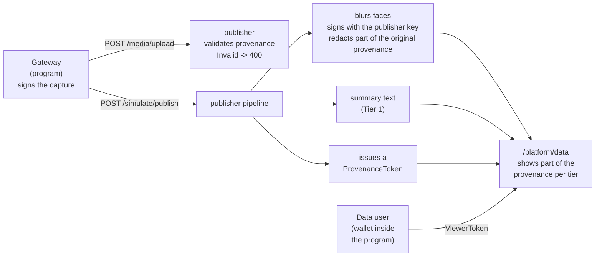

# Connect provenance to the publisher and the chain (C2PA / Stage P, P1 and P2)

In [Prove where an image came from](c2pa-provenance.md) you checked C2PA [1] signing and validation on your own PC only. On this page you send the same signed image to the IW3IP publisher, let the publisher validate the provenance, sign the blurred Tier 2 image itself, and record the provenance hash on the blockchain as a token. Finally, you check how much of the provenance each data user's tier can see.

> **What you do**: send a signed image to the publisher and check the validation, the signing of the Tier 2 image, the token, what provenance each tier sees, and the audit log
>
> **Prerequisites**: §1–§3 of [Prove where an image came from](c2pa-provenance.md) are done. Docker and Node.js are available. The phone wallet is not used
>
> **What you use**: a PC (a USB webcam or built-in camera is optional)
>
> **Time**: about 40–60 minutes

!!! note "Where this page belongs"
    This hands-on runs P1 and P2 of the [C2PA provenance pipeline design spec](../design/c2pa-provenance-spec.md).
    P1 is validation and the audit log at the publisher (§7.1 and §7.3 of the design spec); P2 is the provenance of the Tier 2 image (§5.3), what each tier is shown (§7.2), and token issuance (§8).
    The ideas of Tiers 1–3 and DataUserVC were covered in [Tier the response by trust](data-user-vc-tiered.md) and [Tier by semantic level](data-user-vc-tiered-semantic.md).

## Goal

On the previous page, the gateway (the program that signs next to the camera) and the program that checks the provenance ran on the same PC. In real operation the publisher receives the images and hands each tier its share to the data users.
On this page you run, and check, how the publisher confirms "is the received image real?", attaches provenance to the blurred image as well, and decides how much of it to show to whom.

## What this page covers

- How the publisher's `/media/upload` treats an image without provenance, a signed image, and a tampered image
- How the publisher signs the Tier 2 blurred image with its own key and redacts the information that points to a person from the original's provenance
- How to record the provenance hash on chain as an ERC-721 token (ProvenanceToken)
- Which fields of the provenance (`provenance`) in `/platform/data` each tier (full, access, summary) sees
- The audit records `provenance/verified`, `provenance/derived`, and `provenance/anchored`

## Common pitfalls

- `make_test_certs.py` now also makes the publisher's certificate (`publisher_chain.pem`, `publisher.key`) for this page. If you only have the certificates from §2 of the previous page, make them again (§1)
- The publisher runs in a Docker container and reads the certificates from `examples/hands_on/c2pa_provenance/certs/`, mounted read-only. After remaking the certificates, restart the publisher
- The ProvenanceToken address can change when you restart the Hardhat node. Use the address printed in §2 in §3
- With this page's settings, the publisher issues tokens from an unlocked account of the Hardhat node. This is for local trials only and cannot be used in production

## Prerequisites

- §1–§3 of [Prove where an image came from](c2pa-provenance.md) are done (virtual environment and the C2PA SDK, c2pa-python [2]; certificates; signing and validation)
- Docker works in the course repository `~/program/Blockchain_IoT_Marketplace` ([Environment Setup](../setup/index.md))
- Hardhat works in `iot-market/` (Node.js and `npm install`)

## Exercise programs

- [Program that checks provenance through the publisher (p1p2_publisher_flow.py)](https://github.com/ertlnagoya/Blockchain_IoT_Marketplace/blob/main/examples/hands_on/c2pa_provenance/p1p2_publisher_flow.py)
- [ProvenanceToken contract (ProvenanceToken.sol)](https://github.com/ertlnagoya/Blockchain_IoT_Marketplace/blob/main/iot-market/contracts/ProvenanceToken.sol), with the deploy and read scripts (`iot-market/scripts/deployProvenanceToken.ts`, `readProvenanceToken.ts`)
- [The publisher's C2PA processing (c2pa_provenance.py)](https://github.com/ertlnagoya/Blockchain_IoT_Marketplace/blob/main/publisher/app/c2pa_provenance.py)
- [Compose settings that start the publisher with C2PA (docker-compose.c2pa.yml)](https://github.com/ertlnagoya/Blockchain_IoT_Marketplace/blob/main/infra/docker-compose.c2pa.yml)
- [Exercise guide (README)](https://github.com/ertlnagoya/Blockchain_IoT_Marketplace/blob/main/examples/hands_on/c2pa_provenance/README.md)

`p1p2_publisher_flow.py` plays both the gateway and the data user in one program and prints the result of 18 checks as `PASS` / `FAIL`. As the data user, a wallet inside the program receives and presents the PurchaseViewerVC instead of the phone wallet.

## Shortest path

1. Remake the certificates and run `npm install` in `iot-market/` (§1)
2. Start the Hardhat node and deploy the ProvenanceToken (§2)
3. Start the publisher with the C2PA settings (§3)
4. Run `p1p2_publisher_flow.py` and confirm `all checks passed` (§4)

Branches after that:

- To look closely at what provenance each tier sees: go to §5
- To read the audit log and the on-chain record yourself: go to §6

## 1. Preparation

Pull the latest course repository and activate the virtual environment from the previous page.

```bash
cd ~/program/Blockchain_IoT_Marketplace
git pull
source .venv/bin/activate
```

Remake the certificates. This page uses the publisher's certificate in addition to the gateway's.

```bash
python examples/hands_on/c2pa_provenance/make_test_certs.py
```

It prints the following (the path depends on your environment).

```
wrote .../certs/ca.pem, chain.pem, gw.key (CN=iw3ip-gateway), publisher_chain.pem, publisher.key (CN=iw3ip-publisher)
```

| File | Content | Where it is used |
| --- | --- | --- |
| `ca.pem` | Certificate of your own CA | Registered as the CA the publisher trusts (validation becomes `Trusted`) |
| `chain.pem`, `gw.key` | Gateway certificate and private key | The program signs the captured image |
| `publisher_chain.pem`, `publisher.key` | Publisher certificate and private key | The publisher signs the Tier 2 blurred image |

The ProvenanceToken uses OpenZeppelin's [3] ERC-721 [4] implementation. Reinstall the dependencies in `iot-market/`.

```bash
cd iot-market
npm install
cd ..
```

## 2. Start the Hardhat node and deploy the ProvenanceToken

Start the Hardhat node in another terminal and keep that terminal open.

```bash
cd ~/program/Blockchain_IoT_Marketplace/iot-market
npx hardhat node --hostname 0.0.0.0
```

Back in the original terminal, deploy the ProvenanceToken.

```bash
cd iot-market
npx hardhat run scripts/deployProvenanceToken.ts --network localhost
cd ..
```

It prints the following.

```
Contract "ProvenanceToken" with 0x5FbDB2315678afecb367f032d93F642f64180aa3 deployed
minter: 0xf39Fd6e51aad88F6F4ce6aB8827279cffFb92266
```

You use the address (`0x5FbD...`) in §3. It is this address when it is the first deployment right after the Hardhat node starts. If you deployed other contracts first, use the printed address.

The ProvenanceToken issues one token per detection-event image and records the following four values. The image itself is not put on chain.

| Field | Content |
| --- | --- |
| `manifestLabel` | Manifest identifier of the captured image (`urn:c2pa:...`) |
| `assetSha256` | sha256 of the signed captured image |
| `cid` | IPFS CID (empty when IPFS is not used) |
| `sellerDid` | DID of the provider (the SellerVC holder) (empty when sent through `/simulate/publish`) |

## 3. Start the publisher with the C2PA settings

Start the publisher with the C2PA settings added. Put the address printed in §2 into `PROVENANCE_TOKEN_ADDRESS`.

```bash
PROVENANCE_TOKEN_ADDRESS=0x5FbDB2315678afecb367f032d93F642f64180aa3 \
  docker compose -f infra/docker-compose.yml -f infra/docker-compose.c2pa.yml up -d --build publisher
```

The second Compose file (`docker-compose.c2pa.yml`) adds these settings to the publisher.

| Setting | Value | Meaning |
| --- | --- | --- |
| `C2PA_ENABLED` | `true` | Validate provenance at `/media/upload` (P1) |
| `C2PA_TRUST_ANCHORS_PATH` | `/c2pa/ca.pem` | The trusted CA |
| `C2PA_SIGNER_CHAIN_PATH`, `C2PA_SIGNER_KEY_PATH` | `/c2pa/publisher_chain.pem`, `/c2pa/publisher.key` | The publisher's certificate and key that sign the Tier 2 image (P2) |
| `IMAGE_REDACTION_BACKEND` | `opencv` | Detect and blur faces to make the Tier 2 image |
| `VLM_BACKEND` | `stub` | Produce a fixed summary text (for the Tier 1 summary; no VLM model is used) |
| `PROVENANCE_TOKEN_ADDRESS`, `PROVENANCE_RPC_URL` | the address from §2, `http://host.docker.internal:8545` | Where tokens are issued (P2) |
| `PLATFORM_INGEST_READ_ENABLED` | `true` | For the checks, read every row without authentication |

Confirm that it started.

```bash
curl -s http://localhost:8080/health
```

It succeeded if `{"status":"ok","service":"publisher"}` is printed.

## 4. Run the flow once

```bash
python examples/hands_on/c2pa_provenance/p1p2_publisher_flow.py
```

On success it prints the following (manifest identifiers change every run).

```
c2pa-python 0.38.1 / c2pa-rs 0.91.3
[PASS] P1 unsigned image is accepted without provenance  (200 c2pa={'present': False, ...})
[PASS] P1 signed capture is Trusted at the publisher  (200 Trusted signer=iw3ip-gateway)
[PASS] P1 tampered capture is refused  (400 c2pa_invalid)
[PASS] P1 tampered capture renamed to .webp is refused  (400 c2pa_invalid)
[PASS] P2 event is published  ({'status': 'allowed', 'dataset_id': 'home/event/possible_littering'})
[PASS] P2 row carries the capture's manifest label  (urn:c2pa:...)
[PASS] P2 Tier 2 image has its own manifest  (urn:c2pa:...)
[PASS] P2 Tier 2 image is Trusted and signed by the publisher  (Trusted)
[PASS] P2 capture thumbnail / camera / sensor are redacted  (leaked=[])
[PASS] P2 camera ID appears nowhere in the Tier 2 bytes  (0 hit(s))
  full     views=['event', 'image', 'video', 'image_redacted', 'description_full', 'description_summary']
           image_url=yes image_url_redacted=yes provenance=['anchor_tx', 'derived_sha256', 'manifest_label', 'redacted_manifest_label', 'signer', 'token_contract', 'token_id', 'validation_state']
  access   views=['event', 'image_redacted', 'description_full', 'description_summary']
           image_url=no image_url_redacted=yes provenance=['anchor_tx', 'derived_sha256', 'manifest_label', 'redacted_manifest_label', 'signer', 'token_contract', 'token_id', 'validation_state']
  summary  views=['event', 'description_summary']
           image_url=no image_url_redacted=no provenance=['anchor_tx', 'derived_sha256', 'manifest_label', 'token_contract', 'token_id', 'validation_state']
[PASS] tier full sees signer and the Tier 2 manifest
[PASS] tier access sees the Tier 2 manifest but not the raw image
[PASS] tier summary sees only label, state, token and the summary hash
[PASS] summary text matches provenance.derived_sha256
[PASS] P2 ProvenanceToken anchors the manifest label and image sha256  (token #1)
[PASS] audit log has provenance/verified
[PASS] audit log has provenance/derived
[PASS] audit log has provenance/anchored

outputs: .../out/p1_capture.jpg, .../out/p2_tier2.jpg
all checks passed
```

The flow is shown in the following diagram.



At each step of the diagram, the program and the publisher do the following.

1. **Sign the captured image**: as on the previous page, attach provenance with the camera ID, capture time and sensor readings, and sign with the gateway key (`out/p1_capture.jpg`)
2. **The publisher validates (P1)**: an image without provenance is accepted as before (`present: false`). The signed image is judged `Trusted`. An image with one byte changed is refused with `400 c2pa_invalid` and not stored. It is refused even when sent with the extension changed to `.webp`, because the publisher reads the image format from the first bytes of the file, not from the filename (checks 1–4)
3. **Send the event (P2)**: send an event with the captured image's URL (`image_url`) through `/simulate/publish`. The publisher makes the Tier 2 image with faces blurred and signs it with the publisher key. In doing so it references the captured image as an "ingredient" and redacts the thumbnail, camera ID and sensor readings from the captured image's provenance. It also makes the summary text and issues a ProvenanceToken (checks 5–7)
4. **Check the Tier 2 image yourself**: fetch the Tier 2 image and confirm that it is `Trusted`, that the signer is `iw3ip-publisher`, and that the redacted information and the camera ID are not left (`out/p2_tier2.jpg`, checks 8–10)
5. **Check what each tier sees**: with the DataUserVC attributes of the three tiers full, access and summary, receive a PurchaseViewerVC, present it to get a ViewerToken, and read `/platform/data` (checks 11–14; §5)
6. **Check the chain and the audit log**: read the token's `tokenURI` and confirm that it records the captured image's manifest identifier and sha256. Also confirm that the audit log has the three kinds of records (checks 15–18; §6)

## 5. Provenance each tier sees

Each row of `/platform/data` has a `provenance` field. The publisher picks the fields inside `provenance` for each tier.

| Field | Content | full | access | summary |
| --- | --- | --- | --- | --- |
| `manifest_label` | Manifest identifier of the captured image | ✓ | ✓ | ✓ |
| `validation_state` | Validation result at the publisher (`Trusted` and so on) | ✓ | ✓ | ✓ |
| `token_id`, `token_contract`, `anchor_tx` | ProvenanceToken number, address, minting transaction | ✓ | ✓ | ✓ |
| `derived_sha256` | sha256 of the summary text (`description_summary`); shown only to tiers that receive the summary text | ✓ | ✓ | ✓ |
| `signer` | Name of the captured image's signer | ✓ | ✓ | — |
| `redacted_manifest_label` | Manifest identifier of the Tier 2 image | ✓ | ✓ | — |

Users of the summary tier receive no image. So the link between the summary text and the genuine footage is made through `derived_sha256` (the sha256 of the summary text) and the audit log, not through C2PA provenance (§5.5 of the design spec). Check 14 of the program confirms that the sha256 of the received summary text matches `derived_sha256`.

!!! warning "Rows can be matched across tiers"
    `manifest_label` and `token_id` are visible to every tier with the same values. So when users of different tiers bring their data together, they can tell that the rows were made from the same capture. This is the behaviour §7.2 of the design spec specifies, and one of the open problems in combining provenance with tiered disclosure.

## 6. Read the audit log and the chain

Print the provenance records of the audit log, newest first.

```bash
curl -s "http://localhost:8080/audit/logs?limit=50" | python -c "import json,sys; [print(r['raw_topic'], r['action'], r['reason']) for r in json.load(sys.stdin) if r['raw_topic'].startswith('provenance/')]"
```

It prints something like the following (identifiers and transaction numbers change every run).

```
provenance/anchored allow token:1:tx=0xf60e...:manifest=urn:c2pa:0e72...
provenance/derived allow tier2:urn:c2pa:6631...:ingredient=urn:c2pa:0e72...
provenance/verified allow c2pa:Trusted:urn:c2pa:6631...:trusted=true
provenance/verified deny c2pa:Invalid:urn:c2pa:0e72...:trusted=false
provenance/verified deny c2pa:Invalid:urn:c2pa:0e72...:trusted=false
provenance/verified allow c2pa:Trusted:urn:c2pa:0e72...:trusted=true
```

The three kinds of records mean the following.

| `raw_topic` | When it is written | Example `reason` |
| --- | --- | --- |
| `provenance/verified` | When `/media/upload` validates provenance | `c2pa:Trusted:urn:c2pa:...:trusted=true` |
| `provenance/derived` | When provenance is attached to the Tier 2 image | `tier2:urn:c2pa:...:ingredient=urn:c2pa:...` |
| `provenance/anchored` | When a token is issued | `token:1:tx=0x...:manifest=urn:c2pa:...` |

When a tampered image is sent, the `action` of the `provenance/verified` record is `deny`. There are four `provenance/verified` records. From the bottom: the captured image, the tampered captured image, the tampered captured image with the extension changed, and the Tier 2 image the publisher made. The Tier 2 image is also stored through `/media/upload`, so it is validated in the same way.

The program confirms the on-chain record by reading `tokenURI` (check 15). To read it yourself, run the following script in `iot-market/`. Put the address from §2 in `TOKEN_ADDRESS` and the token number in `TOKEN_ID`.

```bash
cd iot-market
TOKEN_ADDRESS=0x5FbDB2315678afecb367f032d93F642f64180aa3 TOKEN_ID=1 \
  npx hardhat run scripts/readProvenanceToken.ts --network localhost
cd ..
```

It prints the following. `assetSha256` is the same value as the captured image's `sha256` returned by `/media/upload`.

```
token #1 owner 0xf39Fd6e51aad88F6F4ce6aB8827279cffFb92266
manifestLabel urn:c2pa:0e72e6e1-4ae6-41df-b8b9-0ba2e9474be3
assetSha256   0x0cd5f836...
cid           (none)
sellerDid     (none)
```

## Success criteria

- In §4, all 18 checks are `PASS` and `all checks passed` is printed
- In §5, the summary tier's `provenance` has no `signer` and no `redacted_manifest_label`
- In §6, the audit log has `provenance/verified`, `provenance/derived` and `provenance/anchored` records

## What this hands-on cannot confirm

- As on the previous page, it cannot confirm the section between the camera and the gateway (§4 of the design spec), nor that what the image shows is true
- Tokens are issued from an unlocked account of the Hardhat node. In production the publisher has to keep its key safe and send transactions it signs itself
- Even with webcam images, face detection only catches frontal faces. Profile and small faces may not be blurred (the same limit as the face blur in [Tier by semantic level](data-user-vc-tiered-semantic.md))
- Video (fragmented MP4) and the provenance of sensor time series are not covered yet (P3 of the design spec)

## Return to the normal settings

When you go back to other hands-on pages, restart the publisher without the C2PA settings.

```bash
docker compose -f infra/docker-compose.yml up -d publisher
```

## Troubleshooting

- Symptom: `.../certs/publisher_chain.pem not found; run make_test_certs.py first`
  - Check: did you run `make_test_certs.py` in §1? The certificates from the previous page do not include the publisher's
- Symptom: `[FAIL] P1 signed capture is Trusted at the publisher  (200 Valid ...)`
  - Check: did you restart the publisher after remaking the certificates (run the §3 command again)? The publisher reads `ca.pem` when it starts
- Symptom: `[FAIL] P1 unsigned image is accepted without provenance  (200 c2pa=None)`
  - Check: did you start it with `-f infra/docker-compose.c2pa.yml` in §3?
- Symptom: `[FAIL] P2 ProvenanceToken was minted  (no token_id; ...)`
  - Check: is the Hardhat node running? Is the `PROVENANCE_TOKEN_ADDRESS` in §3 the address printed in §2? If you restarted the Hardhat node, redo §2 and §3
  - Check: does `docker compose -f infra/docker-compose.yml logs publisher | grep provenance` show `provenance mint failed`?
- Symptom: `[FAIL] P2 Tier 2 image has its own manifest`
  - Check: does `docker compose -f infra/docker-compose.yml logs publisher | grep -i redaction` show a failed blur? Did you rebuild the publisher with `--build`?
- Symptom: `HH411: The library @openzeppelin/contracts ... is not installed`
  - Check: did you run `npm install` in `iot-market/` in §1?

## References

[1] C2PA, "C2PA Technical Specification, Version 2.3," <https://spec.c2pa.org/specifications/specifications/2.3/specs/C2PA_Specification.html>

[2] Content Authenticity Initiative, "c2pa-python: Python binding for c2pa-rs library," GitHub, <https://github.com/contentauth/c2pa-python>

[3] OpenZeppelin, "OpenZeppelin Contracts," GitHub, <https://github.com/OpenZeppelin/openzeppelin-contracts>

[4] W. Entriken, D. Shirley, J. Evans, N. Sachs, "ERC-721: Non-Fungible Token Standard," Ethereum Improvement Proposals, no. 721, 2018, <https://eips.ethereum.org/EIPS/eip-721>
