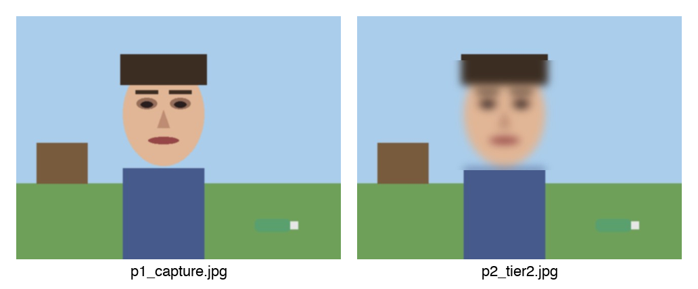
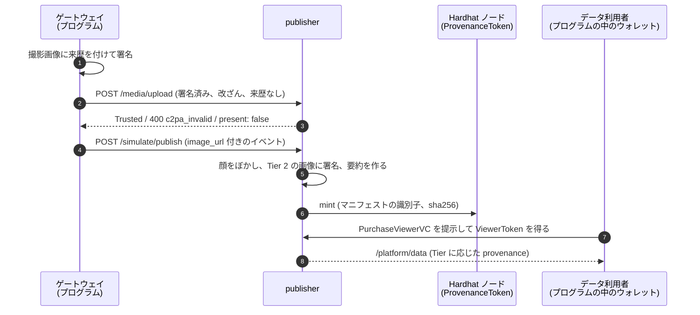
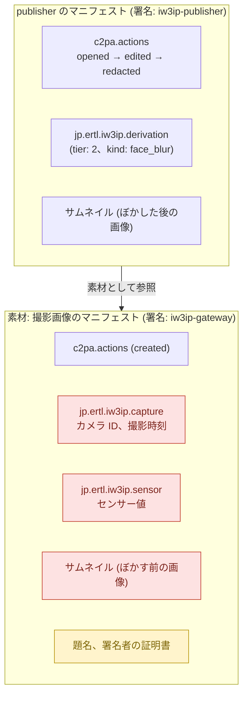
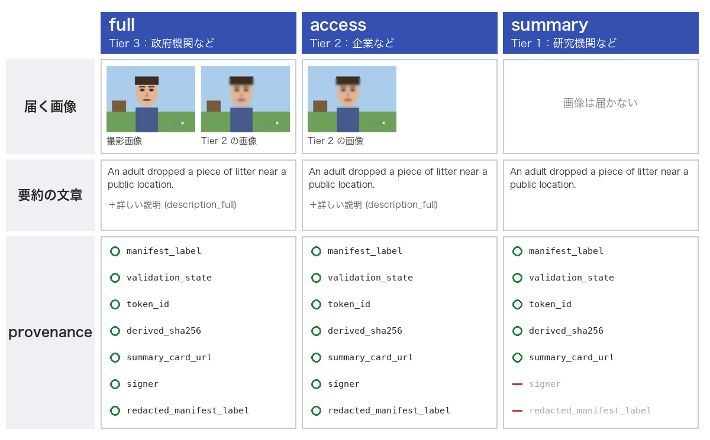

# 来歴を publisher とチェーンにつなぐ (C2PA / Stage P の P1・P2)

[画像の来歴を証明する](c2pa-provenance.md) では、C2PA [1] の来歴の署名と検証を、手元の PC だけで試しました。このページでは、署名した画像を IW3IP の publisher に送ります。publisher は来歴を検証し、顔をぼかした Tier 2 の画像を作って自分の鍵で署名し、来歴のハッシュをブロックチェーンにトークンとして記録します。最後に、データ利用者の Tier ごとに、来歴のどこまでが見えるかを調べます。



このページで作る 2 枚の画像です。左はゲートウェイが署名した撮影画像、右は publisher が顔をぼかして署名し直した Tier 2 の画像です。見た目はぼかしただけですが、右の画像には「左の画像から作った」ことを示す来歴が入っています。

> **やること**: 署名した画像を publisher に送り、publisher による検証、Tier 2 の画像の署名、トークンの発行、Tier ごとの来歴の見え方、監査ログを見る
>
> **前提**: [画像の来歴を証明する](c2pa-provenance.md) の §1〜§3 を終えていること。Docker と Node.js が使えること。スマホのウォレットは使いません
>
> **使うもの**: PC (USB ウェブカメラまたは内蔵カメラは任意)
>
> **所要時間**: 約 40〜60 分

!!! note "このページの位置付け"
    [C2PA 来歴パイプラインの設計仕様](../design/c2pa-provenance-spec.md) の P1 と P2 を動かすハンズオンです。
    P1 は publisher での検証と監査ログ (設計仕様の §7.1、§7.3)、P2 は Tier 2 の画像の来歴 (§5.3)、Tier ごとの来歴の見せ方 (§7.2)、トークンの発行 (§8) です。
    Tier 1〜3 と DataUserVC は [信頼度に応じて見せる中身を変える](data-user-vc-tiered.md) と [意味レベルで段階化する](data-user-vc-tiered-semantic.md) で扱いました。

## 目的

前のページでは、ゲートウェイ (カメラの隣で署名するプログラム) も、来歴を確かめるプログラムも、同じ PC の中で動きました。実際の運用では、画像を受け取るのは publisher で、publisher がデータ利用者に Tier ごとの中身を配ります。
このページでは、publisher の立場で 3 つのことを試します。受け取った画像が本物かを確かめること、ぼかした画像にも来歴を付けること、その来歴を誰にどこまで見せるかを決めることです。

## このページで分かること

- publisher の `/media/upload` が、来歴の無い画像、署名済みの画像、改ざんした画像をそれぞれどう扱うか
- publisher が Tier 2 の画像に自分の鍵で署名し、元の画像の来歴からカメラ ID などを消す流れ
- 来歴のハッシュを ERC-721 のトークン (ProvenanceToken) としてチェーンに記録する方法
- Tier (full、access、summary) ごとに、`/platform/data` の来歴 (`provenance`) のどの項目が見えるか
- 監査ログの `provenance/verified`、`provenance/derived`、`provenance/anchored`

## つまずきやすい点

- `make_test_certs.py` は、ゲートウェイの証明書 (CN は `iw3ip-gateway`) と publisher の証明書 (CN は `iw3ip-publisher`) を、同じテスト用の CA (`IW3IP Test CA`) で発行します。publisher は、自分の証明書で Tier 2 の画像と要約カードに署名します。古い版の `make_test_certs.py` で作った証明書には publisher の証明書が無いため、§1 で作り直します
- publisher は Docker のコンテナで動き、`examples/hands_on/c2pa_provenance/certs/` を読み取り専用でマウントして証明書を読みます。証明書を作り直したら、publisher を起動し直します
- ProvenanceToken のアドレスは、Hardhat ノードを起動し直すと変わることがあります。§3 では、§2 で表示されたアドレスを使います
- この設定では、publisher は Hardhat ノードの、鍵がロックされていないアカウントでトークンを発行します。手元で試すための方法で、本番では使えません

## 前提

- [画像の来歴を証明する](c2pa-provenance.md) の §1〜§3 (仮想環境と C2PA の SDK、c2pa-python [2]、証明書、署名と検証) を終えている
- 教材リポジトリ `~/program/Blockchain_IoT_Marketplace` で Docker が使える ([環境構築](../setup/index.md))
- `iot-market/` で Hardhat が使える (Node.js と `npm install`)

## 演習用プログラム

- [publisher を通して来歴を確かめるプログラム (p1p2_publisher_flow.py)](https://github.com/ertlnagoya/Blockchain_IoT_Marketplace/blob/main/examples/hands_on/c2pa_provenance/p1p2_publisher_flow.py)
- [ProvenanceToken のコントラクト (ProvenanceToken.sol)](https://github.com/ertlnagoya/Blockchain_IoT_Marketplace/blob/main/iot-market/contracts/ProvenanceToken.sol) と、デプロイ、読み出しのスクリプト (`iot-market/scripts/deployProvenanceToken.ts`、`readProvenanceToken.ts`)
- [publisher の C2PA の処理 (c2pa_provenance.py)](https://github.com/ertlnagoya/Blockchain_IoT_Marketplace/blob/main/publisher/app/c2pa_provenance.py)
- [publisher を C2PA の設定で起動する Compose の設定 (docker-compose.c2pa.yml)](https://github.com/ertlnagoya/Blockchain_IoT_Marketplace/blob/main/infra/docker-compose.c2pa.yml)
- [演習説明 (README)](https://github.com/ertlnagoya/Blockchain_IoT_Marketplace/blob/main/examples/hands_on/c2pa_provenance/README.md)

`p1p2_publisher_flow.py` は、ゲートウェイとデータ利用者の 2 役を 1 つのプログラムでこなし、18 項目の確認の結果を `PASS` / `FAIL` で表示します。データ利用者の役では、スマホのウォレットの代わりに、プログラムの中のウォレットが PurchaseViewerVC を受け取って提示します。

既定では、プログラムが描いた公園の絵 (人とペットボトル) に署名します。人の顔は、publisher の顔検出 (OpenCV) が見つけられるように描いてあるため、Tier 2 の画像では顔がぼけます。自分の写真や、ウェブカメラで撮った画像でも試せます (§4 の最後)。

## 最短ルート

1. 証明書を作り直し、`iot-market/` で `npm install` を実行する (§1)
2. Hardhat ノードを起動し、ProvenanceToken をデプロイする (§2)
3. C2PA の設定で publisher を起動する (§3)
4. `p1p2_publisher_flow.py` を実行し、`all checks passed` と表示されるのを見る (§4)

その後の分岐:

- Tier ごとに来歴のどこが見えるかを詳しく見たい場合: §5 へ進みます
- 監査ログとチェーンの記録を自分で読みたい場合: §6 へ進みます

## 1. 準備

教材リポジトリを最新にして、前のページで作った仮想環境を有効にします。

```bash
cd ~/program/Blockchain_IoT_Marketplace
git pull
source .venv/bin/activate
```

証明書を作り直します。このページでは、ゲートウェイの証明書に加えて、publisher の証明書も使います。前のページの §2 で作った証明書にも publisher の証明書は入っていますが、念のため作り直します。

```bash
python examples/hands_on/c2pa_provenance/make_test_certs.py
```

次のように表示されます (パスは環境によって変わります)。

```
wrote .../certs/ca.pem, chain.pem, gw.key (CN=iw3ip-gateway), publisher_chain.pem, publisher.key (CN=iw3ip-publisher)
```

| ファイル | 中身 | 使う場所 |
| --- | --- | --- |
| `ca.pem` | 自分で作った CA の証明書 | publisher が信頼する CA として登録する (検証の結果が `Trusted` になる) |
| `chain.pem`、`gw.key` | ゲートウェイの証明書と秘密鍵 | プログラムが撮影画像に署名する |
| `publisher_chain.pem`、`publisher.key` | publisher の証明書と秘密鍵 (CN は `iw3ip-publisher`) | publisher が Tier 2 の画像と要約カードに署名する |

ProvenanceToken は、OpenZeppelin [3] の ERC-721 [4] の実装を使います。`iot-market/` で依存関係を入れ直します。

```bash
cd iot-market
npm install
cd ..
```

## 2. Hardhat ノードを起動して ProvenanceToken をデプロイする

別のターミナルで Hardhat ノードを起動します。このターミナルは開いたままにします。

```bash
cd ~/program/Blockchain_IoT_Marketplace/iot-market
npx hardhat node --hostname 0.0.0.0
```

元のターミナルに戻り、ProvenanceToken をデプロイします。

```bash
cd iot-market
npx hardhat run scripts/deployProvenanceToken.ts --network localhost
cd ..
```

次のように表示されます。コントラクトを初めてコンパイルするときは、先頭に `Compiled ...` で始まる行が出ることがあります。

```
Contract "ProvenanceToken" with 0x5FbDB2315678afecb367f032d93F642f64180aa3 deployed
minter: 0xf39Fd6e51aad88F6F4ce6aB8827279cffFb92266
```

アドレス (`0x5FbD...`) は §3 で使います。Hardhat ノードを起動して最初にデプロイしたコントラクトは、このアドレスになります。ほかのコントラクトを先にデプロイしていた場合は、表示されたアドレスを使います。

ProvenanceToken は、検知イベントの画像 1 枚につき 1 つのトークンを発行し、次の 4 つの値を記録します。画像そのものはチェーンに載せません。

| 項目 | 内容 |
| --- | --- |
| `manifestLabel` | 撮影画像のマニフェストの識別子 (`urn:c2pa:...`) |
| `assetSha256` | 署名済みの撮影画像の sha256 |
| `cid` | IPFS の CID (IPFS を使わない場合は空) |
| `sellerDid` | 提供者 (SellerVC の holder) の DID (`/simulate/publish` から送った場合は空) |

## 3. C2PA の設定で publisher を起動する

publisher を、C2PA の設定を加えて起動します。`PROVENANCE_TOKEN_ADDRESS` には §2 で表示されたアドレスを入れます。

```bash
PROVENANCE_TOKEN_ADDRESS=0x5FbDB2315678afecb367f032d93F642f64180aa3 \
  docker compose -f infra/docker-compose.yml -f infra/docker-compose.c2pa.yml up -d --build publisher
```

2 つ目の Compose ファイル (`docker-compose.c2pa.yml`) は、publisher に次の設定を加えます。

| 設定 | 値 | 意味 |
| --- | --- | --- |
| `C2PA_ENABLED` | `true` | `/media/upload` で来歴を検証する (P1) |
| `C2PA_TRUST_ANCHORS_PATH` | `/c2pa/ca.pem` | 信頼する CA |
| `C2PA_SIGNER_CHAIN_PATH`、`C2PA_SIGNER_KEY_PATH` | `/c2pa/publisher_chain.pem`、`/c2pa/publisher.key` | Tier 2 の画像に署名する publisher の証明書と鍵 (P2) |
| `IMAGE_REDACTION_BACKEND` | `opencv` | 顔を見つけてぼかし、Tier 2 の画像を作る |
| `VLM_BACKEND` | `stub` | 決まった文の要約を作る (Tier 1 の summary 用。VLM のモデルは使わない) |
| `PROVENANCE_TOKEN_ADDRESS`、`PROVENANCE_RPC_URL` | §2 のアドレス、`http://host.docker.internal:8545` | トークンを発行する先 (P2) |
| `PLATFORM_INGEST_READ_ENABLED` | `true` | 確認のため、認証なしで全部の行を読めるようにする |

起動したか確かめます。

```bash
curl -s http://localhost:8080/health
```

`{"status":"ok","service":"publisher"}` と表示されれば成功です。

## 4. 一通り動かす

```bash
python examples/hands_on/c2pa_provenance/p1p2_publisher_flow.py
```

成功すると、次のように表示されます (マニフェストの識別子は実行のたびに変わります)。1 行目の版の番号は、環境によって変わります (`c2pa-python 0.38.2 / c2pa-rs 0.91.6` などと表示されることがあります)。

```
c2pa-python 0.38.1 / c2pa-rs 0.91.3
[PASS] P1 unsigned image is accepted without provenance  (200 c2pa={'present': False, ...})
[PASS] P1 signed capture is Trusted at the publisher  (200 Trusted signer=iw3ip-gateway)
[PASS] P1 tampered capture is refused  (400 c2pa_invalid)
[PASS] P1 tampered capture renamed to .webp is refused  (400 c2pa_invalid)
[PASS] P2 event is published  ({'status': 'allowed', 'dataset_id': 'home/event/possible_littering'})
[PASS] P2 row carries the capture's manifest label  (urn:c2pa:...)
[PASS] P2 Tier 2 image has its own manifest  (urn:c2pa:...)
[PASS] P2 Tier 2 image is Trusted and signed by the publisher  (Trusted)
[PASS] P2 capture thumbnail / camera / sensor are redacted  (leaked=[])
[PASS] P2 camera ID appears nowhere in the Tier 2 bytes  (0 hit(s))
  full     views=['event', 'image', 'video', 'image_redacted', 'description_full', 'description_summary']
           image_url=yes image_url_redacted=yes provenance=['anchor_tx', 'derived_sha256', 'manifest_label', 'redacted_manifest_label', 'signer', 'summary_card_url', 'summary_manifest_label', 'token_contract', 'token_id', 'validation_state']
  access   views=['event', 'image_redacted', 'description_full', 'description_summary']
           image_url=no image_url_redacted=yes provenance=['anchor_tx', 'derived_sha256', 'manifest_label', 'redacted_manifest_label', 'signer', 'summary_card_url', 'summary_manifest_label', 'token_contract', 'token_id', 'validation_state']
  summary  views=['event', 'description_summary']
           image_url=no image_url_redacted=no provenance=['anchor_tx', 'derived_sha256', 'manifest_label', 'summary_card_url', 'summary_manifest_label', 'token_contract', 'token_id', 'validation_state']
[PASS] tier full sees signer and the Tier 2 manifest
[PASS] tier access sees the Tier 2 manifest but not the raw image
[PASS] tier summary sees label, state, token and the summary hash, not the signer
[PASS] summary text matches provenance.derived_sha256
[PASS] P2 ProvenanceToken anchors the manifest label and image sha256  (token #1)
[PASS] audit log has provenance/verified
[PASS] audit log has provenance/derived
[PASS] audit log has provenance/anchored

outputs: .../out/p1_capture.jpg, .../out/p2_tier2.jpg
all checks passed
```

処理の順番を、次の図に示します。図の番号は、下の説明の番号と同じです。



1. **撮影画像に署名する**: 前のページと同じく、カメラ ID、撮影時刻、センサー値を書いた来歴を付けて、ゲートウェイの鍵で署名します (`out/p1_capture.jpg`)
2. **画像を publisher に送る**: 署名済みの画像のほか、1 バイト書き換えた画像と、来歴の無い画像も送ります
3. **publisher が検証する (P1)**: 来歴の無い画像は、これまでどおり受け付けます (`present: false`)。署名済みの画像は `Trusted` になります。書き換えた画像は `400 c2pa_invalid` で断り、保存しません。拡張子を `.webp` に変えて送っても断ります。publisher は、ファイル名を見ずに、ファイルの先頭のバイトで画像の形式を判断するためです (1〜4 番目のチェック)
4. **イベントを送る**: 撮影画像の URL (`image_url`) を入れたイベントを、`/simulate/publish` で送ります
5. **Tier 2 の画像を作る (P2)**: publisher は顔をぼかした画像を作り、自分の鍵で署名します。このとき、撮影画像を「素材 (ingredient)」として参照し、撮影画像の来歴からサムネイル、カメラ ID、センサー値を消します (下の図で説明します)。あわせて要約の文を作ります (5〜7 番目のチェック)。プログラムは Tier 2 の画像を取得し、`Trusted` であること、署名者が `iw3ip-publisher` であること、消した情報とカメラ ID が残っていないことを調べます (`out/p2_tier2.jpg`、8〜10 番目のチェック)
6. **トークンを発行する (P2)**: publisher は、撮影画像のマニフェストの識別子と sha256 を ProvenanceToken に記録します。プログラムはトークンの `tokenURI` を読んで中身を調べます (15 番目のチェック)
7. **データ利用者がウォレットで VC を提示する**: full、access、summary の 3 つの Tier の DataUserVC の属性で PurchaseViewerVC を受け取り、提示して ViewerToken を得ます
8. **Tier ごとに読む**: ViewerToken で `/platform/data` を読み、Tier ごとに見える項目を調べます (11〜14 番目のチェック。§5)。最後に、監査ログに 3 種類の記録があることを調べます (16〜18 番目のチェック。§6)

Tier 2 の画像 (`p2_tier2.jpg`) の中の来歴は、次の図のようになっています。publisher のマニフェストの中に、撮影画像のマニフェストが素材として入っています。赤い枠は消した項目、黄色い枠は消せずに残る項目です。



撮影画像のマニフェストを丸ごと消すと、「本物の撮影画像から作った」ことを示せなくなります。そこで、個人やカメラにつながる項目だけを消します。消しても撮影画像の署名は検証でき、Tier 2 の画像を受け取った人は「署名された撮影画像から作られた」ことだけを知ります。題名と署名者の証明書は、署名の対象そのものに含まれるため消せません。そのため、ゲートウェイは題名にカメラ ID や撮影時刻を入れず、証明書の名前にもカメラ ID を入れません (前のページの §4)。

!!! note "自分の写真やウェブカメラで試す"
    `--image <ファイルのパス>` を付けると手元の写真 (JPEG か PNG) に、`--webcam` を付けるとウェブカメラで撮った画像に署名して、同じ流れを試せます。`--webcam` には OpenCV が要ります (前のページの §6)。publisher の顔検出は正面の顔だけを見つけるため、横顔の写真ではぼけないことがあります。

## 5. Tier ごとに見える来歴

`/platform/data` の各行には、`provenance` という項目が付きます。publisher は、Tier ごとに、届ける画像と文、`provenance` の中の項目を選びます。



`provenance` の各項目の中身は次のとおりです。

| 項目 | 中身 |
| --- | --- |
| `manifest_label` | 撮影画像のマニフェストの識別子 |
| `validation_state` | publisher での検証の結果 (`Trusted` など) |
| `token_id` | ProvenanceToken の番号 (`token_contract` と `anchor_tx` も同じ Tier に届く) |
| `derived_sha256` | 要約の文 (`description_summary`) の sha256。要約の文を受け取る Tier だけに届く |
| `signer` | 撮影画像の署名者の名前 |
| `redacted_manifest_label` | Tier 2 の画像のマニフェストの識別子 |
| `summary_card_url`、`summary_manifest_label` | 要約の文を描いて署名した要約カードの URL と、そのマニフェストの識別子 (P3)。要約の文を受け取る Tier だけに届く |

summary の Tier の利用者には、画像が届きません。このページのプログラムの 14 番目のチェックは、受け取った要約の文の sha256 が `derived_sha256` と同じかだけを調べています。要約の文が署名された撮影画像から作られたことは、publisher が署名した要約カード (`summary_card_url`) で確かめられます。その手順は、次のページ [VLM の要約から元の画像をたどる](c2pa-provenance-vlm.md) で扱います。

!!! warning "Tier をまたいで突き合わせられる"
    `manifest_label` と `token_id` は、すべての Tier に同じ値で届きます。そのため、異なる Tier の利用者が手元のデータを持ち寄ると、同じ撮影から作られた行だと分かります。これは設計仕様の §7.2 のとおりの動作で、来歴と段階的な開示を両立させるうえで残っている課題です。

## 6. 監査ログとチェーンを見る

監査ログのうち、来歴に関する記録を新しい順に表示します。

```bash
curl -s "http://localhost:8080/audit/logs?limit=50" | python -c "import json,sys; [print(r['raw_topic'], r['action'], r['reason']) for r in json.load(sys.stdin) if r['raw_topic'].startswith('provenance/')]"
```

次のように表示されます (識別子とトランザクションの番号は実行のたびに変わります)。

```
provenance/anchored allow token:1:tx=0xf60e...:manifest=urn:c2pa:0e72...
provenance/derived allow tier1:urn:c2pa:5f7d...:ingredient=urn:c2pa:0e72...
provenance/derived allow tier2:urn:c2pa:6631...:ingredient=urn:c2pa:0e72...
provenance/verified allow c2pa:Trusted:urn:c2pa:6631...:trusted=true
provenance/verified deny c2pa:Invalid:urn:c2pa:0e72...:trusted=false
provenance/verified deny c2pa:Invalid:urn:c2pa:0e72...:trusted=false
provenance/verified allow c2pa:Trusted:urn:c2pa:0e72...:trusted=true
```

| `raw_topic` | 書かれる時点 | `reason` の例 |
| --- | --- | --- |
| `provenance/verified` | `/media/upload` で来歴を検証したとき | `c2pa:Trusted:urn:c2pa:...:trusted=true` |
| `provenance/derived` | Tier 2 の画像や要約カードに来歴を付けたとき | `tier2:urn:c2pa:...:ingredient=urn:c2pa:...` (要約カードは `tier1:...`) |
| `provenance/anchored` | トークンを発行したとき | `token:1:tx=0x...:manifest=urn:c2pa:...` |

`provenance/verified` は 4 件あります。下から順に、撮影画像、書き換えた撮影画像、拡張子を変えた書き換えた撮影画像、publisher が作った Tier 2 の画像です。書き換えた画像の記録は、`action` が `deny` になります。Tier 2 の画像も `/media/upload` を通して保存するため、同じように検証の記録が残ります。

チェーンの記録は、`iot-market/` で次のスクリプトを実行して読めます。`TOKEN_ADDRESS` には §2 のアドレスを、`TOKEN_ID` にはトークンの番号を入れます。

```bash
cd iot-market
TOKEN_ADDRESS=0x5FbDB2315678afecb367f032d93F642f64180aa3 TOKEN_ID=1 \
  npx hardhat run scripts/readProvenanceToken.ts --network localhost
cd ..
```

次のように表示されます。`assetSha256` は、`/media/upload` が返した撮影画像の `sha256` と同じ値です。

```
token #1 owner 0xf39Fd6e51aad88F6F4ce6aB8827279cffFb92266
manifestLabel urn:c2pa:0e72e6e1-4ae6-41df-b8b9-0ba2e9474be3
assetSha256   0x0cd5f836...
cid           (none)
sellerDid     (none)
```

## 成功例

- §4 で 18 項目がすべて `PASS` になり、`all checks passed` と表示される
- `out/p2_tier2.jpg` を開くと、顔がぼけている
- §5 で、summary の Tier の `provenance` に `signer` と `redacted_manifest_label` が無い
- §6 で、監査ログに `provenance/verified`、`provenance/derived`、`provenance/anchored` の記録がある

## このハンズオンで確かめられないこと

- 前のページと同じく、カメラとゲートウェイの間の区間 (設計仕様の §4) と、写っている内容が事実かどうかは確かめられません
- トークンは、Hardhat ノードの、鍵がロックされていないアカウントで発行しています。本番では、publisher の鍵を安全に保管し、自分で署名したトランザクションを送る必要があります
- publisher の顔検出は正面の顔だけを見つけます。横顔や小さな顔はぼけないことがあります ([意味レベルで段階化する](data-user-vc-tiered-semantic.md) の顔ブラーと同じ制約)
- 動画 (断片化 MP4) と、センサーの時系列データの来歴は、まだ扱っていません (設計仕様の P4)

## 元の設定に戻す

ほかのハンズオンに戻るときは、C2PA の設定を外して publisher を起動し直します。

```bash
docker compose -f infra/docker-compose.yml up -d publisher
```

## トラブル時

- 症状: `.../certs/publisher_chain.pem not found; run make_test_certs.py first`
  - 確認: §1 の `make_test_certs.py` を実行したか。古い版の `make_test_certs.py` で作った証明書には、publisher の証明書がありません
- 症状: `[FAIL] P1 signed capture is Trusted at the publisher  (200 Valid ...)`
  - 確認: 証明書を作り直したあと、publisher を起動し直したか (§3 のコマンドをもう一度実行する)。publisher は起動したときに `ca.pem` を読みます
- 症状: `[FAIL] P1 unsigned image is accepted without provenance  (200 c2pa=None)`
  - 確認: §3 で `-f infra/docker-compose.c2pa.yml` を付けて起動したか
- 症状: `[FAIL] P2 ProvenanceToken was minted  (no token_id; ...)`
  - 確認: Hardhat ノードが動いているか。§3 の `PROVENANCE_TOKEN_ADDRESS` が §2 で表示されたアドレスか。Hardhat ノードを起動し直した場合は、§2 と §3 をやり直す
  - 確認: `docker compose -f infra/docker-compose.yml logs publisher | grep provenance` に `provenance mint failed` が出ていないか
- 症状: `[FAIL] P2 Tier 2 image has its own manifest`
  - 確認: `docker compose -f infra/docker-compose.yml logs publisher | grep -i redaction` で、ぼかしの処理が失敗していないか。`--build` を付けて publisher を作り直したか
- 症状: `p2_tier2.jpg` の顔がぼけていない
  - 確認: `--image` で渡した写真の顔が、横向きや小さすぎではないか。オプションなしの既定の絵で、顔がぼけるかを試す
- 症状: `HH411: The library @openzeppelin/contracts ... is not installed`
  - 確認: §1 の `npm install` を `iot-market/` で実行したか

## 参考文献

[1] C2PA, "C2PA Technical Specification, Version 2.3," <https://spec.c2pa.org/specifications/specifications/2.3/specs/C2PA_Specification.html>

[2] Content Authenticity Initiative, "c2pa-python: Python binding for c2pa-rs library," GitHub, <https://github.com/contentauth/c2pa-python>

[3] OpenZeppelin, "OpenZeppelin Contracts," GitHub, <https://github.com/OpenZeppelin/openzeppelin-contracts>

[4] W. Entriken, D. Shirley, J. Evans, N. Sachs, "ERC-721: Non-Fungible Token Standard," Ethereum Improvement Proposals, no. 721, 2018, <https://eips.ethereum.org/EIPS/eip-721>
