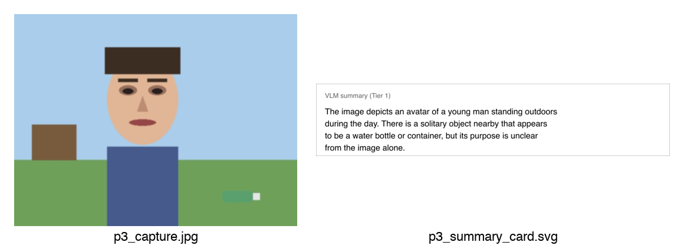
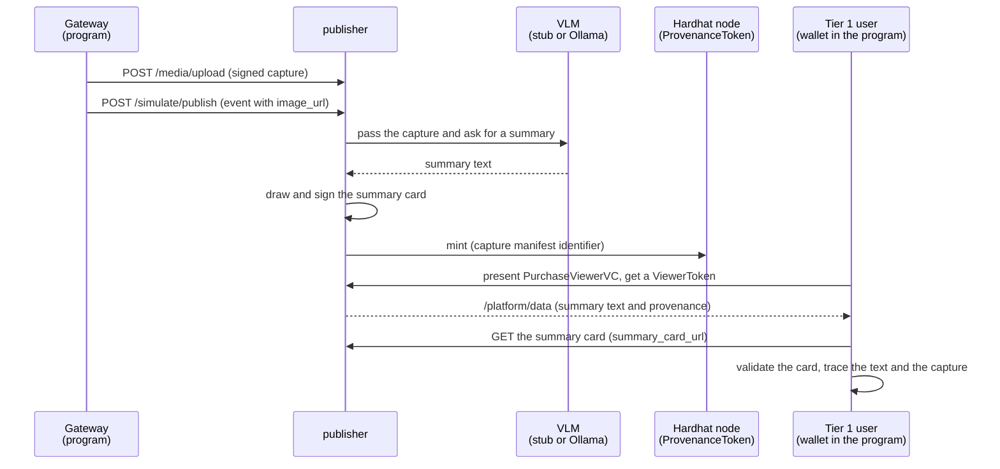
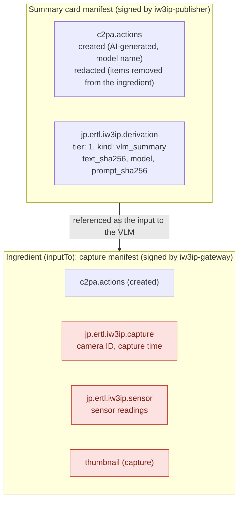
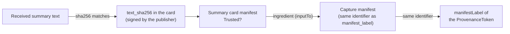

# Trace a VLM summary back to the image (C2PA / Stage P, P3)

In [Connect provenance to the publisher and the chain](c2pa-provenance-publisher.md), the image got provenance and the publisher signed the Tier 2 image too. Tier 1 (summary) users, however, receive no image, only the summary text written by a VLM (an AI that reads an image and writes text). This page gives that summary text provenance as well, so that someone who receives only the text can check for themselves which capture and which model it came from.



On the left is the capture signed by the gateway; on the right is the "summary card", on which the publisher drew the VLM's summary and then signed it. The card's provenance says that the left image was the input to the VLM, and holds the sha256 of the summary text.

> **What you do**: have the publisher write a VLM summary, then look at the summary card's signature, its match with the summary text, the link to the capture and the token, and tamper detection
>
> **Prerequisites**: §1–§3 of [Connect provenance to the publisher and the chain](c2pa-provenance-publisher.md)
>
> **What you need**: a PC (to try a real VLM, Docker must be able to run the 4.7 GB llava model)
>
> **Time**: about 20–30 minutes (another 30 minutes to 1 hour to try a real VLM)

!!! note "Where this page fits"
    This hands-on runs P3 of the [C2PA provenance pipeline design spec](../design/c2pa-provenance-spec.md).
    P3 covers the provenance of the Tier 1 summary text (§5.5 of the spec) and how it is shown (§7.2).
    VLM summaries were covered in [Add meaning to camera data with a local VLM](local-vlm-distribution.md) and [Tier by semantic level](data-user-vc-tiered-semantic.md).

## Goal

The C2PA [1] SDK can sign images and video but not plain text. Up to P2, therefore, the sha256 of the summary text went into the `/platform/data` row, and the publisher's audit log linked it to the capture. That link is the publisher's own record, so a recipient of the summary text could not check by themselves that it really came from a signed capture.

In P3, the publisher draws the summary text into an SVG image (the summary card) and signs the card. By validating the card's provenance, the recipient can trace the summary text back to the capture and the token by themselves.

## What you will learn

- Why an SVG summary card is used to give text C2PA provenance
- What the summary card's provenance holds (the input to the VLM, an action marking the content as AI-generated, the sha256 of the summary text, the model name, the sha256 of the prompt)
- How a Tier 1 user traces the summary text to the capture's manifest and the ProvenanceToken
- What the signature shows and what it does not (it cannot show that the summary contains no information that points to a person)

## Common pitfalls

- The publisher's code changed for this page. Rebuild the publisher with `--build` in §1; without it, no summary card is made
- The summary card's URL (`provenance.summary_card_url`) goes only to tiers that receive the summary text, because the card shows the text
- A real VLM (Ollama's llava) can take more than 3 minutes per inference on CPU only. Raise the publisher's wait time (`VLM_TIMEOUT_SEC`) (§4)
- A small model (moondream) returned an empty summary for this page's picture, and no summary card was made (§4)

## Prerequisites

- You have done §1–§3 of [Connect provenance to the publisher and the chain](c2pa-provenance-publisher.md) (certificates, the Hardhat node and ProvenanceToken, starting the publisher with the C2PA settings)
- The Hardhat node is running

## Exercise programs

- [Program that checks the VLM summary (p3_vlm_summary.py)](https://github.com/ertlnagoya/Blockchain_IoT_Marketplace/blob/main/examples/hands_on/c2pa_provenance/p3_vlm_summary.py)
- `sign_summary` in [the publisher's C2PA code (c2pa_provenance.py)](https://github.com/ertlnagoya/Blockchain_IoT_Marketplace/blob/main/publisher/app/c2pa_provenance.py)
- [The publisher's VLM calls (vlm_client.py)](https://github.com/ertlnagoya/Blockchain_IoT_Marketplace/blob/main/publisher/app/vlm_client.py)
- [Exercise notes (README)](https://github.com/ertlnagoya/Blockchain_IoT_Marketplace/blob/main/examples/hands_on/c2pa_provenance/README.md)

`p3_vlm_summary.py` plays two roles, the gateway and a Tier 1 user, and prints the result of 16 checks as `PASS` / `FAIL`. By default it signs the same park scene as the previous page.

## Shortest route

1. Update the repository and rebuild the publisher (§1)
2. Run `p3_vlm_summary.py` and see `all checks passed` (§2)

Then:

- To look at the summary card and the tracing steps in detail: go to §3
- To try a real VLM (llava on Ollama): go to §4

## 1. Setup

Update the repository and activate the virtual environment from the previous page.

```bash
cd ~/program/Blockchain_IoT_Marketplace
git pull
source .venv/bin/activate
```

Rebuild the publisher with the same settings as §3 of the previous page. Put the address printed in §2 of the previous page in `PROVENANCE_TOKEN_ADDRESS`.

```bash
PROVENANCE_TOKEN_ADDRESS=0x5FbDB2315678afecb367f032d93F642f64180aa3 \
  docker compose -f infra/docker-compose.yml -f infra/docker-compose.c2pa.yml up -d --build publisher
```

With these settings, the VLM is the `stub`. The stub returns a fixed summary without running a model. Check the flow with the stub first; a real VLM comes in §4.

## 2. Run the whole flow

```bash
python examples/hands_on/c2pa_provenance/p3_vlm_summary.py
```

On success it prints the following (identifiers and numbers change on every run).

```
c2pa-python 0.38.1 / c2pa-rs 0.91.3
[PASS] capture is Trusted at the publisher  (200 Trusted)
[PASS] event is published  (0.2s)
[PASS] VLM wrote a summary  (model=stub-vlm/v0)
[PASS] publisher signed the summary card  (warnings=[])
  summary tier views=['event', 'description_summary']
  keys=['dataset_id', 'description_generated_at', 'description_model', 'description_summary', 'issued_at', 'payload', 'provenance', 'publisher_id', 'purpose', 'schema_version', 'subject_did']
  provenance=['anchor_tx', 'derived_sha256', 'manifest_label', 'summary_card_url', 'summary_manifest_label', 'token_contract', 'token_id', 'validation_state']
  text: [stub VLM:7f1295a9] An adult dropped a piece of litter near a public location. Source content-type: image/jpeg.
[PASS] summary tier gets the text but no image and no full description
[PASS] summary tier gets the card URL but not the gateway signer
[PASS] card is Trusted and signed by the publisher  (Trusted)
[PASS] card manifest matches provenance.summary_manifest_label
[PASS] sha256 of the received text matches the signed text_sha256  (model=stub-vlm/v0 prompt=d71d5f9db422...)
[PASS] card says the text is AI-generated  (stub-vlm/v0)
[PASS] card's input is the signed capture  (urn:c2pa:245bc7d0-...)
[PASS] capture thumbnail / camera / sensor are redacted from the card  (leaked=[] hits=0)
[PASS] ProvenanceToken anchors the card's input manifest  (token #2)
[PASS] a changed word in the text no longer matches the card  (ocation. Source content-type: elsewhere.)
[PASS] a changed letter in the card is Invalid  (Invalid)
[PASS] audit log records the summary card under provenance/derived

outputs: .../out/p3_capture.jpg, .../out/p3_summary_card.svg
all checks passed
```

The diagram shows the order of the steps.



1. **Send the capture**: as on the previous page, send a capture signed with the gateway key to the publisher. The publisher judges it `Trusted` (check 1)
2. **Send the event**: send an event that carries the capture's URL. Steps 3–5 below run inside the handling of this event (check 2)
3. **The VLM writes a summary**: the publisher passes the capture to the VLM and has it write a detailed description (`description_full`) and a summary (`description_summary`) (check 3)
4. **Sign the summary card**: the publisher draws the summary text into an SVG image and signs it with its own key. It references the capture as "the input to the VLM" and redacts the thumbnail, camera ID and sensor readings from the capture's provenance, the same way as for the Tier 2 image (check 4; §3)
5. **Mint the token**: as on the previous page, the capture's manifest identifier is recorded in the ProvenanceToken
6. **Read as a Tier 1 user**: obtain a ViewerToken with the DataUserVC attributes of the summary tier and read `/platform/data`. Only the summary text and `provenance` arrive; no image, no detailed description and no signer name (checks 5–6)
7. **Check the card**: fetch the card from `summary_card_url` and validate its provenance. Check that the sha256 of the summary text equals the card's `text_sha256`, that the card's input is the capture's manifest, and that this manifest is recorded in the token (checks 7–13)
8. **Try tampering**: changing the last word of the summary text makes its sha256 differ from the card. Changing one letter in the card makes the card's validation `Invalid` (checks 14–15). Finally, the audit log is checked for the summary card's record (check 16)

## 3. Inside the summary card

Open `out/p3_summary_card.svg` in a browser to see the card with the summary text. The card's provenance looks like the diagram below. The publisher's manifest contains the capture's manifest as "the input to the VLM". Red boxes are redacted items.



| Item | Content | What it tells you |
| --- | --- | --- |
| `digitalSourceType` of `c2pa.created` | `trainedAlgorithmicMedia` [2] | the card's content was made by AI (a trained model) |
| `softwareAgent` of `c2pa.created` | model name (`stub-vlm/v0`, `ollama/llava`, ...) | which model made it |
| `relationship` of the ingredient | `inputTo` | the capture was the input to the VLM (the Tier 2 image of P2 uses `parentOf`, meaning "edited from the capture") |
| `text_sha256` | sha256 of the exact summary text | whether the received text is the text that was signed |
| `prompt_sha256` | sha256 of the instruction (prompt) used for the summary | which instruction produced the summary (the prompt itself is not included) |

The card wraps the text into lines for readability. To match the summary text, use the signed `text_sha256`, not the drawn characters.

A Tier 1 user traces in this order. Every arrow can be checked with only the user's own data and the card.



The differences from P2:

| | Up to P2 | P3 |
| --- | --- | --- |
| Link between the summary text and the capture | the publisher's audit log (the publisher's own record) | the summary card signed by the publisher |
| What the user can check alone | only that the text matches `derived_sha256` | from the text to the capture's manifest and the token |
| Model and prompt that made it | unknown | recorded in the card |

!!! warning "What the signature shows, and what it does not"
    The signature shows "from which capture, with which model and prompt, and by whom (the publisher) the summary was made".
    It cannot show that the summary text contains no information that points to a person (clothing, belongings, location, and so on). That depends on the model and the prompt.
    Also, as on the previous page, `manifest_label` and `token_id` go to every tier, so rows from the same capture can be matched across tiers. The summary card's ingredient points to the same capture manifest.

## 4. Try a real VLM

Use a VLM running on Ollama [3] instead of the stub. The first time, downloading the model takes a while (the same steps as [Add meaning to camera data with a local VLM](local-vlm-distribution.md)).

```bash
VLM_MODEL=llava docker compose -f infra/docker-compose.yml --profile vlm up -d vlm vlm-pull
```

Restart the publisher with the VLM settings changed. `VLM_TIMEOUT_SEC` is how many seconds to wait for one inference.

```bash
VLM_BACKEND=ollama VLM_MODEL=llava VLM_TIMEOUT_SEC=600 \
PROVENANCE_TOKEN_ADDRESS=0x5FbDB2315678afecb367f032d93F642f64180aa3 \
  docker compose -f infra/docker-compose.yml -f infra/docker-compose.c2pa.yml up -d publisher
```

Run the same program. The publisher runs two inferences, the detailed description and the summary. The program waits up to 900 seconds by default; if it takes longer, give the seconds, for example `--timeout 1500`.

```bash
python examples/hands_on/c2pa_provenance/p3_vlm_summary.py
```

In the environment below, the two inferences took 217 seconds and all 16 checks passed.

| Item | Value |
| --- | --- |
| Computer | Mac (Apple M3) |
| Resources given to Docker | 8 CPUs, 7.7 GB memory (no GPU) |
| Model | `llava` on Ollama (4.7 GB) |
| Summary prompt | asks for 1–2 sentences that name no person, organization or place and use generic terms such as `an adult` or `a public location` (`_PROMPTS_DEFAULT` in [vlm_client.py](https://github.com/ertlnagoya/Blockchain_IoT_Marketplace/blob/main/publisher/app/vlm_client.py)) |

The summary text and the card were as follows. The summary text and the card were as follows.

```
[PASS] event is published  (217.3s)
[PASS] VLM wrote a summary  (model=ollama/llava)
  text: The image depicts an avatar of a young man standing outdoors during the day. There is a solitary object nearby that appears to be a water bottle or container, but its purpose is unclear from the image alone.
[PASS] sha256 of the received text matches the signed text_sha256  (model=ollama/llava prompt=4e9601601877...)
[PASS] card says the text is AI-generated  (ollama/llava)
```

The right side of the first image on this page is the summary card from this run. The card's `softwareAgent` becomes `ollama/llava`, and `prompt_sha256` also differs from the stub.

This summary says "young man". The summary prompt asks for generic terms such as `an adult`, yet the model wrote the gender and age group of the figure in the picture. The card's signature is correct and `Trusted`. As the warning in §3 says, the signature only shows who made the text and how; it does not show that the content is free of information that points to a person.

!!! note "Small models may return an empty summary"
    We also tried `VLM_MODEL=moondream` (1.7 GB). For this picture it returned an empty response to the summary prompt, and the row got `vlm_unavailable`. With no summary, no summary card is made either. llava (4.7 GB) returned a summary.

## Success criteria

- In §2, all 16 checks are `PASS` and `all checks passed` is printed
- Opening `out/p3_summary_card.svg` in a browser shows the summary text
- In the §2 output, the summary tier's `provenance` has `summary_card_url` and no `signer`

## What this hands-on cannot check

- That the summary text contains no information that points to a person (the warning in §3)
- That the VLM read the image correctly. The signature does not tell whether the summary matches what is in the image
- The detailed description (`description_full`) is not signed yet. Tier 3 and Tier 2 users receive it without a signature
- As on the previous pages, the segment between the camera and the gateway, and whether what the image shows is true, cannot be checked

## Restoring the settings

To return to other hands-on pages, restart the publisher without the C2PA settings. To stop the real VLM, stop the `vlm` container as well.

```bash
docker compose -f infra/docker-compose.yml up -d publisher
```

```bash
docker compose -f infra/docker-compose.yml --profile vlm stop vlm
```

## Troubleshooting

- Symptom: `[FAIL] publisher signed the summary card  (warnings=[])` and `provenance` has no `summary_card_url`
  - Check: did you rebuild the publisher with `--build` in §1?
- Symptom: `[FAIL] VLM wrote a summary  (model=None)` and `warnings=['vlm_unavailable']`
  - Check: look at `docker compose -f infra/docker-compose.yml logs publisher | grep "vlm describe failed"`
  - If it says `timed out`: raise `VLM_TIMEOUT_SEC` and restart the publisher (§4)
  - If it says `empty/invalid response`: the model returned an empty summary. This happened with moondream; try llava
- Symptom: `[FAIL] ProvenanceToken was minted  (no token_id; ...)`
  - Check: is the Hardhat node running? Redo §2 and §3 of the previous page
- Symptom: the program stops with `TimeoutError`
  - Check: raise `--timeout` and run again. The program signs a new capture, so the VLM inference starts over

## References

[1] C2PA, "C2PA Technical Specification, Version 2.3," <https://spec.c2pa.org/specifications/specifications/2.3/specs/C2PA_Specification.html>

[2] IPTC, "Digital Source Type," NewsCodes vocabulary, <https://cv.iptc.org/newscodes/digitalsourcetype/>

[3] Ollama, "Ollama," GitHub, <https://github.com/ollama/ollama>
