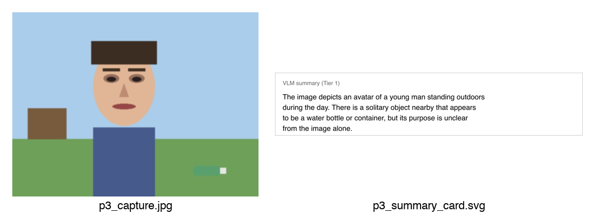
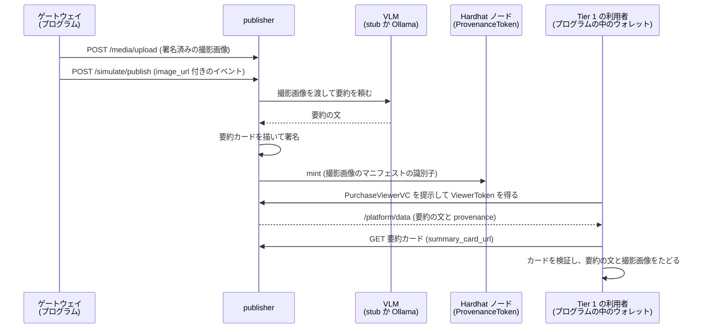
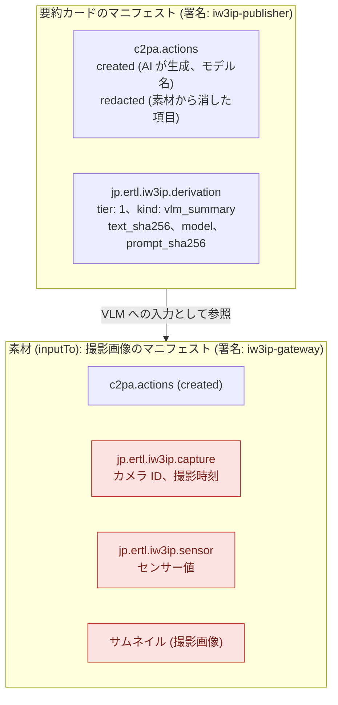
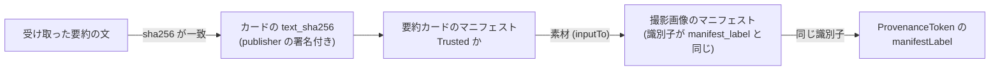

# VLM の要約から元の画像をたどる (C2PA / Stage P の P3)

[来歴を publisher とチェーンにつなぐ (C2PA / Stage P の P1・P2)](c2pa-provenance-publisher.md) では、画像に来歴を付け、publisher が Tier 2 の画像にも署名しました。ただし、Tier 1 (summary) の利用者には画像が届かず、VLM (画像を読んで文章を書く AI) が書いた要約の文だけが届きます。このページでは、その要約の文にも来歴を付けます。要約の文だけを受け取った人が、どの撮影画像から、どのモデルで作られた文かを、自分で確かめられるようにします。



左はゲートウェイが署名した撮影画像、右は publisher が VLM の要約を描いて署名した「要約カード」です。カードの来歴には、左の画像を VLM に入力して作ったことと、要約の文の sha256 が入っています。

> **やること**: publisher に VLM の要約を作らせ、要約カードの署名、要約の文との一致、撮影画像とトークンへのつながり、改ざんの検出を見る
>
> **前提**: [来歴を publisher とチェーンにつなぐ (C2PA / Stage P の P1・P2)](c2pa-provenance-publisher.md) の §1〜§3 を終えていること
>
> **起動しておくもの**: 前のページの Hardhat ノード (ProvenanceToken をデプロイしたもの)。publisher は §1 で作り直します
>
> **使うもの**: PC (本物の VLM を試す場合は、4.7 GB の llava のモデルを Docker で動かせること)
>
> **所要時間**: 約 20〜30 分 (本物の VLM を試す場合は、さらに 30 分〜1 時間)

!!! note "このページの位置付け"
    - Part 2 の 2.5 の最後のページです ([ハンズオン](index.md#25-信頼度に応じた段階アクセス-stage-t--p))。
    - [C2PA 来歴パイプライン — カメラ映像とセンサーデータの来歴証明 (Stage P 設計仕様)](../design/c2pa-provenance-spec.md) の P3 を動かすハンズオンです。
    - P3 は、Tier 1 の要約テキストの来歴 (設計仕様の §5.5) と、その見せ方 (§7.2) です。
    - VLM による要約は [意味レベルで段階化する (VLM と意味的中間表現 / Stage T)](data-user-vc-tiered-semantic.md) で扱いました。ローカルの VLM の使い方は、Part 3 の [ローカル VLM でカメラデータを意味づけ](local-vlm-distribution.md) で扱います。順番はどちらが先でも構いません。このページは、決まった文を返す stub の VLM で最後まで進められます。
    - 前のページ: [来歴を publisher とチェーンにつなぐ (C2PA / Stage P の P1・P2)](c2pa-provenance-publisher.md)
    - 次のページ: Part 3 の [ローカル VLM でカメラデータを意味づけ](local-vlm-distribution.md)

## 目的

C2PA [1] の SDK は、画像や動画には署名できますが、ただの文章 (テキスト) には署名できません。そのため P2 までは、要約の文の sha256 を `/platform/data` の行に入れ、publisher の監査ログで撮影画像と結び付けていました。この結び付けは publisher の手元の記録なので、要約の文を受け取った人は、それが本当に署名された撮影画像から作られたかを自分では確かめられません。

P3 では、publisher が要約の文を SVG の画像 (要約カード) に描き、そのカードに署名します。カードの来歴を検証すれば、受け取った人が自分で、要約の文から撮影画像とトークンまでたどれます。

## このページで分かること

- テキストに C2PA の来歴を付けるために、SVG の要約カードを使う理由
- 要約カードの来歴の中身 (VLM への入力、AI が作ったことを示すアクション、要約の文の sha256、モデル名、プロンプトの sha256)
- Tier 1 の利用者が、要約の文から撮影画像のマニフェストと ProvenanceToken までたどる手順
- 署名で分かることと、分からないこと (要約に個人につながる情報が入っていないことは、署名では示せない)

## つまずきやすい点

- このページのために publisher のプログラムが変わりました。§1 で `--build` を付けて publisher を作り直します。作り直さないと、要約カードが作られません
- 要約カードの URL (`provenance.summary_card_url`) は、要約の文を受け取る Tier にだけ届きます。カードには要約の文が描かれているためです
- 本物の VLM (Ollama の llava) は、CPU だけで動かすと 1 回の推論に 3 分以上かかることがあります。publisher の待ち時間 (`VLM_TIMEOUT_SEC`) を延ばします (§4)
- 小さなモデル (moondream) は、このページの絵に対して空の要約を返し、要約カードが作られないことがありました (§4)

## 前提

- [来歴を publisher とチェーンにつなぐ (C2PA / Stage P の P1・P2)](c2pa-provenance-publisher.md) の §1〜§3 (証明書、Hardhat ノードと ProvenanceToken、C2PA の設定での publisher の起動) を終えている
- Hardhat ノードが動いている

## 演習用プログラム

- [VLM の要約を確かめるプログラム (p3_vlm_summary.py)](https://github.com/ertlnagoya/Blockchain_IoT_Marketplace/blob/main/examples/hands_on/c2pa_provenance/p3_vlm_summary.py)
- [publisher の C2PA の処理 (c2pa_provenance.py)](https://github.com/ertlnagoya/Blockchain_IoT_Marketplace/blob/main/publisher/app/c2pa_provenance.py) の `sign_summary`
- [publisher の VLM の呼び出し (vlm_client.py)](https://github.com/ertlnagoya/Blockchain_IoT_Marketplace/blob/main/publisher/app/vlm_client.py)
- [演習説明 (README)](https://github.com/ertlnagoya/Blockchain_IoT_Marketplace/blob/main/examples/hands_on/c2pa_provenance/README.md)

`p3_vlm_summary.py` は、ゲートウェイと Tier 1 の利用者の 2 役をこなし、16 項目の確認の結果を `PASS` / `FAIL` で表示します。既定では、前のページと同じ公園の絵に署名します。

## 最短ルート

1. 教材リポジトリを最新にし、publisher を作り直す (§1)
2. `p3_vlm_summary.py` を実行し、`all checks passed` と表示されるのを見る (§2)

その後の分岐:

- 要約カードの中身と、たどる手順を詳しく見たい場合: §3 へ進みます
- 本物の VLM (Ollama の llava) で試したい場合: §4 へ進みます

## 1. 準備

教材リポジトリを最新にして、前のページで作った仮想環境を有効にします。

```bash
cd ~/program/Blockchain_IoT_Marketplace
git pull
source .venv/bin/activate
```

publisher を、前のページの §3 と同じ設定で作り直します。`PROVENANCE_TOKEN_ADDRESS` には、前のページの §2 で表示されたアドレスを入れます。

```bash
PROVENANCE_TOKEN_ADDRESS=0x5FbDB2315678afecb367f032d93F642f64180aa3 \
  docker compose -f infra/docker-compose.yml -f infra/docker-compose.c2pa.yml up -d --build publisher
```

この設定では、VLM は `stub` です。stub は、モデルを使わずに決まった文の要約を返します。まず stub で流れを確かめ、本物の VLM は §4 で試します。

## 2. 一通り動かす

```bash
python examples/hands_on/c2pa_provenance/p3_vlm_summary.py
```

成功すると、次のように表示されます (識別子と番号は実行のたびに変わります)。1 行目の版の番号は、環境によって変わります (`c2pa-python 0.38.2 / c2pa-rs 0.91.6` などと表示されることがあります)。

```
c2pa-python 0.38.1 / c2pa-rs 0.91.3
[PASS] capture is Trusted at the publisher  (200 Trusted)
[PASS] event is published  (0.2s)
[PASS] VLM wrote a summary  (model=stub-vlm/v0)
[PASS] publisher signed the summary card  (warnings=[])
  summary tier views=['event', 'description_summary']
  keys=['dataset_id', 'description_generated_at', 'description_model', 'description_summary', 'issued_at', 'payload', 'provenance', 'publisher_id', 'purpose', 'schema_version', 'subject_did']
  provenance=['anchor_tx', 'derived_sha256', 'manifest_label', 'summary_card_url', 'summary_manifest_label', 'token_contract', 'token_id', 'validation_state']
  text: [stub VLM:7f1295a9] An adult dropped a piece of litter near a public location. Source content-type: image/jpeg.
[PASS] summary tier gets the text but no image and no full description
[PASS] summary tier gets the card URL but not the gateway signer
[PASS] card is Trusted and signed by the publisher  (Trusted)
[PASS] card manifest matches provenance.summary_manifest_label
[PASS] sha256 of the received text matches the signed text_sha256  (model=stub-vlm/v0 prompt=d71d5f9db422...)
[PASS] card says the text is AI-generated  (stub-vlm/v0)
[PASS] card's input is the signed capture  (urn:c2pa:245bc7d0-...)
[PASS] capture thumbnail / camera / sensor are redacted from the card  (leaked=[] hits=0)
[PASS] ProvenanceToken anchors the card's input manifest  (token #2)
[PASS] a changed word in the text no longer matches the card  (ocation. Source content-type: elsewhere.)
[PASS] a changed letter in the card is Invalid  (Invalid)
[PASS] audit log records the summary card under provenance/derived

outputs: .../out/p3_capture.jpg, .../out/p3_summary_card.svg
all checks passed
```

処理の順番を、次の図に示します。



1. **撮影画像を送る**: 前のページと同じく、ゲートウェイの鍵で署名した撮影画像を publisher に送ります。publisher は `Trusted` と判定します (1 番目のチェック)
2. **イベントを送る**: 撮影画像の URL を入れたイベントを送ります。次の 3〜5 の処理は、このイベントを受け付ける処理の中で行われます (2 番目のチェック)
3. **VLM が要約を書く**: publisher は撮影画像を VLM に渡し、詳しい説明 (`description_full`) と要約 (`description_summary`) を作らせます (3 番目のチェック)
4. **要約カードに署名する**: publisher は、要約の文を SVG の画像に描き、自分の鍵で署名します。撮影画像を「VLM への入力」として参照し、撮影画像の来歴からサムネイル、カメラ ID、センサー値を消します。Tier 2 の画像と同じ消し方です (4 番目のチェック。§3)
5. **トークンを発行する**: 前のページと同じく、撮影画像のマニフェストの識別子を ProvenanceToken に記録します
6. **Tier 1 の利用者として読む**: summary の Tier の DataUserVC の属性で ViewerToken を得て、`/platform/data` を読みます。届くのは要約の文と `provenance` だけで、画像、詳しい説明、署名者の名前は届きません (5〜6 番目のチェック)
7. **カードを確かめる**: `summary_card_url` からカードを取得し、来歴を検証します。要約の文の sha256 がカードの `text_sha256` と同じか、カードの入力が撮影画像のマニフェストか、そのマニフェストがトークンに記録されているかを調べます (7〜13 番目のチェック)
8. **改ざんを試す**: 要約の文の最後の単語を書き換えると、sha256 がカードと合わなくなります。カードの文字を 1 つ書き換えると、カードの検証が `Invalid` になります (14〜15 番目のチェック)。最後に、監査ログに要約カードの記録があることを調べます (16 番目のチェック)

## 3. 要約カードの中身

`out/p3_summary_card.svg` をブラウザで開くと、要約の文が描かれたカードが表示されます。カードの来歴は、次の図のようになっています。publisher のマニフェストの中に、撮影画像のマニフェストが「VLM への入力」として入っています。赤い枠は消した項目です。



| 項目 | 中身 | 何が分かるか |
| --- | --- | --- |
| `c2pa.created` の `digitalSourceType` | `trainedAlgorithmicMedia` [2] | カードの中身は AI (学習済みのモデル) が作った |
| `c2pa.created` の `softwareAgent` | モデル名 (`stub-vlm/v0`、`ollama/llava` など) | どのモデルが作ったか |
| 素材の `relationship` | `inputTo` | 撮影画像は VLM への入力だった (P2 の Tier 2 の画像は `parentOf` で、「撮影画像を加工した」ことを表す) |
| `text_sha256` | 要約の文そのものの sha256 | 受け取った要約の文が、署名したときの文と同じか |
| `prompt_sha256` | 要約を作らせた指示文 (プロンプト) の sha256 | どの指示で要約を作ったか (指示文そのものは載せない) |

カードの文字は、読みやすいように折り返して描いています。そのため、要約の文との照合には、描いた文字ではなく、署名された `text_sha256` を使います。

Tier 1 の利用者は、次の順にたどります。どの矢印も、利用者が手元のデータとカードだけで確かめられます。



P2 までとの違いをまとめます。

| | P2 まで | P3 |
| --- | --- | --- |
| 要約の文と撮影画像の結び付け | publisher の監査ログ (publisher の手元の記録) | publisher が署名した要約カード |
| 利用者が自分で確かめられるか | 要約の文と `derived_sha256` の一致だけ | 要約の文から撮影画像のマニフェストとトークンまで |
| 作ったモデルとプロンプト | 分からない | カードに記録される |

!!! warning "署名で分かること、分からないこと"
    署名で分かるのは、「どの撮影画像から、どのモデルとプロンプトで、誰 (publisher) が要約を作ったか」です。
    要約の文に、個人につながる情報 (服装や持ち物、場所など) が入っていないことは、署名では示せません。それは、モデルとプロンプトで決まります (§4 の llava の例)。
    また、前のページと同じく、`manifest_label` と `token_id` はすべての Tier に届くため、Tier をまたいで同じ撮影から作られた行だと分かります。要約カードの素材も同じ撮影画像のマニフェストを指します。

## 4. 本物の VLM で試す

この節は任意です。§2 までは stub の VLM で進められます。

stub の代わりに、Ollama [3] で動く VLM を使います。初めて使う場合は、モデルのダウンロードに時間がかかります (Part 3 の [ローカル VLM でカメラデータを意味づけ](local-vlm-distribution.md) でも、同じ `--profile vlm` で VLM を起動します)。

```bash
VLM_MODEL=llava docker compose -f infra/docker-compose.yml --profile vlm up -d vlm vlm-pull
```

publisher を、VLM の設定を変えて起動し直します。`VLM_TIMEOUT_SEC` は、1 回の推論を待つ秒数です。

```bash
VLM_BACKEND=ollama VLM_MODEL=llava VLM_TIMEOUT_SEC=600 \
PROVENANCE_TOKEN_ADDRESS=0x5FbDB2315678afecb367f032d93F642f64180aa3 \
  docker compose -f infra/docker-compose.yml -f infra/docker-compose.c2pa.yml up -d publisher
```

同じプログラムを実行します。publisher は、詳しい説明と要約の 2 回、VLM に推論させます。プログラムは、その間、既定で最大 900 秒待ちます。これより長くかかる場合は、`--timeout 1500` のように秒数を指定します。

```bash
python examples/hands_on/c2pa_provenance/p3_vlm_summary.py
```

次の環境で試したところ、2 回の推論に 217 秒かかり、16 項目がすべて `PASS` になりました。

| 項目 | 内容 |
| --- | --- |
| 計算機 | Mac (Apple M3) |
| Docker に割り当てた資源 | CPU 8 個、メモリ 7.7 GB (GPU は使わない) |
| モデル | Ollama の `llava` (4.7 GB) |
| 要約のプロンプト | 人物、組織、場所の名前などを特定せず、`an adult` や `a public location` のような一般的な語で 1〜2 文にまとめるよう指示する文 ([vlm_client.py](https://github.com/ertlnagoya/Blockchain_IoT_Marketplace/blob/main/publisher/app/vlm_client.py) の `_PROMPTS_DEFAULT`) |

要約の文とカードは、次のとおりでした。

```
[PASS] event is published  (217.3s)
[PASS] VLM wrote a summary  (model=ollama/llava)
  text: The image depicts an avatar of a young man standing outdoors during the day. There is a solitary object nearby that appears to be a water bottle or container, but its purpose is unclear from the image alone.
[PASS] sha256 of the received text matches the signed text_sha256  (model=ollama/llava prompt=4e9601601877...)
[PASS] card says the text is AI-generated  (ollama/llava)
```

このページの最初の画像の右側が、このときの要約カードです。カードの `softwareAgent` は `ollama/llava` になり、`prompt_sha256` も stub のときと変わります。

この要約には「young man」(若い男性) とあります。要約のプロンプトは `an adult` のような一般的な語を使うように指示していますが、モデルは絵の人物の性別と年齢層を書きました。カードの署名は正しく、`Trusted` です。§3 の注意のとおり、署名は「誰がどう作ったか」を示すだけで、中身に個人につながる情報が無いことは示しません。

!!! note "小さなモデルでは要約が空になることがある"
    `VLM_MODEL=moondream` (1.7 GB) でも試しましたが、この絵に対しては要約のプロンプトに空の応答を返し、`vlm_unavailable` になりました。要約が無いため、要約カードも作られません。llava (4.7 GB) では要約が返りました。

## 成功例

- §2 で 16 項目がすべて `PASS` になり、`all checks passed` と表示される
- `out/p3_summary_card.svg` をブラウザで開くと、要約の文が描かれている
- §2 の出力で、summary の Tier の `provenance` に `summary_card_url` があり、`signer` が無い

## このハンズオンで確かめられないこと

- 要約の文に、個人につながる情報が入っていないこと (§3 の注意)
- VLM が画像を正しく読んだこと。要約が画像の中身と合っているかは、署名では分かりません
- 詳しい説明 (`description_full`) には、まだ署名していません。Tier 3 と Tier 2 の利用者には、署名なしで届きます
- 前のページと同じく、カメラとゲートウェイの間の区間と、写っている内容が事実かどうかは確かめられません

## 元の設定に戻す

ほかのハンズオンに戻るときは、C2PA の設定を外して publisher を起動し直します。本物の VLM を止めるときは、`vlm` のコンテナも止めます。

```bash
docker compose -f infra/docker-compose.yml up -d publisher
```

```bash
docker compose -f infra/docker-compose.yml --profile vlm stop vlm
```

## トラブル時

- 症状: `[FAIL] publisher signed the summary card  (warnings=[])` で、`provenance` に `summary_card_url` が無い
  - 確認: §1 で `--build` を付けて publisher を作り直したか
- 症状: `[FAIL] VLM wrote a summary  (model=None)` と `warnings=['vlm_unavailable']`
  - 確認: `docker compose -f infra/docker-compose.yml logs publisher | grep "vlm describe failed"` の内容を見る
  - `timed out` の場合: `VLM_TIMEOUT_SEC` を延ばして publisher を起動し直す (§4)
  - `empty/invalid response` の場合: モデルが空の要約を返しています。moondream で起きました。llava を試す
- 症状: `[FAIL] ProvenanceToken was minted  (no token_id; ...)`
  - 確認: Hardhat ノードが動いているか。前のページの §2 と §3 をやり直す
- 症状: `TimeoutError` でプログラムが止まる
  - 確認: `--timeout` を延ばして、もう一度実行する。プログラムは新しい撮影画像に署名するため、VLM の推論も最初からやり直しになります

## 次に進む

Part 2 はここで終わりです。[ハンズオン](index.md#part-2-の成功判定) の「Part 2 の成功判定」で、確かめたことを振り返れます。

次は Part 3 の [ローカル VLM でカメラデータを意味づけ](local-vlm-distribution.md) です。ローカルの VLM でカメラ画像を意味づけし、その結果を基盤で流通させます。

- Hardhat ノードは、Part 3 では使いません。Ctrl+C で止めて構いません。
- publisher は、[元の設定に戻す](#元の設定に戻す) のとおり C2PA の設定を外して起動し直します。次のページの §1 でも、VLM の設定で起動し直します。
- §4 で起動した `vlm` のコンテナは、次のページでも使うので、動かしたままで構いません。

## 参考文献

[1] C2PA, "C2PA Technical Specification, Version 2.3," <https://spec.c2pa.org/specifications/specifications/2.3/specs/C2PA_Specification.html>

[2] IPTC, "Digital Source Type," NewsCodes vocabulary, <https://cv.iptc.org/newscodes/digitalsourcetype/>

[3] Ollama, "Ollama," GitHub, <https://github.com/ollama/ollama>
