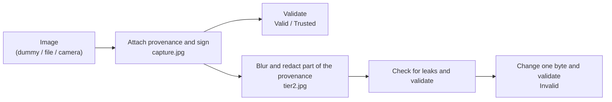

# Prove where an image came from (C2PA / Stage P)

Attach "provenance" that follows the C2PA standard [1] to an image taken with a camera, and sign it electronically. Then make a blurred Tier 2 image and confirm that, while the link to the original is kept, neither the camera ID nor the unblurred image leaks.

> **What you do**: sign a captured image with provenance, and confirm that the provenance of the Tier 2 blurred image no longer carries information that points to a person and that tampering is detected
>
> **Prerequisites**: Python 3.10 or later. The publisher, the blockchain, and the phone wallet are not used
>
> **What you use**: a PC (a USB webcam or built-in camera is optional)
>
> **Time**: about 30–40 minutes

!!! note "Where this page belongs"
    This hands-on runs P0 (the first step) of the [C2PA provenance pipeline design spec](../design/c2pa-provenance-spec.md) on your own machine.
    The C2PA mechanism and terms are explained in §2 "C2PA basics" of the design spec. The idea of Tiers 1–3 was covered in [Tier the response by trust](data-user-vc-tiered.md).
    The steps that build this into the publisher (P1 and later) are not a hands-on yet.

## Goal

Sharing surveillance-camera images as crime leads or disaster information requires being able to answer "is this image real?".
In this hands-on, you attach provenance (a manifest) describing "who took it, when, how, and how it was processed" to an image, sign it, and confirm by actually running it that the recipient can judge for themselves whether the image is genuine.
You also learn about an easily overlooked problem where the provenance itself leaks information that points to a person, and how to prevent it.

## What this page covers

- How to attach provenance to an image, sign it, and validate it
- The difference between the validation results `Valid` and `Trusted`
- That the provenance of a blurred image, by default, carries a thumbnail of the original and the camera ID, and how to remove them (redaction)
- That changing even one byte of the image is caught by validation

## Common pitfalls

- `Valid` means "the signature and hashes are correct"; it says nothing about whether the signer can be trusted. Only after you register a trusted certificate authority (CA) does the result become `Trusted`
- The certificate and key made in this hands-on are for local experiments only. They cannot be used in production, and other people's validators show them as an "untrusted signer"
- A webcam may return black frames right after it opens. The program waits up to about 3 seconds for a bright frame
- Captured images and keys are saved under `out/` and `certs/`. Both are ignored by git, so they cannot be committed by mistake

## Prerequisites

- You have the course repository `~/program/Blockchain_IoT_Marketplace` ([Environment Setup](../setup/index.md))
- Python 3.10 or later is available
- To capture with a webcam (§6), the PC can use the camera. On macOS, allow camera access for the terminal app you use (System Settings → Privacy & Security → Camera)

## Exercise programs

- [Certificate program (make_test_certs.py)](https://github.com/ertlnagoya/Blockchain_IoT_Marketplace/blob/main/examples/hands_on/c2pa_provenance/make_test_certs.py)
- [Signing and validation program (p0_sign_verify.py)](https://github.com/ertlnagoya/Blockchain_IoT_Marketplace/blob/main/examples/hands_on/c2pa_provenance/p0_sign_verify.py)
- [Exercise guide (README)](https://github.com/ertlnagoya/Blockchain_IoT_Marketplace/blob/main/examples/hands_on/c2pa_provenance/README.md)

`p0_sign_verify.py` signs a captured image, makes a Tier 2 blurred image, validates both in one run, and prints the result of 11 checks as `PASS` / `FAIL`.

## Shortest path

These 4 steps are enough at first.

1. Create a virtual environment (venv) and install the C2PA SDK (§1)
2. Create the test certificate (§2)
3. Run signing and validation once with a dummy image and confirm `all checks passed` (§3)
4. Print the provenance and see with your own eyes that the camera ID is gone from the Tier 2 image (§4)

Next branches:

- To confirm by hand that tampering is detected: go to §5
- To try with a real camera image: go to §6

## 1. Setup

At the top of the course repository, create a virtual environment and install the Python version of the C2PA SDK (Software Development Kit, a library used from programs; c2pa-python [2]), Pillow for images, and cryptography for keys.

```bash
cd ~/program/Blockchain_IoT_Marketplace
python3 -m venv .venv
source .venv/bin/activate
python -m pip install c2pa-python pillow cryptography
```

If `.venv` already exists, run only `python -m pip install ...` after `source .venv/bin/activate`. A `.venv` created with uv or a similar tool may print `No module named pip`; in that case, run `python -m ensurepip` and try again, as described in "Troubleshooting". In a newly opened terminal, before the commands from §2 on, move to the top of the course repository and then activate the virtual environment. The commands from §2 on name files with paths relative to the top of the course repository.

```bash
cd ~/program/Blockchain_IoT_Marketplace
source .venv/bin/activate
```

We write `python -m pip install` instead of `pip install` because, depending on how the virtual environment was created, it may have no `pip` command, and another `pip` already on the PC gets called instead. `python -m pip` always installs into the virtual environment's Python.

Check that it is installed.

```bash
python -c "import c2pa; print(c2pa.sdk_version())"
```

Success if a version number such as `0.91.3` is printed (the number depends on when you install).

## 2. Create the test certificate

A C2PA signature requires a certificate issued by a certificate authority (CA). In production you get a certificate from a CA approved by C2PA, but in this hands-on you create your own CA and use it to issue a certificate for the gateway (the device that signs next to the camera).

```bash
python examples/hands_on/c2pa_provenance/make_test_certs.py
```

It prints the following (the path depends on your environment).

```
wrote .../examples/hands_on/c2pa_provenance/certs/ca.pem, chain.pem, gw.key (CN=iw3ip-gateway)
```

The three files it creates are:

| File | Content | Role |
| --- | --- | --- |
| `ca.pem` | Certificate of your own CA | The validator registers it as "I trust this CA" |
| `chain.pem` | Gateway certificate and CA certificate | Embedded in the image with the signature to show who signed |
| `gw.key` | Gateway private key | Used for signing. Never give it to anyone |

Note that the certificate name (CN) is `iw3ip-gateway` and does not contain the camera ID (`cam01`). This is because the certificate name cannot be redacted even from the blurred image made later (§4).

## 3. Run signing and validation once

Run everything once with a dummy image (an image the program draws, with a circle standing in for a face).

```bash
python examples/hands_on/c2pa_provenance/p0_sign_verify.py
```

On success it prints:

```
c2pa-python 0.38.1 / c2pa-rs 0.91.3
[PASS] capture without trust anchor is Valid + untrusted  (Valid)
[PASS] capture with test CA is Trusted  (Trusted)
[PASS] custom assertions are in the capture manifest  (c2pa.actions.v2, jp.ertl.iw3ip.capture, jp.ertl.iw3ip.sensor)
[PASS] Tier 2 derivative is Trusted  (Trusted)
[PASS] capture/sensor assertions are redacted  (leaked=[])
[PASS] no unblurred thumbnail via the ingredient
[PASS] capture manifest thumbnail is redacted
[PASS] capture title has no camera ID  (capture.jpg)
[PASS] signer certificate name has no camera ID  (iw3ip-gateway)
[PASS] camera ID appears nowhere in the Tier 2 bytes  (0 hit(s))
[PASS] one flipped byte makes the derivative Invalid  (Invalid)

outputs: .../out/capture.jpg, .../out/tier2.jpg
all checks passed
```

The program works as shown in the following diagram.



At each step in the diagram, the program does the following:

1. **Sign the captured image**: attach provenance stating that it was captured (`c2pa.actions`), the camera ID and capture time (`jp.ertl.iw3ip.capture`), and sensor readings (`jp.ertl.iw3ip.sensor`), sign it with the gateway key, and save it as `out/capture.jpg`
2. **Validate**: without registering the CA, the result is `Valid` (the signature is correct, but whether to trust the signer is unknown); with `ca.pem` registered, it is `Trusted` (checks 1–2). It also confirms that the custom assertions (`jp.ertl.iw3ip.capture` and `jp.ertl.iw3ip.sensor`) are in the provenance (check 3)
3. **Make the Tier 2 blurred image**: blur the whole image, attach provenance that references the original as an "ingredient", and save it as `out/tier2.jpg`. At this point, the thumbnail, camera ID, and sensor readings are redacted from the original's provenance
4. **Check for leaks**: confirm that the Tier 2 image validates as `Trusted` (check 4). Then confirm that the thumbnail of the original, the camera ID, and the sensor readings are not left in the provenance of the Tier 2 image (checks 5–10)
5. **Check that tampering is detected**: change one byte of the Tier 2 image, validate it, and confirm it becomes `Invalid` (check 11)

The two saved images look like this (left: the dummy captured image; right: the blurred Tier 2 image). The right one only looks blurred, but it contains part of the left image's provenance. §4 prints what is inside.


!!! note "About the blur"
    The program in this hands-on blurs the whole image without detecting faces. Blurring only faces was covered by the face blur in [Tier by semantic level](data-user-vc-tiered-semantic.md).

## 4. Look inside the provenance

Look at the provenance itself, not just the check results. The following command reads the provenance of both images and prints the manifests and assertions they contain.

```bash
python - <<'EOF'
import json
import c2pa
for name in ["capture", "tier2"]:
    path = f"examples/hands_on/c2pa_provenance/out/{name}.jpg"
    store = json.loads(c2pa.Reader(path).json())
    print(f"=== {name}.jpg")
    for label, m in store["manifests"].items():
        mark = "(this file)" if label == store["active_manifest"] else "(ingredient)"
        print(" ", mark, "title:", m.get("title"), "| signer:", m["signature_info"].get("common_name"))
        print("    assertions:", [a["label"] for a in m["assertions"]])
        for a in m["assertions"]:
            if a["label"] == "jp.ertl.iw3ip.capture":
                print("    camera:", a["data"])
EOF
```

It prints the following (`(this file)` and `(ingredient)` may appear in either order).

```
=== capture.jpg
  (this file) title: capture.jpg | signer: iw3ip-gateway
    assertions: ['c2pa.actions.v2', 'jp.ertl.iw3ip.capture', 'jp.ertl.iw3ip.sensor']
    camera: {'camera_id': 'cam01', 'captured_at': '...', 'gateway_did': 'did:jwk:<gateway>'}
=== tier2.jpg
  (ingredient) title: capture.jpg | signer: iw3ip-gateway
    assertions: ['c2pa.actions.v2']
  (this file) title: tier2.jpg | signer: iw3ip-gateway
    assertions: ['c2pa.actions.v2', 'jp.ertl.iw3ip.derivation']
```

Look at three things:

- The provenance of `capture.jpg` contains the camera ID (`cam01`) and the capture time
- `tier2.jpg` contains the original's provenance as `(ingredient)`, which shows that "this image was made from the original"
- However, only `c2pa.actions.v2` (the record that it was captured) remains in `(ingredient)`; the camera ID and sensor readings were redacted. Even so, `tier2.jpg` still validates as `Trusted`

The signature survives redaction because the original's signature covers the **hashes** of its assertions. Removing the content leaves the hashes, so the signature still validates. See §5.3 of the design spec for details.

The `title` and `signer` of `(ingredient)` cannot be redacted and remain. That is why the captured image's title (`capture.jpg`) and the certificate name (`iw3ip-gateway`) do not contain the camera ID.

## 5. Try tampering

Try by hand what check 11 of §3 did. Make `tampered.jpg` by changing one byte of the pixel data of `tier2.jpg`, and validate it next to the original.

```bash
python - <<'EOF'
import c2pa
out = "examples/hands_on/c2pa_provenance/out/"
data = bytearray(open(out + "tier2.jpg", "rb").read())
data[-10] ^= 0xFF
open(out + "tampered.jpg", "wb").write(data)
for name in ["tier2.jpg", "tampered.jpg"]:
    reader = c2pa.Reader(out + name)
    codes = [s["code"] for s in reader.get_validation_results()["activeManifest"]["failure"]]
    print(name, reader.get_validation_state(), codes)
EOF
```

It prints:

```
tier2.jpg Valid ['signingCredential.untrusted']
tampered.jpg Invalid ['signingCredential.untrusted', 'assertion.dataHash.mismatch']
```

This command validates without registering the CA, so even the original is `Valid` (`signingCredential.untrusted`) rather than `Trusted`. The tampered image additionally shows `assertion.dataHash.mismatch` (the pixel-data hash does not match) and becomes `Invalid`.
A one-byte difference that is almost invisible to the eye is still caught by validating the provenance.

## 6. Capture with a webcam

Run the same checks with a real camera image. Install OpenCV as well, then run with `--webcam`.

```bash
python -m pip install "opencv-python<5"
python examples/hands_on/c2pa_provenance/p0_sign_verify.py --webcam
```

Success if, as in §3, all 11 checks are `PASS` and `all checks passed` is printed. Open the captured image and the blurred image to check them (on macOS).

```bash
open examples/hands_on/c2pa_provenance/out/capture.jpg examples/hands_on/c2pa_provenance/out/tier2.jpg
```

To use an image file of your own, pass `--image <file path>` instead of `--webcam` (JPEG or PNG).

## Success criteria

- In §3, all 11 checks are `PASS` and `all checks passed` is printed
- In §4, `jp.ertl.iw3ip.capture` is absent from the `(ingredient)` of `tier2.jpg`
- In §5, `tampered.jpg` is `Invalid`

## What this hands-on cannot show

What C2PA guarantees is "this signer signed this content", not "what the image shows is true".
In this hands-on, the camera and the gateway (the signing program) are on the same PC. With a real surveillance camera, if the footage is swapped between the camera and the gateway, C2PA cannot detect it. See §4 "Trust boundaries" of the design spec for this limitation and how to think about countermeasures.

## Troubleshooting

- Symptom: `ModuleNotFoundError: No module named 'c2pa'`
  - Check: did you activate the virtual environment (`source ~/program/Blockchain_IoT_Marketplace/.venv/bin/activate`)?
  - Check: did you run `python -m pip install c2pa-python pillow cryptography` from §1?
- Symptom: `No module named pip`
  - Check: this happens when `.venv` was created by a method that does not include pip, such as uv. Run `python -m ensurepip`, then run `python -m pip install ...` again
- Symptom: `.../certs/chain.pem not found; run make_test_certs.py first`
  - Check: did you run `make_test_certs.py` from §2?
- Symptom: `[FAIL] signer certificate name has no camera ID  (iw3ip-gateway-cam01; rerun make_test_certs.py)`
  - Check: a certificate made by an older version of `make_test_certs.py` is left over. Run `make_test_certs.py` again
- Symptom: `webcam capture failed (no camera access, or every frame was black)`
  - Check (macOS): under System Settings → Privacy & Security → Camera, is the terminal app you use allowed? Restart the terminal after allowing it
  - Check: is another app using the camera? Is the lens covered, or is the room too dark?
  - Check: did you try another camera with `--camera-index 1` or similar?
- Symptom: `ModuleNotFoundError: No module named 'cv2'`
  - Check: did you run `python -m pip install "opencv-python<5"` from §6?

## References

[1] C2PA, "C2PA Technical Specification, Version 2.3," <https://spec.c2pa.org/specifications/specifications/2.3/specs/C2PA_Specification.html>

[2] Content Authenticity Initiative, "c2pa-python: Python binding for the C2PA SDK," GitHub, <https://github.com/contentauth/c2pa-python>
