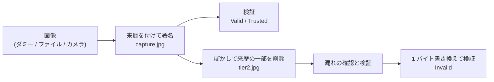
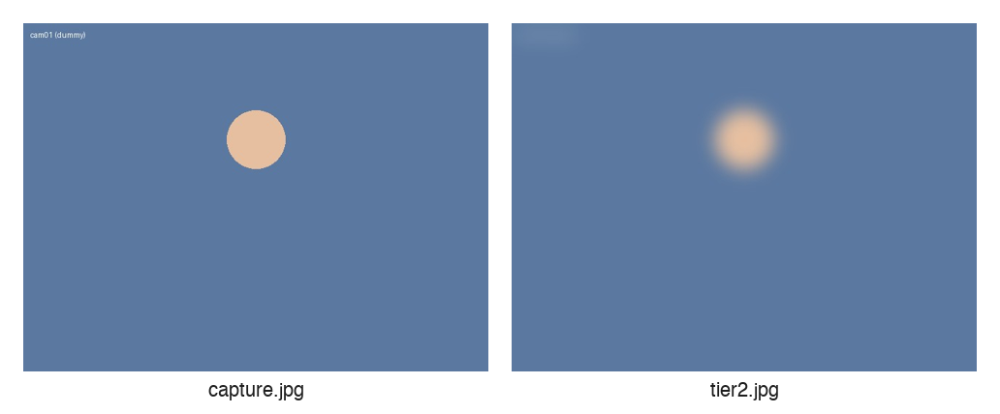

# 画像の来歴を証明する (C2PA / Stage P)

カメラで撮った画像に、C2PA [1] の規格に沿った「来歴」を付けて電子署名します。そのうえで、ぼかしをかけた Tier 2 の画像を作り、元の画像とのつながりを保ったまま、カメラ ID やぼかす前の画像が漏れないことを確認します。

> **やること**: 撮影画像に来歴を付けて署名し、Tier 2 のブラー画像の来歴から個人につながる情報が消えていること、改ざんが見破れることを確かめる
>
> **前提**: Python 3.10 以上が使えること。publisher、ブロックチェーン、スマホのウォレットは使いません
>
> **使うもの**: PC (USB ウェブカメラまたは内蔵カメラは任意)
>
> **所要時間**: 約 30〜40 分

!!! note "このページの位置付け"
    [C2PA 来歴パイプラインの設計仕様](../design/c2pa-provenance-spec.md) の P0 (最初の段階) を手元で動かすハンズオンです。
    C2PA の仕組みと用語は、設計仕様の §2「C2PA の基本」で説明しています。Tier 1〜3 の考え方は [信頼度に応じて見せる中身を変える](data-user-vc-tiered.md) で扱いました。
    publisher に組み込んで動かす段階 (P1 以降) は、まだハンズオンになっていません。

## 目的

監視カメラの画像を犯罪の手がかりや防災の情報として共有するには、「この画像は本物か」に答えられる必要があります。
このハンズオンでは、画像に「誰が、いつ、どう撮って、どう加工したか」を書いた来歴 (マニフェスト) を付けて署名し、受け取った人が本物かどうかを自分で判断できることを、実際に動かして確認します。
あわせて、来歴そのものから個人につながる情報が漏れるという見落としやすい問題と、その防ぎ方を学びます。

## このページで分かること

- 画像に来歴を付けて署名し、検証する流れ
- 検証の結果の `Valid` と `Trusted` の違い
- ぼかした画像の来歴に、元の画像のサムネイルやカメラ ID が既定では付いてくること、それを取り除く方法 (削除、redaction)
- 画像を 1 バイトでも書き換えると、検証で見破れること

## つまずきやすい点

- `Valid` は「署名とハッシュは正しい」という意味で、署名した人を信頼してよいかは含みません。信頼する認証局 (CA) を登録したときだけ `Trusted` になります
- このハンズオンで作る証明書と鍵は、手元で試すためのものです。本番では使えず、ほかの人の検証ツールでは「信頼されていない署名者」と表示されます
- ウェブカメラは、開いた直後のフレームを黒で返すことがあります。プログラムは明るいフレームが出るまで最大で約 3 秒待ちます
- 撮った画像と鍵は `out/` と `certs/` に保存されます。どちらも git の対象外なので、誤ってコミットされることはありません

## 前提

- 教材リポジトリ `~/program/Blockchain_IoT_Marketplace` を手元に用意している ([環境構築](../setup/index.md))
- Python 3.10 以上が使える
- ウェブカメラで撮る場合 (§6) は、PC からカメラが使える。macOS では、使うターミナルのアプリにカメラの使用を許可する (システム設定 → プライバシーとセキュリティ → カメラ)

## 演習用プログラム

- [証明書を作るプログラム (make_test_certs.py)](https://github.com/ertlnagoya/Blockchain_IoT_Marketplace/blob/main/examples/hands_on/c2pa_provenance/make_test_certs.py)
- [署名と検証を確かめるプログラム (p0_sign_verify.py)](https://github.com/ertlnagoya/Blockchain_IoT_Marketplace/blob/main/examples/hands_on/c2pa_provenance/p0_sign_verify.py)
- [演習説明 (README)](https://github.com/ertlnagoya/Blockchain_IoT_Marketplace/blob/main/examples/hands_on/c2pa_provenance/README.md)

`p0_sign_verify.py` は、撮影画像への署名、Tier 2 のブラー画像の作成、検証までを 1 回で行い、11 項目の確認の結果を `PASS` / `FAIL` で表示します。

## 最短ルート

最初は次の 4 手順で十分です。

1. 仮想環境 (venv) を作り、C2PA の SDK を入れる (§1)
2. テスト用の証明書を作る (§2)
3. ダミー画像で署名と検証を一通り動かし、`all checks passed` を確かめる (§3)
4. 来歴の中身を表示して、Tier 2 の画像からカメラ ID が消えていることを自分の目で確かめる (§4)

その後の分岐:

- 改ざんが見破れることを自分の手で確かめたい場合: §5 へ進みます
- 実際のカメラ画像で試したい場合: §6 へ進みます

## 1. 準備

教材リポジトリのトップで仮想環境を作り、C2PA の Python 版の SDK (Software Development Kit、プログラムから使う部品集。c2pa-python [2]) と、画像を扱う Pillow、鍵を扱う cryptography を入れます。

```bash
cd ~/program/Blockchain_IoT_Marketplace
python3 -m venv .venv
source .venv/bin/activate
python -m pip install c2pa-python pillow cryptography
```

すでに `.venv` がある場合は、`source .venv/bin/activate` のあとに `python -m pip install ...` だけを実行します。新しく開いたターミナルでは、先に `source ~/program/Blockchain_IoT_Marketplace/.venv/bin/activate` を実行します。

`pip install` ではなく `python -m pip install` と書くのは、仮想環境の作り方によっては `pip` コマンドが無く、PC に前から入っている別の `pip` が呼ばれてしまうことがあるためです。`python -m pip` なら、必ず仮想環境の Python に入ります。

入ったことを確かめます。

```bash
python -c "import c2pa; print(c2pa.sdk_version())"
```

`0.91.3` のような版の番号が表示されれば成功です (番号は入れた時期によって変わります)。

## 2. テスト用の証明書を作る

C2PA の署名には、認証局 (CA) が発行した証明書が要ります。本番では C2PA が認めた CA から証明書を受け取りますが、このハンズオンでは自分で CA を作り、その CA でゲートウェイ (カメラの隣で署名する機器) の証明書を発行します。

```bash
python examples/hands_on/c2pa_provenance/make_test_certs.py
```

次のように表示されます (パスは環境によって変わります)。

```
wrote .../examples/hands_on/c2pa_provenance/certs/ca.pem, chain.pem, gw.key (CN=iw3ip-gateway)
```

作られる 3 つのファイルの役割は次のとおりです。

| ファイル | 中身 | 役割 |
| --- | --- | --- |
| `ca.pem` | 自分で作った CA の証明書 | 検証する側が「この CA を信頼する」と登録する |
| `chain.pem` | ゲートウェイの証明書と CA の証明書 | 署名と一緒に画像に埋め込まれ、誰が署名したかを示す |
| `gw.key` | ゲートウェイの秘密鍵 | 署名に使う。人に渡してはいけない |

証明書の名前 (CN) が `iw3ip-gateway` で、カメラ ID (`cam01`) を含まないことに注目してください。証明書の名前は、あとで作るブラー画像からも削除できないためです (§4)。

## 3. 署名と検証を一通り動かす

ダミー画像 (プログラムが描いた、顔の代わりの丸がある画像) を使って、一通り動かします。

```bash
python examples/hands_on/c2pa_provenance/p0_sign_verify.py
```

成功すると、次のように表示されます。

```
c2pa-python 0.38.1 / c2pa-rs 0.91.3
[PASS] capture without trust anchor is Valid + untrusted  (Valid)
[PASS] capture with test CA is Trusted  (Trusted)
[PASS] custom assertions are in the capture manifest  (c2pa.actions.v2, jp.ertl.iw3ip.capture, jp.ertl.iw3ip.sensor)
[PASS] Tier 2 derivative is Trusted  (Trusted)
[PASS] capture/sensor assertions are redacted  (leaked=[])
[PASS] no unblurred thumbnail via the ingredient
[PASS] capture manifest thumbnail is redacted
[PASS] capture title has no camera ID  (capture.jpg)
[PASS] signer certificate name has no camera ID  (iw3ip-gateway)
[PASS] camera ID appears nowhere in the Tier 2 bytes  (0 hit(s))
[PASS] one flipped byte makes the derivative Invalid  (Invalid)

outputs: .../out/capture.jpg, .../out/tier2.jpg
all checks passed
```

プログラムの処理の流れは、次の図のとおりです。



図の各段階で、プログラムは次のことをしています。

1. **撮影画像に署名する**: 画像に、撮ったこと (`c2pa.actions`)、カメラ ID と撮影時刻 (`jp.ertl.iw3ip.capture`)、センサー値 (`jp.ertl.iw3ip.sensor`) を書いた来歴を付け、ゲートウェイの鍵で署名して `out/capture.jpg` に保存します
2. **検証する**: CA を登録せずに検証すると `Valid` (署名は正しいが、署名した人を信頼してよいかは分からない)、`ca.pem` を登録して検証すると `Trusted` になります (1〜2 行目)
3. **Tier 2 のブラー画像を作る**: 画像全体をぼかし、元の画像を「素材 (ingredient)」として参照する来歴を付けて `out/tier2.jpg` に保存します。このとき、元の来歴からサムネイル、カメラ ID、センサー値を削除 (redaction) します
4. **漏れが無いかを確かめる**: Tier 2 の画像の来歴に、元の画像のサムネイル、カメラ ID、センサー値が残っていないことを確かめます (5〜10 行目)
5. **改ざんを見破れるかを確かめる**: Tier 2 の画像を 1 バイトだけ書き換えて検証し、`Invalid` になることを確かめます (11 行目)

保存された 2 枚の画像は、次のようになります (左がダミーの撮影画像、右がぼかした Tier 2 の画像)。見た目はぼかしただけですが、右の画像の中には、左の画像の来歴の一部が入っています。中身は §4 で表示します。



!!! note "ぼかしについて"
    このハンズオンのプログラムは、顔を検出せずに画像全体をぼかします。顔だけをぼかす処理は、[意味レベルで段階化する](data-user-vc-tiered-semantic.md) の顔ブラーで扱いました。

## 4. 来歴の中身を見る

確認の結果だけでなく、来歴の中身を自分の目で見てみます。次のコマンドは、2 つの画像の来歴を読み、含まれているマニフェストとアサーションを表示します。

```bash
python - <<'EOF'
import json
import c2pa
for name in ["capture", "tier2"]:
    path = f"examples/hands_on/c2pa_provenance/out/{name}.jpg"
    store = json.loads(c2pa.Reader(path).json())
    print(f"=== {name}.jpg")
    for label, m in store["manifests"].items():
        mark = "(this file)" if label == store["active_manifest"] else "(ingredient)"
        print(" ", mark, "title:", m.get("title"), "| signer:", m["signature_info"].get("common_name"))
        print("    assertions:", [a["label"] for a in m["assertions"]])
        for a in m["assertions"]:
            if a["label"] == "jp.ertl.iw3ip.capture":
                print("    camera:", a["data"])
EOF
```

次のように表示されます (`(this file)` と `(ingredient)` の順は入れ替わることがあります)。

```
=== capture.jpg
  (this file) title: capture.jpg | signer: iw3ip-gateway
    assertions: ['c2pa.actions.v2', 'jp.ertl.iw3ip.capture', 'jp.ertl.iw3ip.sensor']
    camera: {'camera_id': 'cam01', 'captured_at': '...', 'gateway_did': 'did:jwk:<gateway>'}
=== tier2.jpg
  (this file) title: tier2.jpg | signer: iw3ip-gateway
    assertions: ['c2pa.actions.v2', 'jp.ertl.iw3ip.derivation']
  (ingredient) title: capture.jpg | signer: iw3ip-gateway
    assertions: ['c2pa.actions.v2']
```

見るところは次の 3 つです。

- `capture.jpg` の来歴には、カメラ ID (`cam01`) と撮影時刻が入っています
- `tier2.jpg` には、元の画像の来歴が `(ingredient)` として入っており、「この画像は元の画像から作られた」ことが分かります
- ただし、`(ingredient)` に残っているのは `c2pa.actions.v2` (撮ったという記録) だけで、カメラ ID とセンサー値は削除されています。それでも `tier2.jpg` の検証は `Trusted` のままです

削除しても署名が壊れないのは、元の来歴の署名が、各アサーションの**ハッシュ**に対して付いているためです。中身を取り除いてもハッシュは残るので、署名は検証できます。詳しくは設計仕様の §5.3 を参照してください。

`(ingredient)` の `title` と `signer` は、削除できずに残っています。そのため、撮影画像の題名 (`capture.jpg`) と証明書の名前 (`iw3ip-gateway`) には、カメラ ID を入れていません。

## 5. 改ざんしてみる

§3 の 11 行目と同じことを、自分の手で試します。`tier2.jpg` の画素のデータを 1 バイトだけ書き換えた `tampered.jpg` を作り、元の画像と並べて検証します。

```bash
python - <<'EOF'
import c2pa
out = "examples/hands_on/c2pa_provenance/out/"
data = bytearray(open(out + "tier2.jpg", "rb").read())
data[-10] ^= 0xFF
open(out + "tampered.jpg", "wb").write(data)
for name in ["tier2.jpg", "tampered.jpg"]:
    reader = c2pa.Reader(out + name)
    codes = [s["code"] for s in reader.get_validation_results()["activeManifest"]["failure"]]
    print(name, reader.get_validation_state(), codes)
EOF
```

次のように表示されます。

```
tier2.jpg Valid ['signingCredential.untrusted']
tampered.jpg Invalid ['signingCredential.untrusted', 'assertion.dataHash.mismatch']
```

このコマンドは CA を登録せずに検証しているので、元の画像も `Trusted` ではなく `Valid` (`signingCredential.untrusted`) になります。書き換えた画像には、それに加えて `assertion.dataHash.mismatch` (画素のデータのハッシュが合わない) が出て、`Invalid` になります。
見た目ではほとんど区別できない 1 バイトの違いでも、来歴の検証で見破れます。

## 6. ウェブカメラで撮る

実際のカメラの画像で、同じ確認を行います。OpenCV を追加で入れてから、`--webcam` を付けて実行します。

```bash
python -m pip install "opencv-python<5"
python examples/hands_on/c2pa_provenance/p0_sign_verify.py --webcam
```

§3 と同じく 11 項目が `PASS` になり、`all checks passed` と表示されれば成功です。撮った画像とブラー画像を開いて確かめます (macOS の場合)。

```bash
open examples/hands_on/c2pa_provenance/out/capture.jpg examples/hands_on/c2pa_provenance/out/tier2.jpg
```

手元の画像ファイルを使いたい場合は、`--webcam` の代わりに `--image <ファイルのパス>` を付けます (JPEG か PNG)。

## 成功例

- §3 で 11 項目がすべて `PASS` になり、`all checks passed` と表示される
- §4 で、`tier2.jpg` の `(ingredient)` に `jp.ertl.iw3ip.capture` が無い
- §5 で、`tampered.jpg` が `Invalid` になる

## このハンズオンで確かめられないこと

C2PA が保証するのは「この署名者がこの中身に署名した」ことであり、「写っている内容が事実である」ことではありません。
このハンズオンでは、カメラとゲートウェイ (署名するプログラム) が同じ PC の中にあります。実際の監視カメラでは、カメラからゲートウェイまでの区間で映像を差し替えられると、C2PA では見破れません。この限界と対策の考え方は、設計仕様の §4「信頼の境界」を参照してください。

## トラブル時

- 症状: `ModuleNotFoundError: No module named 'c2pa'`
  - 確認: 仮想環境を有効にしたか (`source ~/program/Blockchain_IoT_Marketplace/.venv/bin/activate`)
  - 確認: §1 の `python -m pip install c2pa-python pillow cryptography` を実行したか
- 症状: `No module named pip`
  - 確認: `.venv` を uv など pip を含まない方法で作った場合に起きます。`python -m ensurepip` を実行してから、もう一度 `python -m pip install ...` を実行する
- 症状: `.../certs/chain.pem not found; run make_test_certs.py first`
  - 確認: §2 の `make_test_certs.py` を実行したか
- 症状: `[FAIL] signer certificate name has no camera ID (iw3ip-gateway-cam01; rerun make_test_certs.py)`
  - 確認: 以前の版の `make_test_certs.py` で作った証明書が残っています。`make_test_certs.py` を実行し直す
- 症状: `webcam capture failed (no camera access, or every frame was black)`
  - 確認 (macOS): システム設定 → プライバシーとセキュリティ → カメラ で、使っているターミナルのアプリが許可されているか。許可したあとはターミナルを起動し直す
  - 確認: 別のアプリがカメラを使っていないか。カメラのレンズがふさがれていないか、部屋が暗すぎないか
  - 確認: `--camera-index 1` などで、別のカメラを試したか
- 症状: `ModuleNotFoundError: No module named 'cv2'`
  - 確認: §6 の `python -m pip install "opencv-python<5"` を実行したか

## 参考文献

[1] C2PA, "C2PA Technical Specification, Version 2.3," <https://spec.c2pa.org/specifications/specifications/2.3/specs/C2PA_Specification.html>

[2] Content Authenticity Initiative, "c2pa-python: Python binding for the C2PA SDK," GitHub, <https://github.com/contentauth/c2pa-python>
