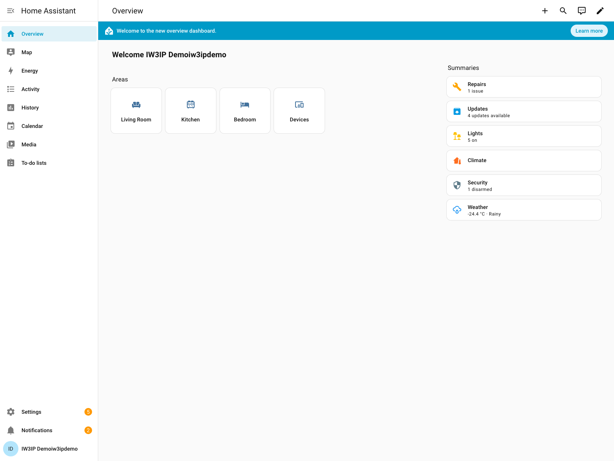
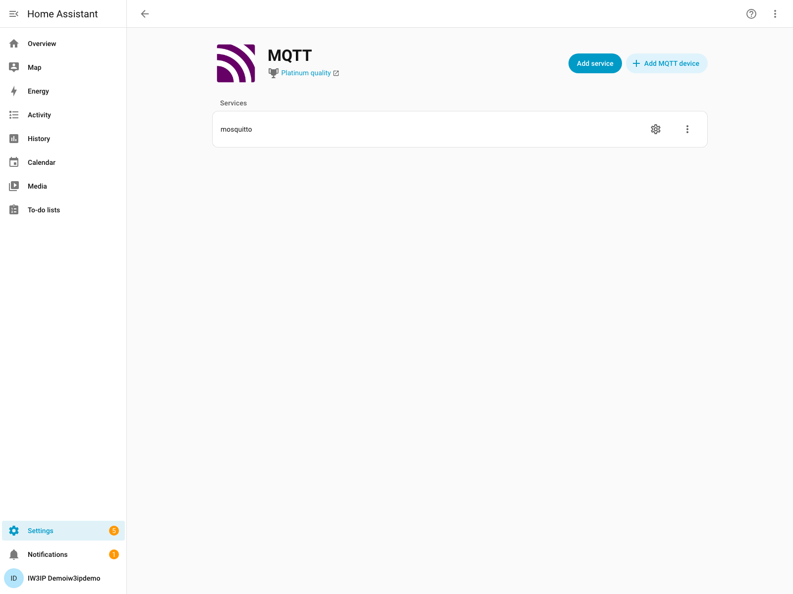
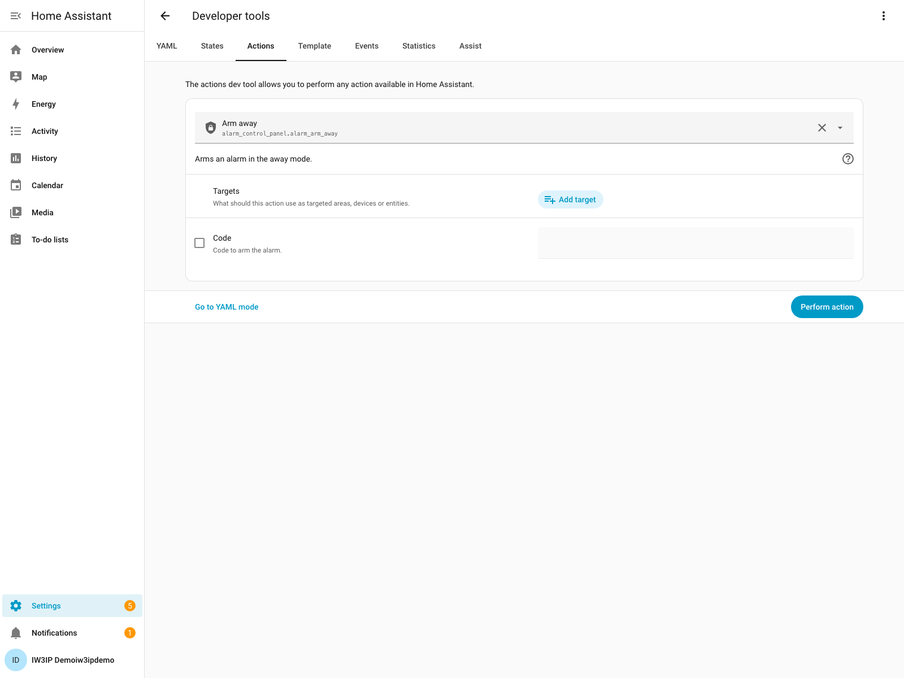
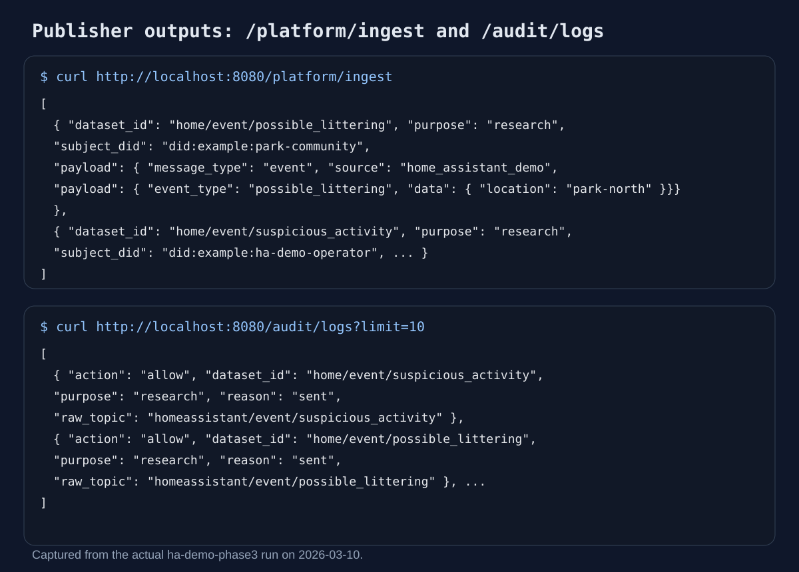
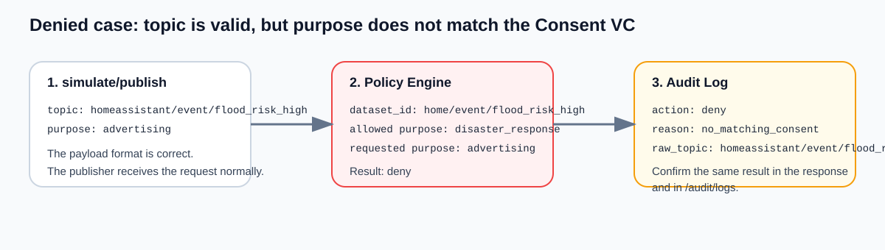
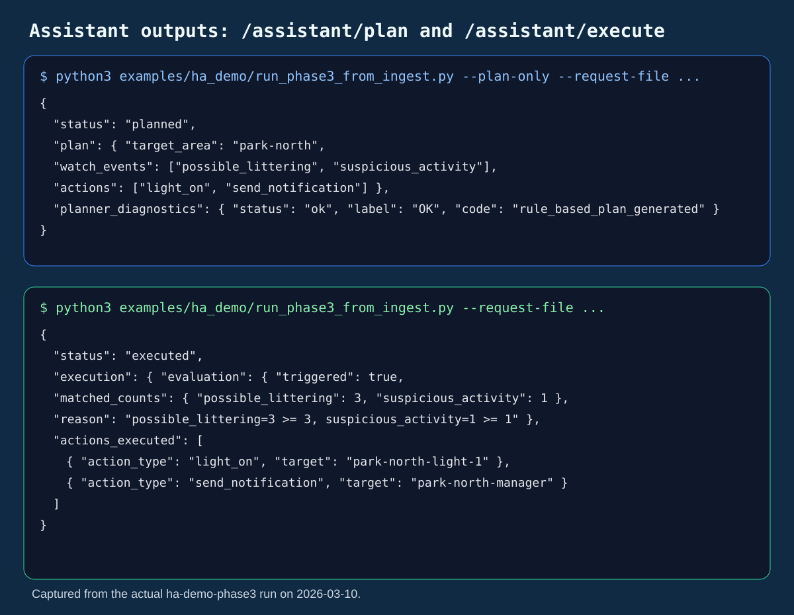

# Run the whole pipeline without hardware (HA Demo Simulator)

A page that runs data generation through sharing in a minimal setup, using Home Assistant's `demo` mode with no real device. A good one to try first.

> **What you'll do**: Stream Home Assistant demo data into the publisher and watch it in the browser
>
> **Prerequisites**: [Environment Setup](../setup/index.en.md) is done
>
> **What you need**: PC only (Docker is enough)
>
> **Time required**: approx. 20 min

## Goal

This is a **minimal simulation environment for trying the Home Assistant and IW3IP integration without real devices**.

It uses Home Assistant `demo` entities to reproduce the following local flow:

`Home Assistant demo -> MQTT -> (optional Node-RED) -> Data Publisher -> Platform API / Audit Log`

This page uses one environment to show Phase 1 state sharing, Phase 2 event sharing, and a Phase 3 assistant execution flow.

## Shortest path

For a first pass, these five steps are enough.

1. `PLATFORM_INGEST_READ_ENABLED=true docker compose -f infra/docker-compose.yml --profile ha-demo up --build -d`
2. Open `http://localhost:8123` and add the `MQTT` integration
3. Register the Consent VCs
4. Run `script.iw3ip_publish_demo_temperature` or `script.iw3ip_publish_demo_possible_littering` from `Developer Tools -> Actions`
5. Check the shared result with `curl http://localhost:8080/platform/ingest`

Branches:

- If you only want Phase 1: send `temperature` and `power`, then inspect `platform/ingest`
- If you want to continue to Phase 2: send `possible_littering` and inspect both `allow` and `deny`
- If you want to continue to Phase 3: start `ha-demo-phase3` and run `run_phase3_from_ingest.py --plan-only`

## What this page covers

- how to reproduce `temperature`, `power`, `person_detected`, `flood_risk_high`, and `possible_littering` without real devices
- how IW3IP publisher receives, normalizes, and records data coming from Home Assistant through MQTT
- the difference between Phase 1 state sharing and Phase 2 event sharing
- how Consent VC changes `allowed` and `denied`
- how to pass the events accumulated in `/platform/ingest` to the Phase 3 `assistant`

## Common issues

- starting Home Assistant alone is not enough; you must add the `MQTT` integration before the scripts can publish
- if Consent VCs are not registered, the scripts may run but the expected sharing behavior will not appear
- Home Assistant can publish an event correctly and the publisher can still reject it if `purpose` does not match
- because there are no physical devices, the flow is easier to lose sight of, so check both `/platform/ingest` and `/audit/logs`
- in Phase 3 it is easy to mix up sharing and execution, because publisher and assistant are separate services

## Prerequisites

- Docker / Docker Compose
- a browser that can open `http://localhost:8123`
- `curl`
- if IPFS started in [Quickstart](../setup/quickstart.en.md) is still running, stop it first from the source repository with `cd ~/program/Blockchain_IoT_Marketplace/ipfs && docker compose down` (IPFS and the publisher both use port 8080)

This hands-on assumes the source-code repository `Blockchain_IoT_Marketplace` on the `main` branch.

Main matching files:

- [README (English)](https://github.com/ertlnagoya/Blockchain_IoT_Marketplace/blob/main/README.md)
- [README (Japanese)](https://github.com/ertlnagoya/Blockchain_IoT_Marketplace/blob/main/README_ja.md)
- [examples/ha_demo/README.md](https://github.com/ertlnagoya/Blockchain_IoT_Marketplace/blob/main/examples/ha_demo/README.md)
- [configuration.yaml](https://github.com/ertlnagoya/Blockchain_IoT_Marketplace/blob/main/home-assistant-demo/config/configuration.yaml)
- [scripts.yaml](https://github.com/ertlnagoya/Blockchain_IoT_Marketplace/blob/main/home-assistant-demo/config/scripts.yaml)
- [run_phase3_from_ingest.py](https://github.com/ertlnagoya/Blockchain_IoT_Marketplace/blob/main/examples/ha_demo/run_phase3_from_ingest.py)

## Phase 1: Confirm the basic state-sharing path

In Phase 1, the goal is to confirm that the basic path from Home Assistant to the publisher is working. It is enough to send one state-oriented dataset first and confirm that it appears in `platform/ingest`.

### 1. Start services

Start the simulation environment. `PLATFORM_INGEST_READ_ENABLED=true` enables `GET /platform/ingest`, which this page uses to inspect ingested data. It is a demo-only API that returns every row without authentication and is disabled (404) unless set. From Part 2 onward, reads use a token obtained by presenting a VC.

```bash
cd ~/program/Blockchain_IoT_Marketplace
PLATFORM_INGEST_READ_ENABLED=true docker compose -f infra/docker-compose.yml --profile ha-demo up --build -d
```

If you also want Node-RED:

```bash
PLATFORM_INGEST_READ_ENABLED=true docker compose -f infra/docker-compose.yml --profile ha-demo --profile nodered up --build -d
```

Check:

```bash
curl http://localhost:8080/health
```

Expected:

```json
{"status":"ok","service":"publisher"}
```

### 2. Initial Home Assistant setup

Open:

- `http://localhost:8123`

On the first run, create a local user. After logging in, first confirm that the Overview page opens correctly.

Real screen example:



What to check:

- `Settings` is visible in the lower-left navigation
- the central page is the normal `Overview` screen
- login has completed and the standard dashboard is open

Then open `Settings -> Devices & Services -> Integrations` and add the `MQTT` integration.

Settings:

- Host: `mosquitto`
- Port: `1883`

The purpose of this step is to make `mqtt.publish` available from Home Assistant scripts. After the integration is added, the setup for this hands-on is ready when the `MQTT` detail screen shows the `mosquitto` service.

Real screen example:



What to check:

- the integration name `MQTT` is visible
- the `mosquitto` service is shown
- once this screen is visible, Home Assistant is ready to use `mqtt.publish`

### 3. Register Consent VCs

Register the Consent VCs used by the demo datasets.

```bash
curl -X POST http://localhost:8080/consents -H 'Content-Type: application/json' -d @examples/ha_demo/consent_temperature.json
curl -X POST http://localhost:8080/consents -H 'Content-Type: application/json' -d @examples/ha_demo/consent_power.json
curl -X POST http://localhost:8080/consents -H 'Content-Type: application/json' -d @examples/ha_demo/consent_person_detected.json
curl -X POST http://localhost:8080/consents -H 'Content-Type: application/json' -d @examples/ha_demo/consent_flood_risk_high.json
curl -X POST http://localhost:8080/consents -H 'Content-Type: application/json' -d @examples/ha_demo/consent_possible_littering.json
curl -X POST http://localhost:8080/consents -H 'Content-Type: application/json' -d @examples/ha_demo/consent_suspicious_activity.json
```

Expected:

- each response includes `"status":"stored"`

Matching files:

- [consent_temperature.json](https://github.com/ertlnagoya/Blockchain_IoT_Marketplace/blob/main/examples/ha_demo/consent_temperature.json)
- [consent_power.json](https://github.com/ertlnagoya/Blockchain_IoT_Marketplace/blob/main/examples/ha_demo/consent_power.json)
- [consent_person_detected.json](https://github.com/ertlnagoya/Blockchain_IoT_Marketplace/blob/main/examples/ha_demo/consent_person_detected.json)
- [consent_flood_risk_high.json](https://github.com/ertlnagoya/Blockchain_IoT_Marketplace/blob/main/examples/ha_demo/consent_flood_risk_high.json)
- [consent_possible_littering.json](https://github.com/ertlnagoya/Blockchain_IoT_Marketplace/blob/main/examples/ha_demo/consent_possible_littering.json)
- [consent_suspicious_activity.json](https://github.com/ertlnagoya/Blockchain_IoT_Marketplace/blob/main/examples/ha_demo/consent_suspicious_activity.json)

### 4. Send demo data from Home Assistant

In Home Assistant, open `Developer Tools -> Actions` and run these scripts. In practice, it is easiest to choose `script.turn_on` in the action selector and then specify the target script entity.

Real screen example:



What to check:

- the `Actions` tab is selected
- `script.turn_on` can be chosen in the action selector
- the execution button can be used to invoke the target script

- `script.iw3ip_publish_demo_temperature`
- `script.iw3ip_publish_demo_power`
- `script.iw3ip_publish_demo_person_detected`
- `script.iw3ip_publish_demo_flood_risk_high`
- `script.iw3ip_publish_demo_possible_littering`
- `script.iw3ip_publish_demo_suspicious_activity`
- `script.iw3ip_publish_demo_phase3_safety_scenario`

These scripts call `mqtt.publish` defined in `scripts.yaml`.

Phase mapping:

- Phase 1:
  - `temperature`
  - `power`
  - `person_detected`
- Phase 2:
  - `flood_risk_high`
  - `possible_littering`
  - `suspicious_activity`

### 5. Check publisher results

After running a Home Assistant script, inspect the publisher side.

```bash
curl http://localhost:8080/platform/ingest
curl 'http://localhost:8080/audit/logs?limit=10'
```

Checkpoints:

- `platform/ingest` contains sent records
- `audit/logs` contains `allow`
- `dataset_id`, `purpose`, `message_hash`, and `raw_topic` are visible

The important point here is not only whether data was sent, but also under which conditions it was allowed.

Example output:



Focus points:

- `/platform/ingest` contains both `home/event/possible_littering` and `home/event/suspicious_activity`
- `/audit/logs` shows `action: allow` with the expected `raw_topic`

So far you have confirmed that events matching a registered consent are shared. The next exercise checks what happens when a consent expires.

### Exercise: an expired consent causes denials

The bundled `examples/ha_demo/consent_*.json` files have `valid_to` set to `2030-12-31T23:59:59Z`, so nothing expires as shipped. Here you deliberately register an expired `possible_littering` consent, confirm that events are denied, and then fix it. This shows how a VC's validity period (`valid_from`–`valid_to`) works.

#### Step 1. Register an expired consent

Send the consent to `/consents` with `valid_to` rewritten to a past date. The file itself is not changed. Consents are overwritten per `vc_id`, so this replaces the one you registered in step 3.

```bash
sed 's/"valid_to": "2030-12-31T23:59:59Z"/"valid_to": "2026-05-01T00:00:00Z"/' examples/ha_demo/consent_possible_littering.json \
  | curl -X POST http://localhost:8080/consents -H 'Content-Type: application/json' -d @-
```

Confirm the response has `"status":"stored"` and `valid_to` is `2026-05-01T00:00:00Z`.

If you have already done [Share USB camera events](webcam-event-sharing.md), a valid consent for the same `possible_littering` (`consent-littering-001`) remains and no denial happens. Check with `curl http://localhost:8080/consents`, and if it is there, delete it with the command below. Register `examples/consent_possible_littering.json` again if you need it after this exercise.

```bash
curl -X DELETE http://localhost:8080/consents/consent-littering-001
```

Then run `script.iw3ip_publish_demo_possible_littering` and `script.iw3ip_publish_demo_suspicious_activity` from step 4.

#### Step 2. Confirm the denial in the audit log

Read the audit log. In zsh, quote the URL because `?` is treated as a glob.

```bash
curl 'http://localhost:8080/audit/logs?limit=20'
```

Look at `action` / `dataset_id` / `reason` / `subject_did`.

??? question "What should you be able to read off?"
    - `possible_littering` has `action: "deny"`, `reason: "no_matching_consent"`, and `subject_did: "unknown"`.
    - `suspicious_activity` has `action: "allow"`, `reason: "sent"`, and `subject_did` holds the data subject DID of the matching consent (`did:example:ha-demo-operator`).
    - So the problem is not that a consent is missing, but that no *matching* consent is found.

#### Step 3. Find the cause

List the registered consents and compare `valid_from` and `valid_to` for `possible_littering` and `suspicious_activity`.

```bash
curl http://localhost:8080/consents
```

??? tip "Hint"
    `valid_from`–`valid_to` is the VC's validity period. If **today's date falls outside this range**, the consent does not match.

#### Step 4. Fix and re-register

Re-register the original file (`valid_to` in 2030) and confirm the response contains `"status":"stored"`.

```bash
curl -X POST http://localhost:8080/consents -H 'Content-Type: application/json' -d @examples/ha_demo/consent_possible_littering.json
```

#### Step 5. Re-send the event and verify

Run `script.iw3ip_publish_demo_possible_littering` again, then confirm the event now appears in `/platform/ingest`.

```bash
curl 'http://localhost:8080/platform/ingest'
```

??? note "If it still fails"
    - Existing `deny` entries remain in the log as history. Always verify with **a new event sent after the consent was re-registered**.
    - If it is still denied, check that the event's `purpose` is included in the consent's `allowed_purposes`.
    - See the "`no_matching_consent`" item in [Troubleshooting](../operations/troubleshooting.md) for details.

#### Something to think about

Why do VCs have an expiry at all? Consider what becomes safer compared with consent that never expires, and how you would operate the system when a consent expires in production.

Once this part works, the basic sharing path from Home Assistant to the publisher is in place. Next, confirm a rejection caused by a `purpose` mismatch.

## Phase 2: Confirm event sharing and denial

### 6. Check a denied case

The Home Assistant scripts mainly exercise allowed paths, so use HTTP simulation to confirm denial.

```bash
curl -X POST http://localhost:8080/simulate/publish \
  -H 'Content-Type: application/json' \
  -d '{
    "topic":"homeassistant/event/flood_risk_high",
    "payload":{
      "event_type":"flood_risk_high",
      "data":{"zone":"river-west","severity":"high"},
      "ts":"2026-03-10T10:05:00Z",
      "source":"home_assistant_demo"
    },
    "purpose":"advertising"
  }'
```

Expected:

```json
{"status":"denied","dataset_id":"home/event/flood_risk_high","reason":"no_matching_consent"}
```

This makes it clear that generating an event and being allowed to share it are separate questions.

How to read the flow:



What to check here:

- the input topic can be correct and still be rejected when `purpose` does not match the Consent VC
- you should confirm the rejection in both the `simulate/publish` response and `audit/logs`

### 7. Test the MQTT path directly

You can also publish directly to the same topic without Home Assistant.

```bash
docker exec -i iw3ip-mosquitto mosquitto_pub \
  -h localhost -p 1883 \
  -t homeassistant/event/possible_littering \
  -m "$(cat examples/ha_demo/payload_possible_littering.json)"
```

Related files:

- [payload_temperature.json](https://github.com/ertlnagoya/Blockchain_IoT_Marketplace/blob/main/examples/ha_demo/payload_temperature.json)
- [payload_power.json](https://github.com/ertlnagoya/Blockchain_IoT_Marketplace/blob/main/examples/ha_demo/payload_power.json)
- [payload_person_detected.json](https://github.com/ertlnagoya/Blockchain_IoT_Marketplace/blob/main/examples/ha_demo/payload_person_detected.json)
- [payload_flood_risk_high.json](https://github.com/ertlnagoya/Blockchain_IoT_Marketplace/blob/main/examples/ha_demo/payload_flood_risk_high.json)
- [payload_possible_littering.json](https://github.com/ertlnagoya/Blockchain_IoT_Marketplace/blob/main/examples/ha_demo/payload_possible_littering.json)

By the end of Phase 2, it should be clear that a valid MQTT path does not automatically mean that sharing is allowed. Phase 3 then takes the accepted events and forwards them into the assistant layer for request interpretation and execution.

## Phase 3: Confirm assistant planning and execution

### 8. Try Phase 3

In Phase 3, the events accumulated by the publisher are converted into `assistant` `observed_events`, and then you inspect `plan -> execute`.

Start:

```bash
PLATFORM_INGEST_READ_ENABLED=true docker compose -f infra/docker-compose.yml --profile ha-demo-phase3 up --build -d
```

Then run this Home Assistant script:

- `script.iw3ip_publish_demo_phase3_safety_scenario`

That script publishes the following sequence for `park-north`:

- three `possible_littering` events
- one `suspicious_activity` event

Next, inspect the `plan` first:

```bash
python3 examples/ha_demo/run_phase3_from_ingest.py \
  --plan-only \
  --request-file examples/ha_demo/phase3_request_park_safety.json
```

At this stage, check:

- `status` is `planned`
- `plan.watch_events` includes `possible_littering` and `suspicious_activity`
- `plan.actions` includes `light_on` and `send_notification`

Example output:

```json
{
  "status": "planned",
  "plan": {
    "target_area": "park-north",
    "watch_events": ["possible_littering", "suspicious_activity"],
    "actions": [
      {"action_type": "light_on", "target": "park-north-light-1"},
      {"action_type": "send_notification", "target": "park-north-manager"}
    ]
  }
}
```

Then pass the events accumulated in the publisher to the assistant and check `execute`:

```bash
python3 examples/ha_demo/run_phase3_from_ingest.py \
  --request-file examples/ha_demo/phase3_request_park_safety.json
```

Expected:

- `execution.evaluation.triggered` is `true`
- `actions_executed` includes `light_on` and `send_notification`

At this stage, the important point is that request interpretation (`plan`) and execution against observed events (`execute`) are separate steps.

Example output:



Focus points in `execute`:

- `evaluation.triggered` is `true`
- `matched_counts.possible_littering` is 3 or more
- `matched_counts.suspicious_activity` is 1 or more
- `actions_executed` contains two actions

`/platform/ingest` still holds the events sent in earlier steps, so any `park-north` events from step 4 or the exercise that are still inside the time window are counted too. To see exactly 3 and 1, restart the publisher with `docker compose -f infra/docker-compose.yml restart publisher` before running the script (the stored events are in memory and are cleared; registered consents are kept).

## Additional notes

### 9. If you want to use Node-RED

Node-RED is useful when you want easier manual injection or time-based pseudo events.

Import flow:

- [nodered_flows.json](https://github.com/ertlnagoya/Blockchain_IoT_Marketplace/blob/main/examples/ha_demo/nodered_flows.json)

Node-RED is optional in this setup.  
It is better to first understand the full path with Home Assistant demo alone, and only then add Node-RED if you want clearer event injection.

### 10. What is Phase 1, Phase 2, and Phase 3 here?

This sample lets you go through Phase 1, Phase 2, and Phase 3 in a single environment.

- Phase 1:
  - state sharing such as `temperature` and `power`
  - basic receive, normalize, send, and record flow
- Phase 2:
  - event sharing such as `flood_risk_high` and `possible_littering`
  - conditional sharing based on `purpose` and Consent VC
- Phase 3:
  - pass publisher events to the assistant and execute the plan
  - inspect `triggered` and `actions_executed`

This page therefore also serves as a connection point to the following hands-on pages:

- [Pull from Home Assistant (HA SSI Publisher)](ha-ssi-publisher.md) (Phase 1)
- [Share disaster events](environment-disaster.md) (Phase 2)
- [Run the regional safety assistant](regional-safety-assistant.md) (Phase 3)

### 11. Stop services

Whether or not you started Node-RED or Phase 3, this one command stops everything:

```bash
docker compose -f infra/docker-compose.yml --profile ha-demo --profile ha-demo-phase3 --profile nodered down
```

## Future extensions

This sample is the entry point for understanding the basic IW3IP path with Home Assistant. If you want to expand the scope later, the following environments are natural next steps.

### FIWARE

FIWARE is an IoT platform family centered on `Context Broker` and `IoT Agent` components for cities, facilities, and multi-organization data flows [1]. It is heavier than Home Assistant, but it is a strong candidate when you want to study cross-system sharing and subscription-based notification. Its official tutorials [2] walk through the components step by step.

### Eclipse Ditto

Eclipse Ditto is a digital-twin platform for device state and command handling [3]. Combined with IW3IP Phase 3, it is useful when you want to trace not only shared events but also later state updates and control results. Connecting devices over MQTT is described in [4].

### CARLA

CARLA is a simulator for urban spaces, vehicles, pedestrians, and virtual sensors [5]. It is much heavier than Home Assistant, but it becomes useful when you want advanced event-generation scenarios for safety, disaster response, and mobility in Phase 2 or Phase 3. Its usage is described in the documentation [6].

## References

[1] FIWARE Foundation, "FIWARE," <https://www.fiware.org/>

[2] FIWARE Foundation, "FIWARE Step-By-Step Tutorials," <https://fiware-tutorials.readthedocs.io/en/latest/>

[3] Eclipse Foundation, "Eclipse Ditto," <https://eclipse.dev/ditto/>

[4] Eclipse Foundation, "Eclipse Ditto Documentation: MQTT protocol binding," <https://eclipse.dev/ditto/connectivity-protocol-bindings-mqtt.html>

[5] CARLA Team, "CARLA Simulator," <https://carla.org/>

[6] CARLA Team, "CARLA Simulator Documentation," <https://carla.readthedocs.io/>
