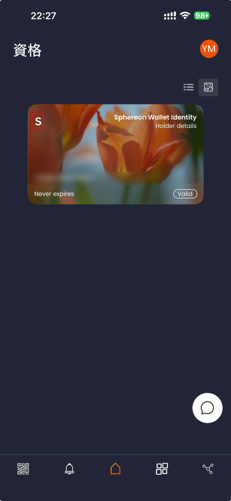
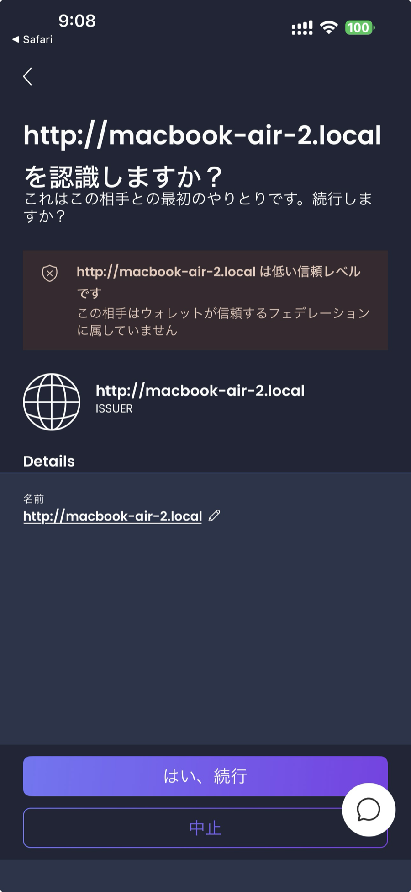
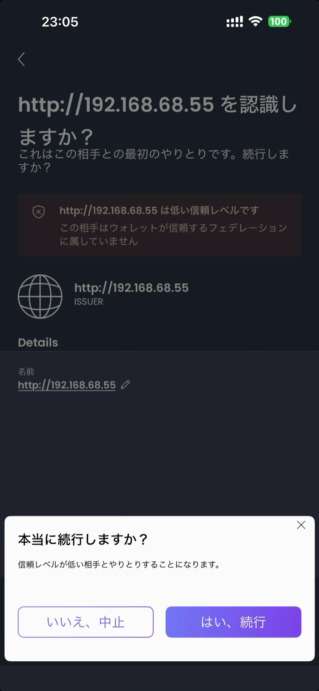
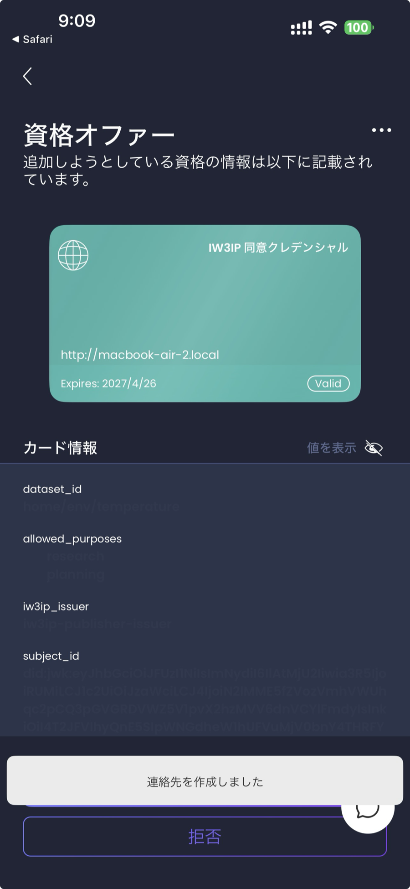
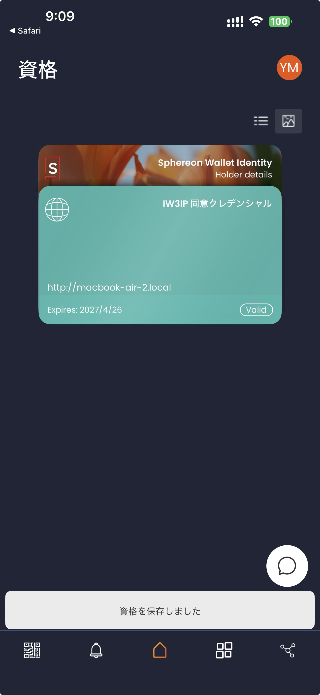
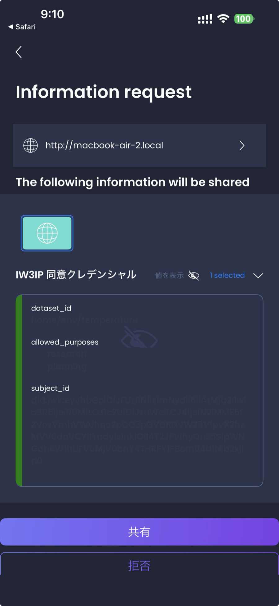
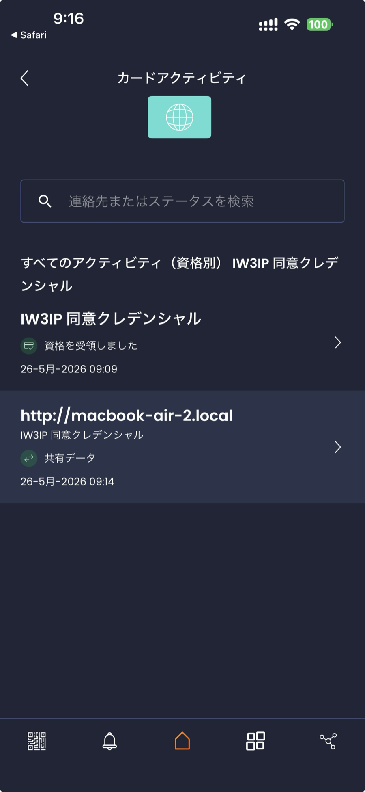

# Authenticate the data provider (Consent VC / Stage 1)

Receive a VC into a smartphone SSI wallet (iw3ip-wallet), then present it to authorize a data action. This is the first hands-on in Part 2 (Feature Extensions) that uses a VC. It replaces the JSON you registered at `/consents` in Stage 0 ([Share detections, not raw frames](webcam-event-sharing.md), [Share disaster events](environment-disaster.md)) with a VC presentation.

> **What you'll do**: Receive a Consent VC on your phone and present it to allow a write
>
> **Prerequisites**: [Pull from Home Assistant (HA SSI Publisher)](ha-ssi-publisher.md) or [Run the whole pipeline without hardware (HA Demo Simulator)](ha-demo-simulator.md) finished, and ideally Stage 0 ([Share detections, not raw frames](webcam-event-sharing.md) or [Share disaster events](environment-disaster.md))
>
> **What you need**: PC + smartphone with iw3ip-wallet
>
> **Time required**: approx. 60 min

!!! note "Wallet used on this page"
    This page uses [`iw3ip-wallet`](https://github.com/ertlnagoya/iw3ip-wallet),
    a fork of Sphereon mobile-wallet [1].

!!! tip "Choosing a dataset"
    The examples on this page use `home/env/temperature`. The same steps
    work with `home/event/possible_littering`, the webcam event from Stage 0
    ([Share detections, not raw frames](webcam-event-sharing.md)); substitute the dataset
    and purpose in that case. Stage numbers are explained in the
    [Hands-on overview](index.md#part-phase-stage).

## Goal

Try the flow where a smartphone SSI wallet presents a Consent VC,
the IW3IP backend verifies it via OID4VP, and only verified requests
receive shared event data.

The existing [Pull from Home Assistant (HA SSI Publisher)](ha-ssi-publisher.md) registers
a Consent-VC-shaped policy JSON directly via `/consents`. This sample
moves to the actual SSI model: **the wallet presents a VC -> verifier
validates it -> allowed/denied**.

Terms used on this page:

- **OID4VCI** (OpenID for Verifiable Credential Issuance): the protocol for issuing a VC and handing it to a wallet [2]
- **OID4VP** (OpenID for Verifiable Presentations): the protocol for a wallet to present a VC [3]
- **Issuer / Verifier**: the side that issues a VC / the side that verifies a presented VC. In this hands-on, the publisher plays both roles
- **Presentation Definition (PD)**: the verifier's request describing which VC and which fields it wants presented. Defined in the PEX (Presentation Exchange) spec (an implementation: `@sphereon/pex` [4])
- **SD-JWT VC**: a JWT-format VC that lets the holder disclose only selected fields [5]
- **did:jwk**: a DID whose identifier is the public key (JWK) itself
- **PolicyToken**: a short-lived authorization token the publisher issues after the VC presentation is verified

Pipeline:

`Mobile wallet (holds VC) -> QR/Deeplink -> OID4VP Verifier -> Platform API -> Event sharing`

## What this page covers

- The basic flow of issuing a VC to the wallet (OID4VCI) and presenting it (OID4VP)
- How the verifier's Presentation Definition (PEX) maps to the wallet's response
- A lightweight stack using `did:jwk` and SD-JWT VC
- How `allowed` / `denied` depends on VC content and `purpose`

## Common issues

- If the Presentation Definition `input_descriptors` disagree with the VC
  claims, the wallet reports "no matching credential"
- DID method mismatches between issuer / wallet / verifier cause signature failures
- SD-JWT VC, W3C VC-JWT, and mdoc are not interchangeable; pin one format
- QR redirect fails if the phone and PC are on different networks
  (same prerequisite as [Open the marketplace and buy on a phone (v1)](mobile-viewer.md))

## Prerequisites

- Docker / Docker Compose available
- PC and phone on the same LAN
- `$HOST_IP` in commands and `<HOST_IP>` in URLs stand for the PC's LAN IP. In each terminal you use, first run `export HOST_IP=<your PC's LAN IP>` (see the [Hands-on overview](index.md#host-ip) for how to find it). Replace `<HOST_IP>` in URLs you type into a browser or phone with the same IP
- Installable `iw3ip-wallet` (fork) build on the phone
  (TestFlight / internal APK / Expo dev build)
- You have started the publisher once via [Pull from Home Assistant (HA SSI Publisher)](ha-ssi-publisher.md) or [Run the whole pipeline without hardware (HA Demo Simulator)](ha-demo-simulator.md)

## Related repositories

- `iw3ip-wallet`: <https://github.com/ertlnagoya/iw3ip-wallet>
  - upstream: Sphereon-Opensource/mobile-wallet [1]
  - Branch policy: `main` tracks upstream; `iw3ip/*` carries IW3IP-specific changes
- [Blockchain_IoT_Marketplace](https://github.com/ertlnagoya/Blockchain_IoT_Marketplace): publisher (includes the OID4VCI / OID4VP endpoints; started with the `ssi-wallet` profile)

## Shortest path

The intended flow is 5 steps:

1. Start the publisher with the issuer / verifier profile enabled
2. Open `iw3ip-wallet` on the phone; scan the issuer QR to receive a Consent VC
3. Scan the verifier QR shown on the PC screen
4. The wallet selects the matching VC and presents it
5. Confirm `allow` (with `reason` `ok`) in the publisher's `/audit/logs`

Next branches:

- To see a denial: change `purpose` to one not covered by the VC and re-present
- Revocation: not implemented yet; see [Extension ideas](#extension-ideas) for the idea
- To compare with Phase 1: observe that audit logs now capture presentation
  events rather than direct `/consents` registration

## 1. Start

```bash
cd ~/program/Blockchain_IoT_Marketplace
docker compose -f infra/docker-compose.yml --profile ssi-wallet up --build -d
```

Check:

```bash
curl http://localhost:8080/health
curl http://localhost:8080/.well-known/openid-credential-issuer
```

## 2. Inspect Presentation Definition

```bash
curl http://localhost:8080/verifier/presentation-definitions/consent-temperature
```

Points to verify:

- `input_descriptors` include constraints on `dataset_id` and `allowed_purposes`
- Format is `vc+sd-jwt`

## 3. Open the wallet

Open `iw3ip-wallet` on the phone and complete first-run setup.
An initial key is generated as `did:jwk`.

Right after first run, only the wallet's own card (Holder details) is shown.

{ width="220" }

## 4. Issue via issuer QR

Open in the PC browser:

```txt
http://<HOST_IP>:8080/issuer/offer?type=ConsentVC&dataset_id=home/env/temperature&purpose=research
```

Scan the displayed QR with the wallet. Because this is the first interaction with the publisher, the wallet asks for confirmation. Choose "はい、続行" (Yes, continue), and answer the follow-up confirmation the same way. The hands-on publisher is not in the wallet's trusted list, so it is shown as a low trust level.

| Confirm the party | Confirm to continue |
|---|---|
| { width="220" } | { width="220" } |

The wallet shows the content of the VC being issued; accept it. Once stored, "IW3IP 同意クレデンシャル" (IW3IP consent credential) appears in the list.

| Content of the offered VC | List after storing |
|---|---|
| { width="220" } | { width="220" } |

## 5. Present via verifier QR

Open in the PC browser:

```txt
http://<HOST_IP>:8080/verifier/request?dataset_id=home/env/temperature&purpose=research
```

Scan the QR with the wallet. It shows the request and the fields of the VC to be presented; review them and choose "共有" (Share).

{ width="220" }

The result goes back to the wallet and is not shown in the PC browser. On the PC, check it in the audit log.

```bash
curl 'http://localhost:8080/audit/logs?limit=3'
```

If the top (newest) entry has `action` `allow` and `reason` `ok`, it worked. The publisher log also shows a line for the issued PolicyToken.

```bash
docker compose -f infra/docker-compose.yml logs publisher 2>&1 | grep policy_token_issued
```

For reference, the response returned to the wallet looks like this:

```json
{
  "status": "allowed",
  "dataset_id": "home/env/temperature",
  "vc_kind": "ConsentVC",
  "policy_token": "VHA9X1d...",
  "policy_token_jti": "9b2fc3...",
  "expires_in": 300
}
```

`policy_token` is the short-lived authorization token used in §8.
It is valid for 5 minutes and single-use: one call to `/platform/ingest`
consumes it.

## 6. Denial case

Change `purpose` to `marketing` and present again.

```txt
http://<HOST_IP>:8080/verifier/request?dataset_id=home/env/temperature&purpose=marketing
```

As in §5, check the audit log on the PC. The top entry has `action` `deny` and `reason` `purpose_mismatch`.

```bash
curl 'http://localhost:8080/audit/logs?limit=3'
```

For reference, the response returned to the wallet looks like this:

```json
{
  "status": "denied",
  "dataset_id": "home/env/temperature",
  "reason": "purpose_mismatch",
  "human_message_ja": "提示された VC の許可目的に、今回の用途が含まれていません。",
  "human_message_en": "The presented VC's allowed_purposes does not cover this purpose."
}
```

Holding the VC is not enough; the verifier's constraints must also match.

## 7. Audit log check

```bash
curl 'http://localhost:8080/audit/logs?limit=10'
```

Points to verify:

- `presentation_verified` events are recorded with `allow` / `deny`
- `holder_did`, `vc_hash`, `purpose` are preserved
- Compared with HA SSI Publisher, the log additionally records
  "who presented which VC" rather than just the policy outcome

The wallet keeps a history as well. Open the VC card to see when it was received and when it was presented to which party.

{ width="220" }

## 8. Write data with the PolicyToken

Pass the `policy_token` from §5 as a `Authorization: Bearer` header to
`/platform/ingest` to write data backed by the verified VC.
The legacy `/consents` JSON registration path still works without a header.

PolicyToken properties:

- TTL: 5 minutes (returned as `expires_in`)
- Single-use: one successful `/platform/ingest` call invalidates it
- Scope: only accepts a body whose `dataset_id` matches the issuance time
- Format: opaque string (server-side in-memory)

Request. Replace `<policy_token>` with the value after `token=` in the `policy_token_issued` line of the publisher log (see the end of this section).

```bash
TOKEN='<policy_token>'

curl -X POST http://$HOST_IP:8080/platform/ingest \
  -H "Authorization: Bearer $TOKEN" \
  -H "Content-Type: application/json" \
  -d '{
    "dataset_id":"home/env/temperature",
    "purpose":"research",
    "value":21.4
  }'
```

Expected result:

```json
{"status":"received","count":N}
```

The audit log gains a PolicyToken consumption entry:

```bash
curl "http://$HOST_IP:8080/audit/logs?limit=5"
```

```json
{
  "action": "allow",
  "raw_topic": "platform/ingest",
  "reason": "policy_token_consumed:9b2fc3...",
  "dataset_id": "home/env/temperature",
  "purpose": "research",
  "holder_did": "did:jwk:...",
  "presentation_verified": "allow"
}
```

Error cases:

| Situation | HTTP | `detail` |
| --- | --- | --- |
| Reusing the same token | 403 | `policy_token_already_consumed` |
| Expired | 401 | `policy_token_expired` |
| Body `dataset_id` differs from token | 403 | `policy_token_dataset_mismatch` |
| Unknown token | 401 | `policy_token_unknown` |

The token is returned to the wallet as the `/verifier/response` response,
so it is not shown in the PC browser. After the presentation
finishes, check the publisher log, find the line
`policy_token_issued jti=... token=... dataset=... ttl=...s`, and copy the
value after `token=` into `<policy_token>` above.

```bash
docker compose -f infra/docker-compose.yml logs publisher 2>&1 | grep policy_token_issued | tail -n 1
```

If more than 5 minutes have passed since §5, or `policy_token_expired` is returned, the token has expired. Redo the presentation in §5 and use the `token=` value from the newest (last) line printed by the command above.

## Next steps

This hands-on (Stage 1) only covers **single-use write authorization**
(ConsentVC + PolicyToken). Other forms of authorization are covered on the following pages.

- [Authenticate the viewer (Viewer VC / Stage 3)](ha-ssi-viewer.md) — reads, any number of times within the TTL (ViewerVC)
- [Authenticate machines (Service VC / Stage 4 prep)](ha-ssi-service.md) — continuous writes from a device (ServiceVC)
- [Hand a credential to the buyer's wallet (Bridge / Stage 5)](marketplace-vc-bridge.md) — purchase-bound read (PurchaseViewerVC)
- [Read ServiceVC-written data with a PurchaseViewerVC (Stage 6)](marketplace-vc-end-to-end.md) — capstone of Stage 1–5
- [Back the seller's identity (Seller VC / Stage 7)](marketplace-seller-vc.md) — seller identity

## Extension ideas

- **Revocation (not implemented)**: the current publisher has no revoke endpoint.
  Extend it to publish a revocation list (e.g. Status List 2021) so that a
  revoked VC results in `denied` for the same presentation
- **SIOPv2 holder auth**: verify the holder's DID alongside the presentation
- **Phase 3 integration**: require VC presentation before
  [Let an AI plan the steps (LLM Planner)](llm-planner.md) `plan` execution, lifting the check into
  the intelligence layer

## Troubleshooting

- Symptom: wallet shows "no matching credential"
  - Check: Presentation Definition `vct` / claims vs the VC's contents
- Symptom: signature verification error
  - Check: DID methods align across issuer / verifier / wallet
  - Check: clock skew (`iat` / `exp`) is within tolerance
- Symptom: QR does not open
  - Check: phone and PC are on the same LAN (see [Open the marketplace and buy on a phone (v1)](mobile-viewer.md))

## References

[1] Sphereon, "mobile-wallet," GitHub repository, <https://github.com/Sphereon-Opensource/mobile-wallet>

[2] OpenID Foundation, "OpenID for Verifiable Credential Issuance 1.0," <https://openid.net/specs/openid-4-verifiable-credential-issuance-1_0.html>

[3] OpenID Foundation, "OpenID for Verifiable Presentations 1.0," <https://openid.net/specs/openid-4-verifiable-presentations-1_0.html>

[4] Sphereon, "pex," GitHub repository, <https://github.com/Sphereon-Opensource/pex>

[5] O. Terbu, D. Fett, and B. Campbell, "SD-JWT-based Verifiable Digital Credentials (SD-JWT VC)," IETF Internet-Draft draft-ietf-oauth-sd-jwt-vc-19, Aug. 2026, <https://datatracker.ietf.org/doc/draft-ietf-oauth-sd-jwt-vc-19/>
