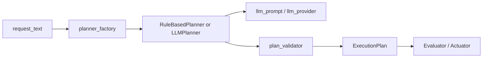

# AI に手順を考えさせる (LLM Planner)

Phase 3 の [地域安全アシスタントを動かす](regional-safety-assistant.md) の rule-based planner を、LLM（Large Language Model、大規模言語モデル）ベースの planner に差し替える最小構成を試します。

> **やること**: stub provider → フロントデモ → 実 LLM の 3 段階で planner を差し替える
>
> **前提**: [地域安全アシスタントを動かす](regional-safety-assistant.md)
>
> **使うもの**: PC (実 LLM を使う場合は API キーまたはローカル LLM)
>
> **所要時間**: 約 60 分

このページでは次の 3 段階で進めます。

1. `stub` provider でローカルに再現する
2. フロントデモ (`assistant-demo`) で `planner_diagnostics` の表示を確認する
3. 必要なら OpenAI 互換 API に接続する

## 最短ルート

最初は次の 5 手順で十分です。

1. `assistant` を起動する
2. `stub` provider で `/assistant/plan` を呼ぶ
3. `planner_diagnostics` を確認する
4. 必要なら `assistant-demo` を起動して UI から同じ結果を見る
5. 最後に `openai_compatible` へ切り替える

その後の分岐:

- API だけ見たい場合: `stub` provider と `curl` で十分です
- UI まで確認したい場合: `assistant-demo` を起動します
- 実 API までつなぎたい場合: `.env.local.example` を使って `assistant-llm` へ進みます

## このページで分かること

- rule-based planner を LLM planner に置き換えるときに、何を固定すべきか
- `planner_factory`、`validator`、`fallback` の役割
- `planner_diagnostics` を使って結果と失敗をどう読むか

## つまずきやすい点

- LLM を入れると evaluator や actuator まで変える必要があると誤解しやすい
- `stub` と `openai_compatible` の設定差分が環境変数に集まっている
- 失敗時は `plan` 本体に加えて `planner_diagnostics` を見ないと原因が分かりにくい

## 前提

- Docker / Docker Compose が使える
- `curl` が使える
- Python 3.11 以上 (段階 1 と 5.2 の `uvicorn`、5.5 の `pytest` をホストで動かすため)。`Blockchain_IoT_Marketplace` リポジトリのトップで仮想環境 (venv) を作り、その中に必要なパッケージを入れておく。Homebrew の Python などでは、venv の外で `pip install` すると `externally-managed-environment` エラーになります。`python3 --version` が 3.11 より古い場合は、下の `python3 -m venv` を `python3.11 -m venv` のようにバージョンを指定して実行します

    ```bash
    cd ~/program/Blockchain_IoT_Marketplace
    python3 -m venv .venv && source .venv/bin/activate
    pip install fastapi uvicorn pydantic pydantic-settings httpx pytest
    ```

    `pip install -e . pytest` でも必要なパッケージが入ります (publisher 用のパッケージも一緒に入ります)。新しく開いたターミナル (「別ターミナル」) でも、`uvicorn`・`python`・`pytest` を使う前に `source ~/program/Blockchain_IoT_Marketplace/.venv/bin/activate` を実行します。venv を有効にすると、`python` は venv の Python 3 を指します
- ソースコードリポジトリ `Blockchain_IoT_Marketplace` の `main` ブランチを使う

参考:

- [Docker 公式サイト](https://docs.docker.com/get-docker/)
- [httpx 公式ドキュメント](https://www.python-httpx.org/)

## 対応するソースコード

- [assistant/app/planner_interface.py](https://github.com/ertlnagoya/Blockchain_IoT_Marketplace/blob/main/assistant/app/planner_interface.py)
- [assistant/app/planner_factory.py](https://github.com/ertlnagoya/Blockchain_IoT_Marketplace/blob/main/assistant/app/planner_factory.py)
- [assistant/app/llm_planner.py](https://github.com/ertlnagoya/Blockchain_IoT_Marketplace/blob/main/assistant/app/llm_planner.py)
- [assistant/app/llm_prompt.py](https://github.com/ertlnagoya/Blockchain_IoT_Marketplace/blob/main/assistant/app/llm_prompt.py)
- [assistant/app/llm_provider.py](https://github.com/ertlnagoya/Blockchain_IoT_Marketplace/blob/main/assistant/app/llm_provider.py)
- [assistant/app/plan_validator.py](https://github.com/ertlnagoya/Blockchain_IoT_Marketplace/blob/main/assistant/app/plan_validator.py)
- [問題用プログラム](https://github.com/ertlnagoya/Blockchain_IoT_Marketplace/blob/main/examples/hands_on/phase3_llm_planner/problem_program.py)
- [解答用プログラム](https://github.com/ertlnagoya/Blockchain_IoT_Marketplace/blob/main/examples/hands_on/phase3_llm_planner/answer_program.py)
- [演習説明](https://github.com/ertlnagoya/Blockchain_IoT_Marketplace/blob/main/examples/hands_on/phase3_llm_planner/README.md)
- [React フロントデモ](https://github.com/ertlnagoya/Blockchain_IoT_Marketplace/tree/main/assistant-ui)
- [.env.local.example](https://github.com/ertlnagoya/Blockchain_IoT_Marketplace/blob/main/.env.local.example)
- [examples/phase3_llm.env.example](https://github.com/ertlnagoya/Blockchain_IoT_Marketplace/blob/main/examples/phase3_llm.env.example)
- [examples/phase3_llm_mock.env.example](https://github.com/ertlnagoya/Blockchain_IoT_Marketplace/blob/main/examples/phase3_llm_mock.env.example)
- [examples/phase3_llm_expected_plan.json](https://github.com/ertlnagoya/Blockchain_IoT_Marketplace/blob/main/examples/phase3_llm_expected_plan.json)
- [examples/phase3_llm_mock_server.py](https://github.com/ertlnagoya/Blockchain_IoT_Marketplace/blob/main/examples/phase3_llm_mock_server.py)
- [examples/phase3_request_station_warning.json](https://github.com/ertlnagoya/Blockchain_IoT_Marketplace/blob/main/examples/phase3_request_station_warning.json)

演習プログラムでは、`/assistant/plan` に送る最小 JSON と、返ってきた `plan` の要約のしかたを確認できます。

## アーキテクチャ図



LLM の呼び出しは `main.py` に直接書かず、planner の差し替えは `planner_factory` だけで行います。

## 段階 1: stub provider で planner の入出力を確認する

### 1. `stub` provider で起動

`Blockchain_IoT_Marketplace` リポジトリで次を実行します。

```bash
cd ~/program/Blockchain_IoT_Marketplace
source .venv/bin/activate
ASSISTANT_PLANNER_MODE=llm \
ASSISTANT_PLANNER_NAME=llm-planner-stub-v1 \
ASSISTANT_LLM_PROVIDER=stub \
uvicorn assistant.app.main:app --host 0.0.0.0 --port 8090
```

`uvicorn` はホストの Python (前提で作った venv) で動かします。Docker Compose の `assistant` サービスは rule-based planner で起動し、`planner_name` が `rule-based-planner-v1` になるため、この段階ではホストで起動します。

別ターミナルで起動を確認します。

```bash
cd ~/program/Blockchain_IoT_Marketplace
source .venv/bin/activate
curl http://localhost:8090/health
```

期待結果:

```json
{"status":"ok","service":"assistant"}
```

### 2. 日本語要求で `plan` を確認

```bash
curl -X POST http://localhost:8090/assistant/plan \
  -H 'Content-Type: application/json' \
  -d @examples/phase3_request_park_safety.json
```

期待結果の例:

```json
{
  "status": "planned",
  "plan": {
    "planner_name": "llm-planner-stub-v1",
    "target_area": "park-north",
    "watch_events": ["possible_littering", "suspicious_activity"]
  }
}
```

確認項目:

- `planner_name` が `llm-planner-stub-v1`
- `target_area` が `park-north`
- `watch_events` が JSON 配列で返る

同じ要求を演習プログラム (解答用) から送ると、`plan` と `planner_diagnostics` の要点だけを表示します。

```bash
python examples/hands_on/phase3_llm_planner/answer_program.py --base-url http://localhost:8090
```

### 3. 英語要求で `plan` を確認

```bash
curl -X POST http://localhost:8090/assistant/plan \
  -H 'Content-Type: application/json' \
  -d @examples/phase3_request_station_warning.json
```

期待結果の例:

```json
{
  "status": "planned",
  "plan": {
    "planner_name": "llm-planner-stub-v1",
    "target_area": "station-front",
    "watch_events": ["suspicious_activity"],
    "actions": [
      {"action_type": "send_notification"},
      {"action_type": "show_warning"}
    ]
  }
}
```

英語の要求でも `station-front` を読み取れることを確認します。

ここまでで、自然言語の要求から `plan` を得る最小の経路を確認しました。次に、フロントエンドから確認する方法を見ます。

## 段階 2: frontend demo と diagnostics を確認する

### 3.5 React フロントデモを起動

Phase 3 assistant の API をブラウザから操作する最小の React 画面もあります。

先に、段階 1 で起動した `uvicorn` を Ctrl+C で止めます (同じ 8090 番ポートを使うため)。

```bash
docker compose -f infra/docker-compose.yml --profile assistant up --build -d assistant
docker compose -f infra/docker-compose.yml --profile assistant-ui up --build -d assistant-ui
```

開く URL:

- `http://localhost:4173`

この画面で確認できること:

- 自然言語要求の編集
- `POST /assistant/plan`
- `POST /assistant/execute`
- `GET /assistant/executions`
- `planner_diagnostics` の badge / alert 表示

画面イメージ:


ローカルの mock LLM まで含めて 1 コマンドで起動する場合は、上の `assistant` を止めてから次を実行します (`assistant-demo` も 8090 番ポートを使います)。

```bash
docker compose -f infra/docker-compose.yml stop assistant
docker compose -f infra/docker-compose.yml --profile assistant-demo up --build -d
```

この profile で起動されるもの:

- `assistant-demo`
- `llm-mock`
- `assistant-ui`

### 4. 実 API 用の環境変数を確認

実際の OpenAI 互換 API を使う場合は、次の example を参照します。

```bash
cat .env.local.example
```

主な項目:

- `ASSISTANT_PLANNER_MODE=llm`
- `ASSISTANT_LLM_PROVIDER=openai_compatible`
- `ASSISTANT_LLM_API_BASE_URL`
- `ASSISTANT_LLM_API_KEY`
- `ASSISTANT_LLM_MODEL`

`planner_diagnostics` の見方:

- `status`
  - `ok` か `fallback`
- `severity`
  - `info`, `warning`, `error`
- `label`
  - バッジにそのまま表示する短い表示名
- `color_hint`
  - `green`, `amber`, `red` のような色分けヒント
- `code`
  - UI やフロントの分岐に使いやすい固定コード
- `category`
  - `success`, `provider`, `validation`, `planner` のような大分類
- `user_message`
  - 利用者向けにそのまま表示しやすい短い説明文
- `summary`
  - 何が起きたかの短い説明
- `suggestion`
  - 次に確認すべき内容

フロント側でそのまま使う例:

```ts
type PlannerDiagnostics = {
  status: "ok" | "fallback";
  severity: "info" | "warning" | "error";
  label: string;
  color_hint: "green" | "amber" | "red";
  code: string;
  category: "success" | "provider" | "validation" | "planner";
  user_message: string;
  summary?: string | null;
  suggestion?: string | null;
};

type BadgeViewModel = {
  label: string;
  tone: "success" | "warning" | "danger" | "neutral";
  detail: string;
  code: string;
  category: string;
};

export function diagnosticsToBadge(diagnostics: PlannerDiagnostics): BadgeViewModel {
  const toneMap: Record<PlannerDiagnostics["color_hint"], BadgeViewModel["tone"]> = {
    green: "success",
    amber: "warning",
    red: "danger",
  };

  return {
    label: diagnostics.label,
    tone: toneMap[diagnostics.color_hint] ?? "neutral",
    detail: diagnostics.user_message,
    code: diagnostics.code,
    category: diagnostics.category,
  };
}
```

たとえば fallback 時は、次のように表示できます。

```ts
const badge = diagnosticsToBadge({
  status: "fallback",
  severity: "warning",
  label: "Fallback",
  color_hint: "amber",
  code: "llm_provider_error",
  category: "provider",
  user_message: "The LLM API could not be used, so the rule-based planner was used instead.",
});
```

React での最小例:

```tsx
type PlannerDiagnostics = {
  label: string;
  color_hint: "green" | "amber" | "red";
  code: string;
  category: string;
  user_message: string;
  summary?: string | null;
  suggestion?: string | null;
};

function DiagnosticsBadge({ diagnostics }: { diagnostics: PlannerDiagnostics }) {
  return (
    <span className={`badge badge-${diagnostics.color_hint}`}>
      {diagnostics.label}
    </span>
  );
}

function DiagnosticsAlertPanel({ diagnostics }: { diagnostics: PlannerDiagnostics }) {
  return (
    <div className={`alert alert-${diagnostics.color_hint}`}>
      <strong>{diagnostics.label}</strong>
      <p>{diagnostics.user_message}</p>
      <small>
        code={diagnostics.code} / category={diagnostics.category}
      </small>
      {diagnostics.suggestion ? <p>Next: {diagnostics.suggestion}</p> : null}
    </div>
  );
}
```

Vue での最小例:

```vue
<script setup lang="ts">
type PlannerDiagnostics = {
  label: string;
  color_hint: "green" | "amber" | "red";
  code: string;
  category: string;
  user_message: string;
  summary?: string | null;
  suggestion?: string | null;
};

defineProps<{
  diagnostics: PlannerDiagnostics;
}>();
</script>

<template>
  <span :class="`badge badge-${diagnostics.color_hint}`">
    {{ diagnostics.label }}
  </span>

  <div :class="`alert alert-${diagnostics.color_hint}`">
    <strong>{{ diagnostics.label }}</strong>
    <p>{{ diagnostics.user_message }}</p>
    <small>code={{ diagnostics.code }} / category={{ diagnostics.category }}</small>
    <p v-if="diagnostics.suggestion">Next: {{ diagnostics.suggestion }}</p>
  </div>
</template>
```

最小 CSS 例:

```css
.badge {
  display: inline-flex;
  align-items: center;
  border-radius: 999px;
  padding: 0.2rem 0.65rem;
  font-size: 0.85rem;
  font-weight: 700;
}

.badge-green {
  background: #e8f7ee;
  color: #146c43;
}

.badge-amber {
  background: #fff3cd;
  color: #9a6700;
}

.badge-red {
  background: #fbe9e7;
  color: #b42318;
}

.alert {
  margin-top: 0.75rem;
  border-left: 4px solid currentColor;
  border-radius: 0.5rem;
  padding: 0.75rem 1rem;
  background: #f8f9fa;
}

.alert-green {
  color: #146c43;
  background: #eefbf3;
}

.alert-amber {
  color: #9a6700;
  background: #fff8e1;
}

.alert-red {
  color: #b42318;
  background: #fef3f2;
}
```

`planner_diagnostics` を API と UI の両方から読めることを確認したら、provider を差し替えて実 API に切り替えます。

## 段階 3: OpenAI 互換 API へ切り替える

### 5. OpenAI 互換 API に切り替える

`.env.local.example` をコピーし、`.env.local` の `ASSISTANT_LLM_API_KEY` (必要なら `ASSISTANT_LLM_MODEL` と `ASSISTANT_LLM_API_BASE_URL` も) を自分の値に書き換えてから起動します。8090 番ポートを使うほかの assistant は先に止めておきます。ホストで `uvicorn` を動かしている場合は、そのターミナルで Ctrl+C を押します。

```bash
cd ~/program/Blockchain_IoT_Marketplace
git pull --ff-only
# §3.5 などで起動した Docker の assistant だけを止める (publisher などはそのまま動き続ける)
docker compose -f infra/docker-compose.yml stop assistant assistant-demo llm-mock assistant-ui
cp .env.local.example .env.local
```

エディタで `.env.local` の `ASSISTANT_LLM_API_KEY` など (必要なら `ASSISTANT_LLM_MODEL` と `ASSISTANT_LLM_API_BASE_URL` も) を書き換えて保存してから、起動します。PC で動かしているローカル LLM を使う場合、コンテナの中からは `localhost` で届かないので、`ASSISTANT_LLM_API_BASE_URL` は `http://host.docker.internal:<ポート>/v1` にします。

```bash
cd ~/program/Blockchain_IoT_Marketplace
docker compose -f infra/docker-compose.yml --profile assistant-llm up --build -d assistant-llm
```

参考スクリーンショット:


その後は同じ `curl` を使えます。

```bash
curl -X POST http://localhost:8090/assistant/plan \
  -H 'Content-Type: application/json' \
  -d @examples/phase3_request_park_safety.json
```

期待する JSON の形は、次の example で確認できます。

- [examples/phase3_llm_expected_plan.json](https://github.com/ertlnagoya/Blockchain_IoT_Marketplace/blob/main/examples/phase3_llm_expected_plan.json)

参考スクリーンショット:


### 5.2 local mock server で HTTP 経路を試す

実 API をまだ使いたくない場合は、OpenAI 互換のモックサーバで HTTP 経路だけ確認できます。

§3.5 で `assistant-demo` を起動したままの場合は、その中の `llm-mock` が 18000 番ポートを使っています。先に止めます。§5 の `assistant-llm` を含め、8090 番ポートを使う Docker の assistant もここで止めます。

```bash
cd ~/program/Blockchain_IoT_Marketplace
docker compose -f infra/docker-compose.yml stop assistant assistant-demo assistant-llm llm-mock assistant-ui
```

まず mock server を起動します。

```bash
cd ~/program/Blockchain_IoT_Marketplace
source .venv/bin/activate
uvicorn examples.phase3_llm_mock_server:app --host 127.0.0.1 --port 18000
```

Docker Compose を使う場合は次を実行します。

```bash
docker compose -f infra/docker-compose.yml --profile llm-mock up --build -d llm-mock
```

どちらの場合も、別のターミナルで mock server が応答することを確かめます。`{"status":"ok"}` のような JSON が返れば起動しています。

```bash
curl http://127.0.0.1:18000/health
```

別ターミナルで assistant を起動します (下のコマンドで、リポジトリのトップに移って venv を有効にします)。8090 番ポートを使うほかの assistant (Docker の `assistant`、`assistant-demo`、`assistant-llm`) は先に止めておきます。

```bash
cd ~/program/Blockchain_IoT_Marketplace
source .venv/bin/activate
source examples/phase3_llm_mock.env.example
uvicorn assistant.app.main:app --host 0.0.0.0 --port 8090
```

さらに別のターミナルで、同じ `curl` を送ります。

```bash
cd ~/program/Blockchain_IoT_Marketplace
source .venv/bin/activate
curl -X POST http://localhost:8090/assistant/plan \
  -H 'Content-Type: application/json' \
  -d @examples/phase3_request_park_safety.json
```

確認項目:

- `planner_name` が `llm-planner-mock-http-v1`
- `planner_diagnostics.provider_name` が `openai_compatible`
- `planner_diagnostics.severity` が `info`
- `planner_diagnostics.label` が `OK`
- `planner_diagnostics.color_hint` が `green`
- `planner_diagnostics.code` が `llm_plan_generated`
- `planner_diagnostics.category` が `success`
- `planner_diagnostics.user_message` が画面表示用に読める
- `planner_diagnostics.used_fallback` が `false`

### 5.5 演習用 pytest を使う

このハンズオンには、問題用プログラムと解答用プログラムの両方に使える pytest もあります。問題用プログラム (`problem_program.py`) では、送る JSON を作る `build_plan_request()` (TODO 1) と、応答を要約する `summarize_plan()` (TODO 2) を実装します。

まず、解答用プログラムで確認します。

```bash
cd ~/program/Blockchain_IoT_Marketplace
source .venv/bin/activate
pytest -q tests/test_phase3_llm_hands_on_program.py
```

問題用プログラムの TODO を実装した後は、次のように対象を切り替えます。

```bash
PHASE3_LLM_HANDS_ON_MODULE=examples.hands_on.phase3_llm_planner.problem_program \
pytest -q tests/test_phase3_llm_hands_on_program.py
```

### 6. validator と fallback を確認

LLM の出力はそのまま採用せず、次を必ず検証します。

- 許可イベントか
- 許可アクションか
- 許可エリアか
- JSON として parse できるか

いずれかを満たさない場合は rule-based planner にフォールバックします。

確認の観点:

- `planner_name` が期待値と違う場合は、フォールバックした可能性がある
- 許可外の action がそのまま実行されない
- フォールバックした理由は、`/assistant/plan` の応答の `planner_diagnostics.error_type` と `planner_diagnostics.error_message` で分かる (`POST /assistant/execute` で実行した計画は、`/assistant/executions` にも残る)

## 成功判定

このハンズオンでは、次を確認できれば成功です。

- `stub` provider で `llm` モードが動く
- 日本語要求と英語要求の両方で `plan` を返せる
- OpenAI 互換 API 用の環境変数を説明できる
- validator と fallback の役割を説明できる

## よくある問題

### `.env.local` に値がそのまま残っている

- `REPLACE_WITH_YOUR_API_KEY` のままでは実 API は使えません

LLM API を使えないとき、`/assistant/plan` はエラーにならず、rule-based planner の計画を返します (fallback)。理由は応答の `planner_diagnostics` の `code` と `error_message` に出ます。

### `error_message` が `LLM API returned HTTP 401`

- `ASSISTANT_LLM_API_KEY` を確認してください。`.env.local` を書き換えたあとは、§5 の `up` のコマンドで起動し直します

### `error_message` が `LLM API returned HTTP 404` または `405`

- `ASSISTANT_LLM_API_BASE_URL` が OpenAI 互換の `/chat/completions` を提供しているか確認してください
- `ASSISTANT_LLM_MODEL` のモデル名が正しいか確認してください

### `error_message` が `could not reach LLM API (ConnectError)` など

- かっこの中は例外の種類です。`ConnectError` は接続できないとき、`ReadTimeout` などは応答が時間内に返らないときに出ます

- `ASSISTANT_LLM_API_BASE_URL` のホストとポートに届くか確認してください。§5.2 の mock server なら `curl http://127.0.0.1:18000/health` で確かめます
- Docker の `assistant-llm` から PC のローカル LLM を使う場合は、`localhost` ではなく `host.docker.internal` を指定します

### `error_message` が `missing api_key` などの `missing ...`

- `.env.local` の `ASSISTANT_LLM_API_KEY`・`ASSISTANT_LLM_API_BASE_URL`・`ASSISTANT_LLM_MODEL` が空でないか確認してください

### `error_message` が `LLM API response is not JSON`

- API の応答そのものが JSON ではありません。`ASSISTANT_LLM_API_BASE_URL` が API ではなく Web ページ (HTML) を指していないか確認してください

### `error_message` が `model response is not valid JSON`

- モデルが JSON の計画を返していません。JSON モード (`response_format`) に対応したモデルを使ってください

### `code` が `llm_output_invalid`

- モデルは JSON を返しましたが、計画の形式の検証 (`ExecutionPlan`) か許可リストの検証に通りませんでした。`error_message` に、足りない項目や許可されていないエリア・イベント・アクションが出ます

### LLM のエラーなのに `Internal Server Error` (HTTP 500) になる

- 教材リポジトリが古いと、HTTP のエラーや接続のエラーで fallback せず 500 になります。`git pull` してから、Docker なら `--build` を付けて、ホストなら `uvicorn` を起動し直してください

### `docker compose --profile assistant-llm up` が失敗する

- `.env.local` を作成したか確認してください (キーが空でも起動はします。その場合は上の `missing api_key` になります)
- `port is already allocated` なら、8090 番ポートを使うほかの assistant を §5 のコマンドで止めてください

### `station-front` にならない

- `main` ブランチを最新にしているか確認してください (`git pull`)

## 次の学習

- 実装方針を整理したい場合: [LLM Planner 置き換え仕様](llm-planner-spec.md)
- Phase 3 の元サンプルに戻る場合: [地域安全アシスタントを動かす（Phase 3）](regional-safety-assistant.md)
