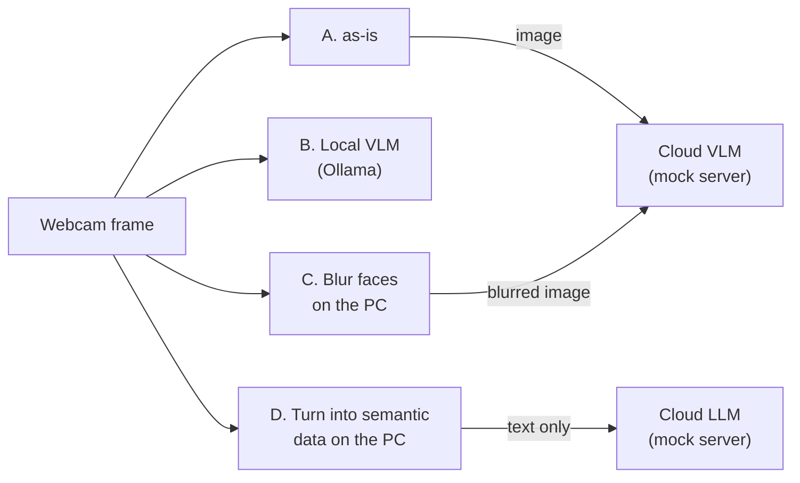

# Protect camera images before handing them to AI (local vs cloud)

Hand the same webcam frame to AI in four ways, and each time compare **what left the PC** and **what the AI's description reveals**. The cloud AI is replaced by a mock server that records everything it receives, so no API key is needed and no data leaves the PC.

> **What you'll do**: Hand the same image to AI in four configurations and compare what left the PC and what the descriptions say
>
> **Prerequisites**: Having run [Enrich camera data with a local VLM](local-vlm-distribution.md) once helps
>
> **What you need**: PC + USB webcam (or a JPEG image) + Docker + Python 3
>
> **Time required**: approx. 90–120 min (the first run takes longer because the VLM model has to be downloaded)

## Goal

When analyzing camera images with AI, sending the raw image to the cloud gives the best accuracy, but the faces, clothing, and text in the background all leave the PC. Processing on the PC keeps everything inside, but the available models are smaller and slower. This exercise runs four configurations, including the options in between (hide before sending, send text only), so that you can measure the trade-off between privacy and usefulness yourself.

## What this page covers

- What leaves the PC as-is when an image is sent to a cloud AI
- Clues that still leave the PC even after faces are blurred on the PC
- How to turn the image into semantic data (people count, region types) on the PC and send only text, and the limits of that approach
- How far data should be processed before it is shared on IW3IP

## The four configurations



| Configuration | What leaves the PC | What to check |
|---|---|---|
| A. Send the raw image to a cloud VLM | the image itself | Baseline: everything visible leaves |
| B. Process with a local VLM | nothing | How description quality and speed change |
| C. Blur faces on the PC, then send to a cloud VLM | the blurred image | Whether clues other than faces (clothing, name tags, text in the background) remain |
| D. Turn into semantic data on the PC, send only text to a cloud LLM | text with the people count and region types | How useful a judgment can be without sending any image |

!!! warning "When taking pictures"
    Only photograph people who agreed to it (yourself, or a printed synthetic face). Do not point the camera at other people, ID cards, or screens showing personal data. All data in this exercise stays on the PC, but delete it afterwards as described in [Clean up](#7-clean-up).

## Prerequisites

- Docker
- If the IPFS from the [Quickstart](../setup/quickstart.md) is still running, stop it first (`cd ~/program/Blockchain_IoT_Marketplace/ipfs && docker compose down`); IPFS and the publisher both use port 8080
- Python 3 with OpenCV, installed in a venv at the top of the course repository (`cd ~/program/Blockchain_IoT_Marketplace && python3 -m venv .venv && source .venv/bin/activate && pip install "opencv-python<5"`; OpenCV 5 removed the face detector used here). In the terminal that runs `answer_program.py` / `problem_program.py`, run `source ~/program/Blockchain_IoT_Marketplace/.venv/bin/activate` first
- An up-to-date course repository (`git pull`)
- A USB webcam (without one, pass a JPEG image with `--image`)

Matching files (`examples/hands_on/privacy_compare/` in the course repository):

- [mock_cloud_server.py](https://github.com/ertlnagoya/Blockchain_IoT_Marketplace/blob/main/examples/hands_on/privacy_compare/mock_cloud_server.py) — the mock cloud AI; saves what it receives under `received/`
- [answer_program.py](https://github.com/ertlnagoya/Blockchain_IoT_Marketplace/blob/main/examples/hands_on/privacy_compare/answer_program.py) — reference program that runs the four configurations
- [problem_program.py](https://github.com/ertlnagoya/Blockchain_IoT_Marketplace/blob/main/examples/hands_on/privacy_compare/problem_program.py) — exercise version with two parts to write yourself
- [README.md](https://github.com/ertlnagoya/Blockchain_IoT_Marketplace/blob/main/examples/hands_on/privacy_compare/README.md) — description of the exercise

## 1. Setup

Run from the top of the course repository. Use three terminals.

**Terminal 1: the publisher** (used for the semantic analysis in configuration D). With `SEMANTIC_ANALYZER_BACKEND=vision`, OpenCV detects faces and text-like regions.

```bash
cd ~/program/Blockchain_IoT_Marketplace
SEMANTIC_ANALYZER_BACKEND=vision docker compose -f infra/docker-compose.yml up --build -d publisher
curl http://localhost:8080/health
```

Start the **local VLM (Ollama)** and download the lightweight vision-language model `moondream` (about 1.7 GB).

```bash
docker run -d --name iw3ip-ollama -p 11434:11434 -v iw3ip_ollama:/root/.ollama ollama/ollama
docker exec iw3ip-ollama ollama pull moondream
```

The `vlm` service in docker-compose.yml does not publish port 11434 to the host, so Ollama runs as a separate container that programs on the PC can reach. If the Ollama desktop app or something else already uses port 11434, it cannot start, so quit it first (see [Troubleshooting](../operations/troubleshooting.md), 10).

**Terminal 2: the mock cloud AI**. With `--ollama-url`, it forwards each request to the local Ollama and returns a realistic description.

```bash
cd ~/program/Blockchain_IoT_Marketplace/examples/hands_on/privacy_compare
python3 mock_cloud_server.py --port 18080 --ollama-url http://localhost:11434 --ollama-model moondream
```

```
[cloud] mock cloud AI on http://127.0.0.1:18080 (forwarding to http://localhost:11434 (moondream))
[cloud] received data is saved under .../privacy_compare/received
```

## 2. Hand the frame to AI in four configurations

Run the comparison in **terminal 3**. It takes one frame from the webcam and hands it to AI in the four configurations in turn. Without a camera, add `--image picture.jpg`.

```bash
cd ~/program/Blockchain_IoT_Marketplace/examples/hands_on/privacy_compare
source ~/program/Blockchain_IoT_Marketplace/.venv/bin/activate
python3 answer_program.py --out-dir results
```

Result with one synthetic face image (CPU-only PC, about 3 minutes for all four).

| Configuration | What left the PC | Image sent (bytes) | Text sent (chars) | Time (s) | AI description (start) |
|---|---|---|---|---|---|
| A raw image -> cloud VLM | image and text | 49467 | 30 | 42.3 | The image shows a man with short, dark hair and a beard wearing glasses. ... |
| B raw image -> local VLM | nothing | 0 | 0 | 88.2 | The image shows a man with short, dark hair and a beard wearing glasses. ... |
| C faces blurred (1) -> cloud VLM | blurred image and text | 35979 | 30 | 54.7 | The image shows a blurred face of a man, with the eyes and nose clearly visible but ... |
| D meaning (text only) -> cloud LLM | text only | 0 | 325 | 4.4 | The image contains a single person in the frame and is not sensitive to privacy concerns. |

The results are saved under `results/`.

- `results/report.md` — the table above
- `results/outbound.jsonl` — for each request, what was sent and the AI's answer
- `results/frame.jpg` / `results/frame_blurred.jpg` — the frame and the copy with faces blurred

In this example both the mock cloud and the local path answer with the same `moondream`, so A and B give the same description. A real cloud VLM is a much larger model and describes in more detail. Times vary a lot with the PC.

## 3. Check what the cloud received

The mock cloud terminal prints one line per request.

```
[cloud] #001 A: image 49467 bytes, text 30 chars -> saved to received/
[cloud] #002 C: image 35979 bytes, text 30 chars -> saved to received/
[cloud] #003 D: image 0 bytes, text 325 chars -> saved to received/
```

What it received is saved as-is under `received/`. With a real cloud service, this would be handed to the provider's servers.

- `001_image1.jpg` (configuration A): the frame itself
- `002_image1.jpg` (configuration C): the face is blurred, but hair, clothing, and background remain. Small text in a corner of the image also remains
- `003.json` (configuration D): no image, only text. `003.json` is a record of the request (`id`, `received_at`, `tag`, `text`, and so on), and `text` holds the instruction to the AI followed by this JSON

```json
{"people_count": 1, "objects": ["person"], "sensitive_region_types": ["face", "unknown_sensitive"], "privacy_risk_score": 0.9}
```

The answer to D, "not sensitive to privacy concerns", overlooks the `face` in `sensitive_region_types` that it received. Sending text only lets the least leave the PC, but it also gives the AI less to judge from, and the AI can reach a wrong conclusion.

## 4. Exercise: complete the exercise program

`problem_program.py` has two `TODO`s.

- **TODO 1 `redact_faces()`**: blur each detected face region. Use `cv2.GaussianBlur`, and widen the region a little so the hair line and chin are covered too
- **TODO 2 `sir_to_text()`**: build the semantic data to send to the cloud. Keep only the people count, object kinds, sensitive region kinds, and `privacy_risk_score`; leave out personal identifiers, region coordinates, and frame IDs

```bash
python3 problem_program.py --out-dir results_mine
```

Check that the face is hidden in `results_mine/frame_blurred.jpg` and that the newest `.json` under `received/` contains no coordinates or identifiers. Compare with the reference program.

## 5. Compare and discuss

Fill in the table to compare the four configurations.

| Aspect | A | B | C | D |
|---|---|---|---|---|
| What left the PC | | | | |
| Clues that identify a person in what left (face, clothing, text, place) | | | | |
| Accuracy of the AI's description | | | | |
| Time | | | | |
| Cloud cost (would a real service charge?) | | | | |

Things to think about:

1. If you share data with people in the neighborhood for crime prevention or monitoring, which configuration would you choose, and why?
2. How could you reduce the clues that remain in C even after faces are blurred (e.g. drop clothing colors, also hide text regions, lower the resolution)?
3. What could you add to the semantic data in D so that the AI does not misjudge? The more you add, what becomes more likely to leave the PC?
4. Combined with the purpose (`purpose`) of an IW3IP [Consent VC](ha-ssi-wallet.md) or the [tiered-access Tiers](data-user-vc-tiered.md), which configuration would you allow for which party?

## 6. Common issues

- **`module 'cv2' has no attribute 'CascadeClassifier'`**: OpenCV 5 is installed. Activate the venv and reinstall with `pip install "opencv-python<5"`.
- **D's semantic data is `{"people_count": 0, "objects": [], "sensitive_region_types": [], "privacy_risk_score": 1.0}`**: the publisher's analysis failed. At the top of the course repository, run `docker compose -f infra/docker-compose.yml logs publisher | grep "semantic analyze failed"` to see why. Update the course repository (`git pull`) and restart the publisher with `--build`. Without `SEMANTIC_ANALYZER_BACKEND=vision`, a fixed mock result is returned.
- **B says `skipped: local VLM not reachable`**: check that Ollama is running (`docker ps`) and listening on port 11434.
- **It takes too long**: on a CPU-only PC one description takes from tens of seconds to a few minutes. Answers are capped at 120 tokens.
- **The camera cannot be opened**: see the troubleshooting of [Detect with a USB webcam (OpenCV)](webcam.md), or pass an image with `--image`.

## 7. Clean up

Stop the mock cloud in Terminal 2 with Ctrl+C, then delete the frames you took and the data the mock cloud received. This moves to `examples/hands_on/privacy_compare` to delete them, then returns to the top of the course repository before stopping the containers.

```bash
cd ~/program/Blockchain_IoT_Marketplace/examples/hands_on/privacy_compare
rm -rf results results_mine received
cd ~/program/Blockchain_IoT_Marketplace
docker rm -f iw3ip-ollama
docker compose -f infra/docker-compose.yml --profile vlm down
```

If you no longer need the downloaded VLM model (the `iw3ip_ollama` volume, about 1.7 GB), remove it with `docker volume rm iw3ip_ollama`.

## Related pages

- [Enrich camera data with a local VLM](local-vlm-distribution.md) — distribute semantic data from a local VLM on the platform
- [Tier by semantic level](data-user-vc-tiered-semantic.md) — vary face blurring and descriptions by the receiver's trust
- [Detect with a USB webcam (OpenCV)](webcam.md) — basics of camera capture
