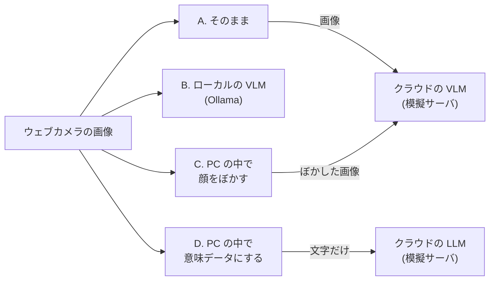

# AI に渡す前にカメラ画像を守る (ローカルとクラウドの比較)

ウェブカメラで撮った同じ 1 枚を、4 通りの方法で AI に渡し、そのたびに **何が PC の外に出たか** と **AI の説明から何が分かってしまうか** を比べます。クラウドの AI は、受け取ったものをすべて記録する模擬サーバで代用するので、API キーは不要で、データは PC の外に出ません。

> **やること**: 同じ画像を 4 つの構成で AI に渡し、外に出たものと説明の内容を比べる
>
> **前提**: [ローカル VLM でカメラデータを意味づけ](local-vlm-distribution.md) を一度動かしていると理解が早い
>
> **使うもの**: PC + USB ウェブカメラ (無ければ手元の JPEG 画像) + Docker + Python 3
>
> **所要時間**: 90〜120 分 (初回は VLM のモデル取得に時間がかかります)

## 目的

カメラ画像を AI で分析するとき、画像をそのままクラウドに送れば精度は高くなりますが、写っている人の顔、服装、背景の文字まで外に出ます。PC の中で処理すれば何も外に出ませんが、使える AI は小さく、時間もかかります。この演習では、その間の選択肢 (送る前に隠す、文字にしてから送る) も含めた 4 つの構成を実際に動かし、プライバシーと有用性のトレードオフを自分で測ります。

## このページで分かること

- 画像をクラウドの AI に送ると、何がそのまま外に出るか
- PC の中で顔をぼかしても、外に出てしまう手がかり
- 画像を PC の中で意味データ (人数や領域の種類) に変えてから文字だけを送る方法と、その限界
- IW3IP で共有するデータを、どの段階まで加工してから出すべきか

## 比べる 4 つの構成



| 構成 | PC の外に出るもの | 確かめたいこと |
|---|---|---|
| A. 生の画像をクラウドの VLM に送る | 画像そのもの | 基準。写っているものすべてが外に出る |
| B. ローカルの VLM で処理する | 何も出ない | 説明の質と速度がどう変わるか |
| C. PC の中で顔をぼかしてからクラウドの VLM に送る | ぼかした画像 | 顔以外の手がかり (服装、名札、背景の文字) が残るか |
| D. PC の中で意味データにしてから、クラウドの LLM に文字だけ送る | 人数と領域の種類を表すテキスト | 画像を出さずに、どこまで役に立つ判断ができるか |

!!! warning "撮影するときの注意"
    写すのは、撮影に同意した人だけにしてください (自分自身、または印刷した合成の顔画像)。他の人、身分証、個人情報が表示された画面にカメラを向けないでください。この演習のデータは PC の中だけで処理されますが、終わったら [後片付け](#7-後片付け) のとおり削除します。

## 前提

- Docker が使える
- Python 3 と OpenCV が使える (`pip install "opencv-python<5"`。OpenCV 5 では、この演習で使う顔検出の機能が外れています)
- 教材リポジトリが最新 (`git pull`)
- USB ウェブカメラ (無い場合は、手元の JPEG 画像を `--image` で渡します)

対応するファイル (教材リポジトリの `examples/hands_on/privacy_compare/`):

- [mock_cloud_server.py](https://github.com/ertlnagoya/Blockchain_IoT_Marketplace/blob/main/examples/hands_on/privacy_compare/mock_cloud_server.py) — 模擬のクラウド AI。受け取ったものを `received/` に保存する
- [answer_program.py](https://github.com/ertlnagoya/Blockchain_IoT_Marketplace/blob/main/examples/hands_on/privacy_compare/answer_program.py) — 4 つの構成を実行する解答用プログラム
- [problem_program.py](https://github.com/ertlnagoya/Blockchain_IoT_Marketplace/blob/main/examples/hands_on/privacy_compare/problem_program.py) — 2 か所を自分で書く課題用プログラム
- [README.md](https://github.com/ertlnagoya/Blockchain_IoT_Marketplace/blob/main/examples/hands_on/privacy_compare/README.md) — 演習の説明

## 1. 準備

教材リポジトリのトップで実行します。ターミナルを 3 つ使います。

**ターミナル 1: publisher** (構成 D の意味データ化に使います)。`SEMANTIC_ANALYZER_BACKEND=vision` を付けると、OpenCV で顔や文字らしい領域を検出します。

```bash
SEMANTIC_ANALYZER_BACKEND=vision docker compose -f infra/docker-compose.yml up --build -d publisher
curl http://localhost:8080/health
```

**ローカルの VLM (Ollama)** を起動し、軽量な視覚言語モデル `moondream` (約 1.7 GB) を取得します。

```bash
docker run -d --name iw3ip-ollama -p 11434:11434 -v iw3ip_ollama:/root/.ollama ollama/ollama
docker exec iw3ip-ollama ollama pull moondream
```

**ターミナル 2: 模擬のクラウド AI**。`--ollama-url` を付けると、受け取った依頼を手元の Ollama に回して、本物らしい説明を返します。

```bash
cd examples/hands_on/privacy_compare
python3 mock_cloud_server.py --port 18080 --ollama-url http://localhost:11434 --ollama-model moondream
```

```
[cloud] mock cloud AI on http://127.0.0.1:18080 (forwarding to http://localhost:11434 (moondream))
[cloud] received data is saved under .../privacy_compare/received
```

## 2. 4 つの構成で AI に渡す

**ターミナル 3** で比較を実行します。ウェブカメラから 1 枚撮って、4 つの構成で順に AI に渡します。カメラが無い場合は `--image 画像.jpg` を付けます。

```bash
cd examples/hands_on/privacy_compare
python3 answer_program.py --out-dir results
```

合成の顔画像 1 枚で実行したときの結果です (CPU だけの PC で、4 構成あわせて約 3 分)。

| 構成 | PC の外に出たもの | 送った画像 (バイト) | 送った文字 (字) | 時間 (秒) | AI の説明 (冒頭) |
|---|---|---|---|---|---|
| A raw image -> cloud VLM | 画像と文字 | 49467 | 30 | 42.3 | The image shows a man with short, dark hair and a beard wearing glasses. ... |
| B raw image -> local VLM | なし | 0 | 0 | 88.2 | The image shows a man with short, dark hair and a beard wearing glasses. ... |
| C faces blurred (1) -> cloud VLM | ぼかした画像と文字 | 35979 | 30 | 54.7 | The image shows a blurred face of a man, with the eyes and nose clearly visible but ... |
| D meaning (text only) -> cloud LLM | 文字だけ | 0 | 325 | 4.4 | The image contains a single person in the frame and is not sensitive to privacy concerns. |

結果は `results/` に保存されます。

- `results/report.md` — 上の比較表
- `results/outbound.jsonl` — 1 回の送信ごとに、送った内容と AI の答え
- `results/frame.jpg` / `results/frame_blurred.jpg` — 撮った画像と、顔をぼかした画像

この例では、模擬クラウドもローカルも同じ `moondream` で答えているので、A と B の説明は同じです。本物のクラウドの VLM はもっと大きなモデルで、より詳しく説明します。時間は PC の性能で大きく変わります。

## 3. クラウドが受け取ったものを確かめる

模擬クラウドのターミナルには、受け取るたびに 1 行表示されます。

```
[cloud] #001 A: image 49467 bytes, text 30 chars -> saved to received/
[cloud] #002 C: image 35979 bytes, text 30 chars -> saved to received/
[cloud] #003 D: image 0 bytes, text 325 chars -> saved to received/
```

受け取ったものは `received/` にそのまま保存されています。本物のクラウドのサービスなら、これが事業者のサーバに渡ります。

- `001_image1.jpg` (構成 A): 撮った画像そのもの
- `002_image1.jpg` (構成 C): 顔はぼかされていますが、髪型、服、背景はそのままです。画像の隅に小さな文字があれば、それも残ります
- `003.json` (構成 D): 画像は無く、次の文字だけです

```json
{"people_count": 1, "objects": ["person"], "sensitive_region_types": ["face", "unknown_sensitive"], "privacy_risk_score": 0.9}
```

構成 D の答え「プライバシー上の問題はない (not sensitive to privacy concerns)」は、受け取った `sensitive_region_types` に `face` があるのに、それを読み落としています。文字だけを渡す方法は外に出るものが最も少ない一方で、判断の材料も少なくなり、AI が誤った結論を出すことがあります。

## 4. 演習: 課題用プログラムを完成させる

`problem_program.py` には `TODO` が 2 つあります。

- **TODO 1 `redact_faces()`**: 検出した顔の領域をぼかす。`cv2.GaussianBlur` を使い、髪の生え際やあごも隠れるように領域を少し広げる
- **TODO 2 `sir_to_text()`**: クラウドに送る意味データを作る。人数、物体の種類、機微な領域の種類、`privacy_risk_score` だけを残し、個人の識別子、領域の座標、フレームの ID は含めない

```bash
python3 problem_program.py --out-dir results_mine
```

`results_mine/frame_blurred.jpg` で顔が隠れていること、`received/` の最新の `.json` に座標や識別子が入っていないことを確かめます。解答用プログラムと結果を比べてください。

## 5. 比べて考える

次の表を埋めて、4 つの構成を比べます。

| 観点 | A | B | C | D |
|---|---|---|---|---|
| PC の外に出たもの | | | | |
| 外に出たものから、個人を特定できる手がかり (顔、服装、文字、場所) | | | | |
| AI の説明の正確さ | | | | |
| 時間 | | | | |
| クラウドの費用 (本物のサービスなら発生するか) | | | | |

考えてみよう:

1. 防犯や見守りの用途で、地域の人にデータを共有するなら、どの構成を選びますか。理由も書いてください。
2. 構成 C で顔をぼかしても残る手がかりを、どうすれば減らせますか (例: 服装の色を落とす、文字の領域も隠す、解像度を下げる)。
3. 構成 D で AI が誤った判断をしないよう、送る意味データに何を足せばよいですか。足すほど、何が外に出やすくなりますか。
4. IW3IP の [Consent VC](ha-ssi-wallet.md) の目的 (`purpose`) や [段階アクセスの Tier](data-user-vc-tiered.md) と組み合わせるなら、どの構成をどの相手に許しますか。

## 6. よくある問題

- **`module 'cv2' has no attribute 'CascadeClassifier'`**: OpenCV 5 が入っています。`pip install "opencv-python<5"` で入れ直します。
- **構成 D の意味データが `(analysis unavailable; treat as private)` になる**: publisher の解析が失敗しています。教材リポジトリを最新にして (`git pull`)、publisher を `--build` 付きで起動し直します。`SEMANTIC_ANALYZER_BACKEND=vision` を付け忘れた場合は、固定の模擬データが返ります。
- **構成 B が `skipped: local VLM not reachable` になる**: Ollama が起動しているか (`docker ps`)、ポート 11434 で待ち受けているかを確認します。
- **時間がかかりすぎる**: CPU だけの PC では、1 回の説明に数十秒から数分かかります。答えの長さは 120 トークンに制限しています。
- **カメラが開けない**: [USB ウェブカメラ](webcam.md) のトラブル項目を参照するか、`--image` で画像を渡します。

## 7. 後片付け

撮った画像と、模擬クラウドが受け取ったデータを削除します。

```bash
rm -rf results results_mine received
docker rm -f iw3ip-ollama
docker compose -f infra/docker-compose.yml down
```

取得した VLM のモデル (`iw3ip_ollama` ボリューム、約 1.7 GB) も不要なら、`docker volume rm iw3ip_ollama` で削除します。

## 関連ページ

- [ローカル VLM でカメラデータを意味づけ](local-vlm-distribution.md) — ローカルの VLM と意味データを基盤で流通させる
- [意味レベルで段階化する](data-user-vc-tiered-semantic.md) — 受け取る人の信頼度に応じて、顔のぼかしや説明文を出し分ける
- [USB ウェブカメラ](webcam.md) — カメラの取り込みの基礎
