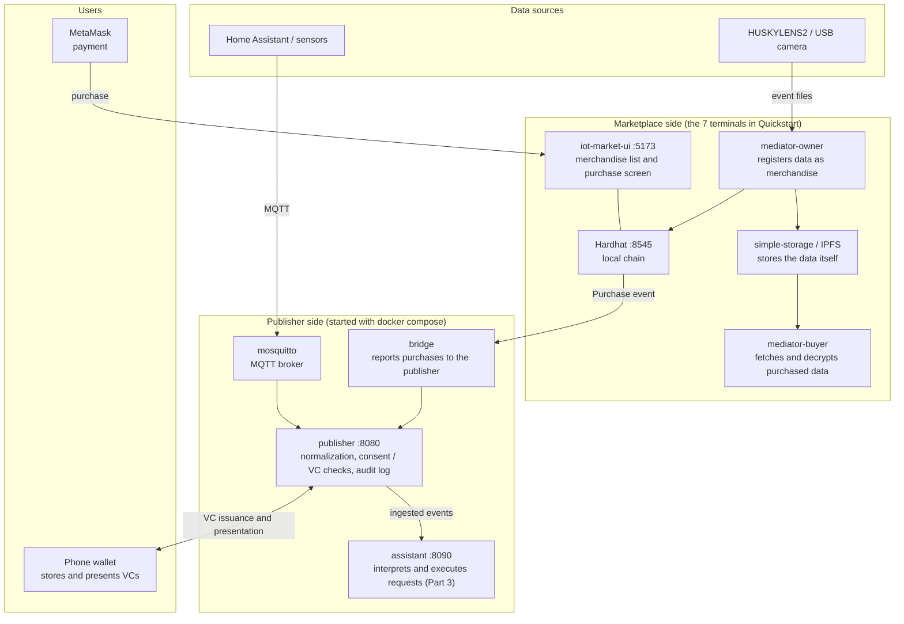

# IoTxWeb3 Intelligence Platform (IW3IP) Documentation

This documentation site brings together the IW3IP overview, implementation examples, and hands-on instructions.

## Main Use Cases

- Undergraduate students studying computing or information systems
- Instructors and TAs running practical sessions

Participants should start from the [Learning Roadmap](foundations/roadmap.md), and instructors and TAs from the [Course Guide](foundations/course-guide.md).

## What This Site Covers

You can work through the material in order, from foundational understanding to the basic hands-on.

- Foundations:
  - blockchain
  - Hardhat
  - SSI / DID / VC
- Practice:
  - quickstart
  - hands-on samples
  - troubleshooting

External websites and papers are positioned as follow-up material for standards, deeper technical detail, and research background.

## Site structure

Each section has a different purpose and readership. Participants go through Learning Foundations, Environment Setup and Hands-on in that order, and open Support when they get stuck. Design is the section to read after the hands-on, when you want to know the mechanisms in detail or when you extend a feature.

| Section | Purpose | What it contains | Main readers |
|---|---|---|---|
| Learning Foundations | Understand the basics of the technology | concepts of blockchain, Hardhat, SSI / DID / VC, and the study order | participants |
| Environment Setup | Prepare the exercise environment | installing the tools and the quickstart | participants |
| Hands-on | Understand by running it | commands, expected output, checkpoints | participants |
| [Design](design/index.md) | Explain the mechanisms and the reasons behind the design | VCs, tokens, APIs, data flows, chosen approaches and reasons, open issues | people extending or implementing features, participants doing advanced study, instructors |
| [Support](operations/index.md) | Get unstuck during the exercises | troubleshooting, FAQ | participants and TAs |
| For Instructors | Plan and run a course | Course Guide (plans by number of sessions, assessment), Facilitator Guide | instructors and TAs |
| About This Site | Edit the site, get in touch | building and editing the site, contact | site editors |

## System overview



Two groups of processes are started.

- **Marketplace side**: the blockchain (Hardhat), the merchandise UI, data storage, and the mediators. Start them in 7 terminals by following [Quickstart](setup/quickstart.md). Used for listing and purchasing data (the second half of Part 1 and the marketplace integration in Part 2).
- **Publisher side**: the MQTT broker and the publisher. Start them with `docker compose -f infra/docker-compose.yml up` in the course repository. Used for ingesting data, deciding whether sharing is allowed by consent or VC, and the audit log (the first half of Part 1, Part 2, and Part 3).

The two groups run independently. Note that the IPFS gateway on the marketplace side and the publisher both use port 8080, so they cannot run at the same time. Before a hands-on that uses the publisher, stop IPFS with `docker compose down` in the `ipfs` directory. In the Part 2 marketplace integration, the bridge reports purchase events to the publisher and connects them. The [tech stack table in the Hands-on overview](hands-on/index.md#tech-stack-at-a-glance) shows which hands-on uses which.

Small devices such as a Raspberry Pi with a camera can also serve as data sources.

{ width="360" }

## If You Want To Run One Demo First

If you want the simplest Phase 1 / Phase 2 entry without physical devices, `ha-demo-simulator` is the best starting point. Phases 1–3 are the development stages of the platform, described in [Phase structure in the platform overview](platform-overview.md#phase-structure).

- Matching page: [Home Assistant Demo Simulator sample](hands-on/ha-demo-simulator.md)
- What you can confirm:
  - `Home Assistant demo -> MQTT -> publisher`
  - state sharing for `temperature` and `power`
  - event sharing for `flood_risk_high` and `possible_littering`
  - `allowed`, `denied`, and the `audit log`

Start command:

```bash
cd ~/program/Blockchain_IoT_Marketplace
PLATFORM_INGEST_READ_ENABLED=true docker compose -f infra/docker-compose.yml --profile ha-demo up --build -d
```

Open:

- `http://localhost:8123`
- `http://localhost:8080/health`

As the shortest Phase 3 demo, `assistant-demo` starts the following in one command:

- `assistant-demo`
- `llm-mock`
- `assistant-ui`

Matching page:

- [LLM Planner Hands-on](hands-on/llm-planner.md)

Start command:

```bash
cd ~/program/Blockchain_IoT_Marketplace
docker compose -f infra/docker-compose.yml --profile assistant-demo up --build -d
```

Open:

- `http://localhost:4173`

## Recommended Learning Order

1. [Learning Roadmap](foundations/roadmap.md)
2. [Blockchain Basics](foundations/blockchain-basics.md)
3. [Hardhat Basics](foundations/hardhat-basics.md)
4. [SSI/DID/VC Basics](foundations/ssi-did-vc-basics.md)
5. [Prerequisites](setup/prerequisites.md)
6. [HA Demo Simulator](hands-on/ha-demo-simulator.md) (run the whole flow without hardware)
7. [Quickstart](setup/quickstart.md)
8. [Hands-on](hands-on/index.md)
9. [Design](design/index.md) (when you want the mechanisms in detail)
10. [References](foundations/references.md)

If you get stuck, see [Troubleshooting](operations/troubleshooting.md). Instructors and TAs should first read the [Course Guide](foundations/course-guide.md) to plan the course.

## Run docs locally

Run this in the folder where you cloned this site's repository (`ertlnagoya/iw3ip.github.io`). The course repository also has a `docs/` folder, but that holds separate, older documents.

```bash
cd <folder where you cloned iw3ip.github.io>
python3 -m venv .venv
source .venv/bin/activate
pip install -r docs/requirements.txt
mkdocs serve
```

Open: `http://127.0.0.1:8000`
