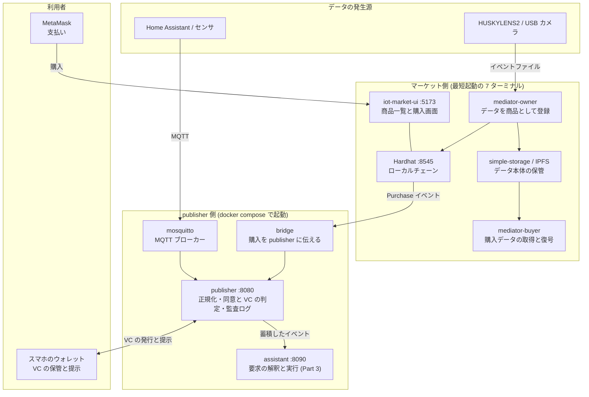
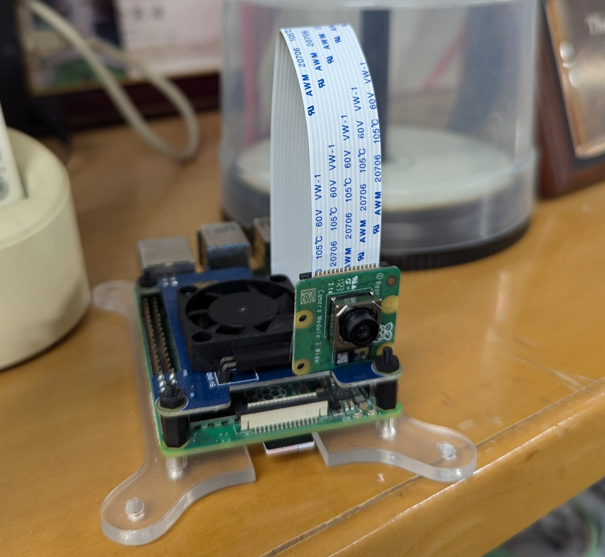

# IoTxWeb3 Intelligence Platform (IW3IP) ドキュメント

IW3IP の全体像、実装例、ハンズオン手順をまとめたドキュメントサイトです。

## 想定読者

- コンピュータや情報システムを学ぶ学部学生
- 演習を担当する講師・TA

受講者は [学習ロードマップ](foundations/roadmap.md) から、講師・TA は [授業ガイド](foundations/course-guide.md) から読むことを推奨します。

## 扱う内容

基礎理解から基本ハンズオンまでを順に確認できます。

- 基礎学習:
  - ブロックチェーン
  - Hardhat
  - SSI / DID / VC
- 実践:
  - 最短起動
  - 各 Hands-on サンプル
  - トラブルシュート

外部サイトや論文は、標準仕様や研究背景を詳しく調べたいときの参考資料です。

## サイトの構成

章ごとに、目的と主な読者が違います。受講者は、学習基礎、環境構築、ハンズオンの順に進み、詰まったときに「困ったとき」を開きます。設計は、ハンズオンを終えて仕組みを詳しく知りたいときや、機能を拡張するときに読む章です。

| 章 | 目的 | 書いてあること | 主な読者 |
|---|---|---|---|
| 学習基礎 | 技術の基本を理解する | ブロックチェーン、Hardhat、SSI / DID / VC の考え方と学習の順序 | 受講者 |
| 環境構築 | 演習の環境を用意する | ツールのインストールと最短起動 | 受講者 |
| ハンズオン | 動かして理解する | コマンド、期待する出力、確認ポイント | 受講者 |
| [設計](design/index.md) | 仕組みと設計判断の理由を説明する | VC・トークン・API・データの流れ、選んだ方式と理由、未解決の課題 | 機能を拡張・実装する人、発展学習をする受講者、講師 |
| [困ったとき](operations/index.md) | 演習中に詰まったときに解決する | トラブルシュート、FAQ | 受講者・TA |
| ワークショップ | 授業を組み立てて進める | 授業ガイド (コマ数別の構成、評価)、講師進行ガイド | 講師・TA |
| このサイトについて | サイトを編集する、問い合わせる | サイトの構築と編集、問い合わせ先 | サイトの編集者 |

## 全体構成



起動するものは 2 系統あります。

- **マーケット側**: ブロックチェーン (Hardhat)、商品一覧の画面、データ保管、仲介プロセスです。[最短起動](setup/quickstart.md) の手順で、ターミナルを 7 つ使って起動します。データの出品と購入 (Part 1 の後半、Part 2 のマーケット連携) で使います。
- **publisher 側**: MQTT ブローカーと publisher です。教材リポジトリで `docker compose -f infra/docker-compose.yml up` を実行して起動します。データの取り込み、同意や VC による共有可否の判定、監査ログ (Part 1 の前半、Part 2、Part 3) で使います。

2 つの系統は独立して動きます。なお、マーケット側の IPFS (ゲートウェイ) と publisher は、どちらもポート 8080 を使うため、同時には起動できません。publisher を使うハンズオンの前に、`ipfs` ディレクトリで `docker compose down` を実行して IPFS を止めてください。 Part 2 のマーケット連携では、bridge が購入のイベントを publisher に伝えて両者をつなぎます。各ハンズオンがどちらを使うかは、[ハンズオンの概要の早見表](hands-on/index.md#使う技術要素の早見表) にまとめています。

データの発生源には、Raspberry Pi とカメラのような小型の機器も使えます。

{ width="360" }

## まず 1 つ動かしたい場合

実機なしで Phase 1 / Phase 2 の基本経路を確認したい場合は、`ha-demo-simulator` から始めてください。Phase 1〜3 は基盤の発展段階を表す区分で、[プラットフォーム概要のフェーズ構成](platform-overview.md#フェーズ構成) で説明しています。

- 対応ページ: [Home Assistant Demo Simulator サンプル](hands-on/ha-demo-simulator.md)
- 確認できること:
  - `Home Assistant demo -> MQTT -> publisher`
  - `temperature` / `power` の状態共有
  - `flood_risk_high` / `possible_littering` のイベント共有
  - `allowed` / `denied` / `audit log`

起動コマンド:

```bash
cd ~/program/Blockchain_IoT_Marketplace
PLATFORM_INGEST_READ_ENABLED=true docker compose -f infra/docker-compose.yml --profile ha-demo up --build -d
```

開く URL:

- `http://localhost:8123`
- `http://localhost:8080/health`

Phase 3 の最短デモとして `assistant-demo` を使うと、1 コマンドで次をまとめて起動できます。

- `assistant-demo`
- `llm-mock`
- `assistant-ui`

対応ページ:

- [LLM Plannerハンズオン](hands-on/llm-planner.md)

起動コマンド:

```bash
cd ~/program/Blockchain_IoT_Marketplace
docker compose -f infra/docker-compose.yml --profile assistant-demo up --build -d
```

開く URL:

- `http://localhost:4173`

## 推奨学習順

1. [学習ロードマップ](foundations/roadmap.md)
2. [ブロックチェーン基礎](foundations/blockchain-basics.md)
3. [Hardhat基礎](foundations/hardhat-basics.md)
4. [SSI/DID/VC基礎](foundations/ssi-did-vc-basics.md)
5. [事前準備](setup/prerequisites.md)
6. [HA Demo Simulator](hands-on/ha-demo-simulator.md)（実機なしで一通り動かす）
7. [最短起動](setup/quickstart.md)
8. [ハンズオン](hands-on/index.md)
9. [設計](design/index.md)（仕組みを詳しく知りたいとき）
10. [参考文献](foundations/references.md)

途中で詰まったら [トラブルシュート](operations/troubleshooting.md) を参照してください。講師・TA は、先に [授業ガイド](foundations/course-guide.md) を読んで授業の構成を決めます。

## ローカルでDocsを起動

このサイトのリポジトリ (`ertlnagoya/iw3ip.github.io`) を clone したフォルダで実行します。下の例は `~/program/iw3ip.github.io` に clone した場合です。教材リポジトリにも `docs/` がありますが、そちらは別の古い文書です。

```bash
cd ~/program/iw3ip.github.io
python3 -m venv .venv
source .venv/bin/activate
pip install -r docs/requirements.txt
mkdocs serve
```

- URL: `http://127.0.0.1:8000`
