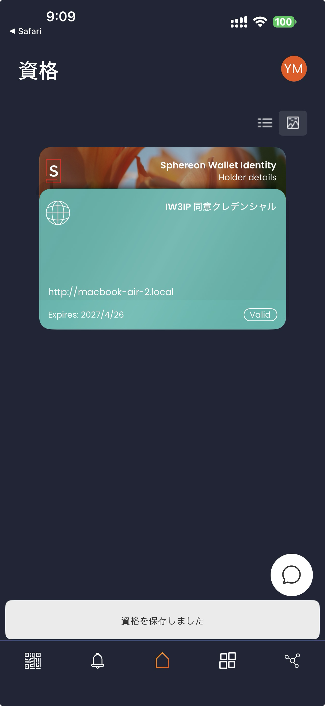
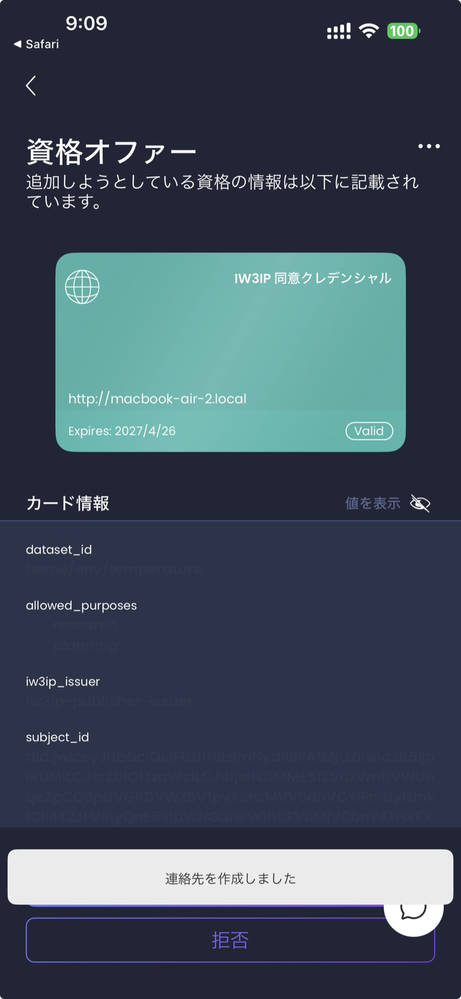

# Prerequisites (install tools)

Before the hands-on, install the required software on your PC and confirm it works.
Each item includes a one-line note on why the tool is needed. Technical terms are explained where they appear.

> If you already have these tools, you can just complete the [verification checklist](#verification-checklist) and proceed to the next page ([Run the whole pipeline without hardware (HA Demo Simulator)](../hands-on/ha-demo-simulator.md)).

## Overview — why each tool

The hands-on builds a local development environment for sharing data safely on your laptop.
This environment consists of the following processes:

| Process | Role | Tool needed |
|---|---|---|
| Local blockchain | Records sale/purchase transactions | **Node.js** (`npx hardhat node`) |
| Marketplace UI | List / buy in the browser | **Node.js** + browser + **MetaMask** |
| Storage server and mediators | Holds the actual data, and the processes that mediate listing and buying (`mediator-owner` / `mediator-buyer`) | **Rust** (`cargo run`) |
| Distributed file store | Replicates files | **Docker** (IPFS container) |
| Publisher / bridge | Consent checks, issuing and verifying VCs, purchase notifications | **Docker** |

So once you have **Docker / Node.js / Rust / Git / browser + MetaMask**, you can build the environment.

## Required

### 1. Docker

Used to start the whole environment together.

- **macOS / Windows**: install [Docker Desktop](https://www.docker.com/products/docker-desktop/) — has a GUI for managing containers.
- **Linux**: distro-provided `docker` package, or the official install script.
- Site: <https://www.docker.com/>

> **Memory**: check Docker Desktop's Settings → Resources → Memory. If it is **below 6 GB, raise it to 6 GB or more**; with too little memory, some containers stop.

### 2. Node.js (ships with npm)

The JavaScript runtime, used by the marketplace UI and the local blockchain.

- Site: <https://nodejs.org/>
- Pick the **20.x LTS** (Long Term Support) version (the sample output in the check below is also v20)
- Need to switch versions? [nvm](https://github.com/nvm-sh/nvm) or [volta](https://volta.sh/) help

### 3. Rust (ships with cargo)

Runs the storage server (`simple-storage`).

- Install: <https://www.rust-lang.org/tools/install>
- One-liner: `curl --proto '=https' --tlsv1.2 -sSf https://sh.rustup.rs | sh`

### 4. Git

To clone the lesson repo.

- Site: <https://git-scm.com/>
- macOS ships it with Xcode CLI tools; Linux distros usually have it preinstalled.

### 5. Browser + MetaMask extension

For buying data on the marketplace (used in Part 1).

- Browser: any of Chrome / Edge / Firefox / Brave
- [MetaMask](https://metamask.com/) — install as a browser extension
- An Ethereum-style wallet that connects to the local chain

## Optional (used in some hands-on pages)

Add these depending on which hands-on pages you plan to do.

### Python 3 / curl / jq

The HUSKYLENS2 and USB webcam bridges and the exercise programs (`problem_program.py` etc.) run on Python 3. `curl` and `jq` are used to call the APIs and inspect responses.

- Python **3.11 or later** is required (as set in `pyproject.toml` of the course repository). Check with `python3 --version`
- The `python3` from the macOS Command Line Tools is 3.9, which is too old. Run `brew install python@3.12` with Homebrew, or install 3.11 or later with the installer from [Python](https://www.python.org/). When you create a venv, name the version, as in `python3.12 -m venv .venv`
- `curl` ships with macOS / Linux. `jq` is available from <https://jqlang.org/>

### Smartphone + SSI wallet app

Used in Part 2 (Feature Extensions) to receive and store VCs (digital credentials).

- iPhone or Android works
- App to use: **iw3ip-wallet** ([ertlnagoya/iw3ip-wallet](https://github.com/ertlnagoya/iw3ip-wallet)), a fork of the open-source Sphereon Wallet
- Build the `iw3ip/phase2-consent-vc` branch and install it on your device. See [README.iw3ip.md](https://github.com/ertlnagoya/iw3ip-wallet/blob/iw3ip/phase2-consent-vc/README.iw3ip.md). In a class, the instructor may distribute a prepared build instead
- The store version of Sphereon Wallet does not include a fix for a navigation failure when presenting right after receiving a VC, so it has not been verified with the hands-on pages on this site
- What the app looks like:

| Credential list | Offer dialog |
|---|---|
| { width="220" } | { width="220" } |

### VS Code + Dev Containers (recommended)

For people who want to read the publisher source code.

- VS Code: <https://code.visualstudio.com/>
- Extension: [Dev Containers](https://marketplace.visualstudio.com/items?itemName=ms-vscode-remote.remote-containers)

## Background helpful (not required)

You can do the hands-on without these, but they speed up the learning:

- **Command-line basics** (`cd`, `ls`, `cat`)
- **HTTP/REST basics** (GET / POST and JSON)
- **Git basics** (clone, branch)
- **Browser DevTools** (F12 — Network / Console)

## Verification checklist

Open a terminal and run these. They should all print a version number:

```bash
docker --version
node --version
npm --version
cargo --version
git --version
```

Expected output:

```
Docker version 25.0.x, build ...
v20.x.x
10.x.x
cargo 1.xx.x (...)
git version 2.x.x
```

If you see `command not found`, go back to the section above and reinstall.

### Terminal setting (zsh on macOS)

Some hands-on commands include comment lines that start with `#`. The default macOS shell (zsh) prints `zsh: command not found: #` for pasted comment lines unless told otherwise. Run the following once so comments are ignored.

```bash
echo 'setopt interactive_comments' >> ~/.zshrc
source ~/.zshrc
```

### Confirm Docker runs

```bash
docker run --rm hello-world
```

If you see the "Hello from Docker!" message, it is working.

### Clone the lesson repo

The hands-on pages assume the course repository is at `~/program/Blockchain_IoT_Marketplace`. Clone it under `~/program` as follows.

```bash
mkdir -p ~/program && cd ~/program
git clone https://github.com/ertlnagoya/Blockchain_IoT_Marketplace.git
cd Blockchain_IoT_Marketplace
```

The initial clone takes a few minutes (the repo is large).

## You can move on if…

- [ ] All five `--version` commands print a version
- [ ] `docker run hello-world` succeeds
- [ ] You have a `~/program/Blockchain_IoT_Marketplace` directory
- [ ] (Part 1) MetaMask shows up in your browser's extensions list
- [ ] (Optional, for §1.4 of Part 1) MetaMask Mobile is installed on your phone
- [ ] (Part 2) iw3ip-wallet is installed on your phone

All checked → go to [Run the whole pipeline without hardware (HA Demo Simulator)](../hands-on/ha-demo-simulator.md). That page does not use the Quickstart stack; it runs with Docker Compose only. After that, go to [Quickstart (run the stack)](quickstart.md).

## Per-OS notes

### Windows

- Recommended: **WSL2 + Docker Desktop**.
- Installing WSL: <https://learn.microsoft.com/windows/wsl/>
- If you run into problems such as path separators, do the hands-on work inside WSL2.

### macOS

- Apple Silicon (M1–M4) works. The first container build can be slower than on Intel.

### Linux

- You may need permission to talk to the Docker daemon (`docker` group membership):
  `sudo usermod -aG docker $USER && newgrp docker`

## When things go wrong

- Port conflict → see "Port conflicts" in [Troubleshooting](../operations/troubleshooting.md#port-conflicts)
- Docker out of memory → bump Docker Desktop's memory limit to ≥ 6 GB
- Anything else → check [FAQ](../operations/faq.md)

## Words you'll learn here

| Term | Short meaning |
|---|---|
| **Terminal** | The text-based command app (macOS: Terminal, Windows: PowerShell or WSL) |
| **Container** | A unit that packages an application with its runtime environment. Docker runs it |
| **Extension** | A small add-on inside a browser. MetaMask is one |

For the full vocab list, see the mini-glossary in [Environment Setup](index.md#mini-glossary).
