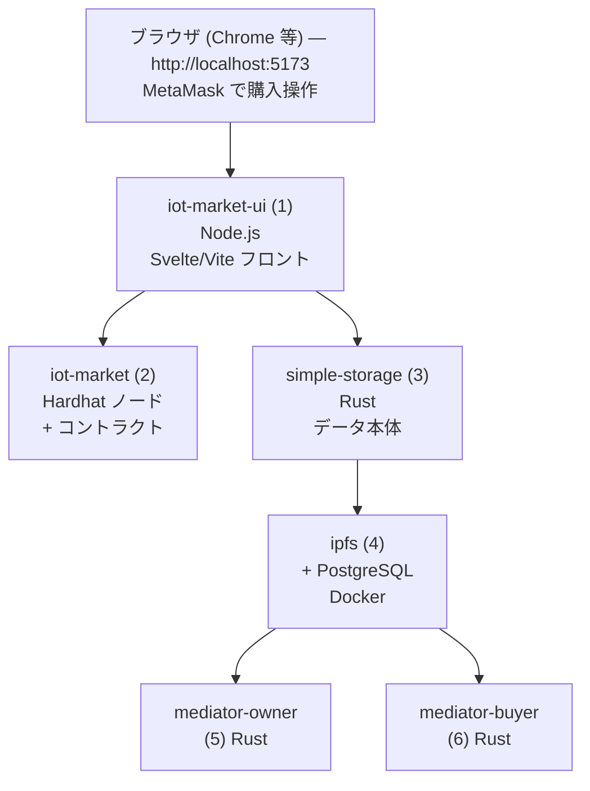
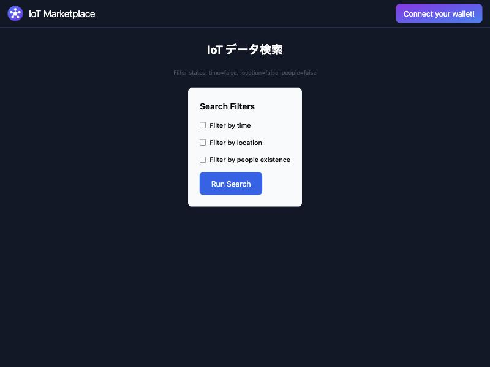
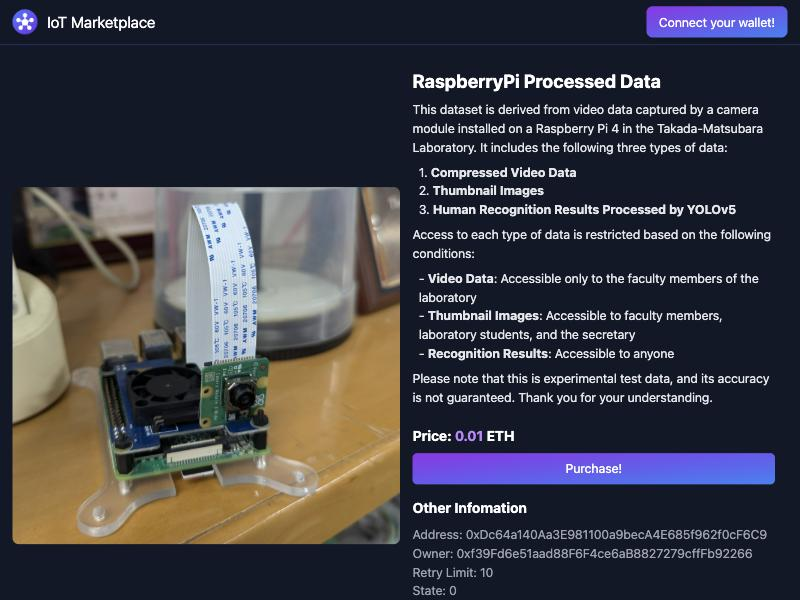
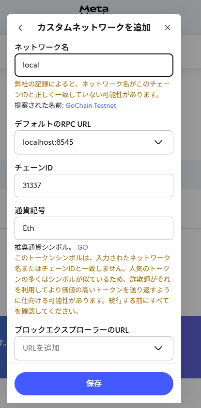

# 最短起動 (スタックを動かす)

[事前準備 (ツールのインストール)](prerequisites.md) でインストールしたツールを使って、ハンズオン環境一式をまとめて起動します。このページは、ハンズオンの Part 1 の 1.1 を終えてから進めます。
所要時間の目安は **約 15〜30 分** です (初回は docker pull / npm install に時間がかかります)。

> ここでは 6 種類のプロセスを起動します。コントラクトのデプロイと、2 つある仲介プロセスにもそれぞれターミナルを使うため、ターミナルは全部で 7 つ開きます。
> 手順どおりに進めてください。

!!! note "このページの位置付け"
    - Part 1 の 1.1 と 1.2 の間に行います ([ハンズオン](../hands-on/index.md#12-デバイスからデータを取る))。
    - 始める前に、1.1 (HA SSI Publisher を選んだ場合は 1.2) で起動した publisher を止めます。publisher と、このページで起動する IPFS は、どちらもポート 8080 を使うためです。止めるコマンドは、[手順 5](#5-ipfs-と-postgresql-を起動-docker) の注意にあります。
    - 前のページ: [実機なしで一連を動かす (HA Demo Simulator)](../hands-on/ha-demo-simulator.md) (1.1)。1.2 で [Home Assistant のデータを取り込む (HA SSI Publisher)](../hands-on/ha-ssi-publisher.md) を選んだ場合は、そのページ (1.2) のあとに行います
    - 次のページ: [ハンズオン](../hands-on/index.md#12-デバイスからデータを取る) の 1.2 (デバイスからデータを取る)。1.2 で HA SSI Publisher を済ませた場合は、[ハンズオン](../hands-on/index.md#13-マーケットプレイスで売買-v1-経路) の 1.3 (マーケットプレイスで売買)

## ここで動かすもの — 全体像



(1) フロントエンド、(2) ブロックチェーン、(3) データ保管、(4) ファイル分散、(5)(6) 仲介プロセス、の 6 つです。

## 起動順 — 上から順に

> **ターミナルを 7 つ用意してください**。デプロイ (ターミナル 2) を除き、各プロセスは起動したまま動作し続けます。
> macOS Terminal なら ⌘+T、VS Code なら "Split Terminal" が利用できます。

### 0. 教材リポジトリに移動

教材リポジトリは `~/program/Blockchain_IoT_Marketplace` にある前提です ([事前準備 (ツールのインストール)](prerequisites.md) で clone した場所)。新しいターミナルは別のフォルダで開くことがあるので、各ターミナルでは絶対パスで移動します。

```bash
cd ~/program/Blockchain_IoT_Marketplace
```

### 0.5 ホスト名 `host.docker.internal` を確認

仲介プロセスとフロントエンドは、接続先として `host.docker.internal` という名前を使います。この名前が PC 上で引けるかを確認します。

```bash
ping -c 1 host.docker.internal
```

`cannot resolve` や `Unknown host` と表示される場合は、hosts ファイルに次の 1 行を追加します (管理者権限が必要です)。

```
127.0.0.1 host.docker.internal
```

- macOS / Linux: `/etc/hosts` (例: `sudo sh -c 'echo "127.0.0.1 host.docker.internal" >> /etc/hosts'`)
- Windows: `C:\Windows\System32\drivers\etc\hosts` (WSL2 の中で作業する場合は WSL2 側の `/etc/hosts`)

追加したら、もう一度 `ping` で応答があることを確認します。

### 1. ローカルブロックチェーンを起動

ターミナル 1:

```bash
cd ~/program/Blockchain_IoT_Marketplace/iot-market
npm install
npx hardhat node
```

期待する出力 (抜粋):

```
Started HTTP and WebSocket JSON-RPC server at http://127.0.0.1:8545/

Accounts
========
WARNING: These accounts ... use only for testing.

Account #0: 0xf39F... (10000 ETH)
Private Key: 0xac09...
...
Account #2: 0x3C44... (10000 ETH)
Private Key: 0x5de4...
...
```

> **このターミナルは閉じないでください**。ブロックチェーンが動き続けます。
>
> 表示された **Account #2 と Private Key** は、後で MetaMask に取り込むので画面に残しておきます (購入者側の仲介プロセスが Account #2 を使うためです)。
> この Private Key は Hardhat が公開しているテスト用の鍵で、誰でも知ることができます。実際のネットワークでは使わないでください。

### 2. コントラクトをデプロイ

ターミナル 2 (別の窓):

```bash
cd ~/program/Blockchain_IoT_Marketplace/iot-market
npx hardhat run scripts/deployMerchandiseWithIoTMarket.ts --network localhost
```

成功すると、デプロイされたコントラクトのアドレスが表示されます。

### 3. フロントエンドを起動

ターミナル 3:

```bash
cd ~/program/Blockchain_IoT_Marketplace/iot-market-ui
npm install
npm run dev
```

期待する出力:

```
  VITE v5.x  ready in 500 ms
  ➜  Local:   http://127.0.0.1:5173/
```

ブラウザで <http://localhost:5173> を開いて、「IoT データ検索」という検索画面が表示されれば成功です。

### 4. データ保管庫を起動

ターミナル 4:

```bash
cd ~/program/Blockchain_IoT_Marketplace/simple-storage
cargo run
```

初回は Rust ライブラリのコンパイルで数分かかります。
`listening on 0.0.0.0:3000` が出れば起動完了です。

### 5. IPFS と PostgreSQL を起動 (Docker)

!!! warning "publisher が動いている場合"
    [実機なしで一連を動かす (HA Demo Simulator)](../hands-on/ha-demo-simulator.md) などで起動した publisher が動いたままの場合は、先に止めます。IPFS と publisher は、どちらもポート 8080 を使うためです。次のコマンドは、HA Demo Simulator で起動した Home Assistant と Node-RED もまとめて止めます。

    ```bash
    cd ~/program/Blockchain_IoT_Marketplace
    docker compose -f infra/docker-compose.yml --profile ha-demo --profile ha-demo-phase3 --profile nodered down
    ```

ターミナル 5:

```bash
cd ~/program/Blockchain_IoT_Marketplace/ipfs
docker compose up -d
```

`-d` (detached) を付けているため、バックグラウンドで起動します。
状態を確認します。

```bash
docker compose ps
```

`SERVICE` 列が `ipfs` と `postgres` の行で、`STATUS` が **Up** で始まっていれば成功です。

### 6. 仲介プロセス (オーナー側 + 購入者側) を起動

ターミナル 6 (オーナー側):

```bash
cd ~/program/Blockchain_IoT_Marketplace/mediator-owner
cargo run -- settings/owner_1.yaml
```

ターミナル 7 (購入者側):

```bash
cd ~/program/Blockchain_IoT_Marketplace/mediator-buyer
cargo run --bin mediator-b
```

両方とも、次の表示が出れば成功です (初回はコンパイルに数分かかります)。

```
Pubkey uploaded successfully
====================
Initialization complete!
====================
...
====================
Starting blockchain watch
====================
```

オーナー側は、続けて `Watching raw_data/output for new event files` と表示し、このフォルダに出力されるイベントファイルを商品として登録します。

`Pubkey uploaded successfully` は、仲介プロセスが自分の公開鍵を PubKey コントラクトに登録したことを示します。購入には、購入者の公開鍵が登録されている必要があります。購入者側の仲介プロセスは Account #2 として動くので、MetaMask にも Account #2 を取り込みます。

## 動作確認

1. ブラウザで <http://localhost:5173> を開きます。「IoT データ検索」という検索画面が表示されます。

    { width="480" }

2. 手順 2 でデプロイした商品のページを開きます。商品の説明、価格、「Purchase!」ボタンが表示されれば成功です。

    ```
    http://localhost:5173/merchandise/0xDc64a140Aa3E981100a9becA4E685f962f0cF6C9
    ```

    { width="480" }

3. **MetaMask** をセットアップします (次節)。

検索画面の「Run Search」で一覧に出るのは、`mediator-owner` が動画のメタデータを IPFS と PostgreSQL (`ipfs_records` テーブル) に登録した商品だけです。手順 2 のデプロイで登録される 5 件や、イベントファイルから作られた商品は検索に出ません。商品ページの URL (`http://localhost:5173/merchandise/<商品のアドレス>`) を直接開いて確認します。デプロイした 5 件のアドレスは手順 2 の出力に表示されます (毎回同じ値です)。

## MetaMask のローカルチェーン設定

MetaMask をローカル Hardhat に接続します。

1. MetaMask 拡張を開く
2. ネットワーク選択 → 「**カスタムネットワーク追加**」
3. 以下を入力:
   - ネットワーク名: `Hardhat Local`
   - RPC URL: `http://localhost:8545`
   - チェーン ID: `31337`
   - 通貨記号: `ETH`
4. 保存して、追加したネットワークに切り替える

ステップ 1 で出ていた **Account #2 の Private Key** をインポートします:

1. MetaMask 右上のアイコン → **アカウントのインポート**
2. Private Key を貼り付ける (`0x` 始まりの 64 桁)
3. 取り込んだアカウントの残高に **約 10000 ETH** が表示されれば成功 (`mediator-buyer` が公開鍵の登録に使ったガス代のぶん、9999.99… とわずかに少なくなります)

参考画像 (ネットワーク追加のイメージ):



## ここまでできていれば次に進める

- [ ] ターミナル 1〜7 がすべて立ち上がっていてエラーで落ちていない
- [ ] <http://localhost:5173> で検索画面が、商品ページの URL で商品が表示される
- [ ] MetaMask が `Hardhat Local` ネットワークに接続できている
- [ ] MetaMask のアカウント残高が約 `10000 ETH` (9999.99… でよい) と表示される

すべてチェック → [ハンズオン](../hands-on/index.md) の Part 1 の 1.2 に進み、1.2 のページを 1 つ終えたら 1.3 の出品と購入に進みます。1.2 で [Home Assistant のデータを取り込む (HA SSI Publisher)](../hands-on/ha-ssi-publisher.md) を済ませてから最短起動をした場合は、そのまま 1.3 に進みます。

## 最短起動を使わないページ

次のページは、最短起動のスタックを使いません。必要なもの (publisher など) は、それぞれのページで起動します。

- Part 1 の 1.1: [実機なしで一連を動かす (HA Demo Simulator)](../hands-on/ha-demo-simulator.md)
- Part 1 の 1.2: [Home Assistant のデータを取り込む (HA SSI Publisher)](../hands-on/ha-ssi-publisher.md)
- Part 2 の 2.1〜2.3: [検知イベントだけを共有する](../hands-on/webcam-event-sharing.md)、[防災イベントを共有する](../hands-on/environment-disaster.md)、[データ提供者の認証 (Consent VC / Stage 1)](../hands-on/ha-ssi-wallet.md)、[データ閲覧者の認証 (Viewer VC / Stage 3)](../hands-on/ha-ssi-viewer.md)、[機器間での連携認証 (Service VC / Stage 4 prep)](../hands-on/ha-ssi-service.md)
- Part 2 の 2.5: [信頼度に応じて見せる中身を変える (DataUserVC / Stage T)](../hands-on/data-user-vc-tiered.md)、[画像・動画を段階アクセスで配信する (DataUserVC / Stage T)](../hands-on/data-user-vc-tiered-media.md)、[意味レベルで段階化する (VLM と意味的中間表現 / Stage T)](../hands-on/data-user-vc-tiered-semantic.md)、[画像の来歴を証明する (C2PA / Stage P)](../hands-on/c2pa-provenance.md)、[来歴を publisher とチェーンにつなぐ (C2PA / Stage P の P1・P2)](../hands-on/c2pa-provenance-publisher.md)、[VLM の要約から元の画像をたどる (C2PA / Stage P の P3)](../hands-on/c2pa-provenance-vlm.md)
- Part 3 のすべてのページ

publisher を起動するページでは、先に最短起動の IPFS (手順 5) を止めます。IPFS と publisher は、どちらもポート 8080 を使うためです。IPFS は、`ipfs` ディレクトリで `docker compose down` を実行して止めます。

上のページのうち、publisher を起動しないのは、[画像の来歴を証明する (C2PA / Stage P)](../hands-on/c2pa-provenance.md) (Python のプログラムだけで動きます) と、Part 3 の [地域安全アシスタントを動かす](../hands-on/regional-safety-assistant.md) と [AI に手順を考えさせる (LLM Planner)](../hands-on/llm-planner.md) (publisher の代わりに、assistant (ポート 8090) などを起動します) です。

[来歴を publisher とチェーンにつなぐ (C2PA / Stage P の P1・P2)](../hands-on/c2pa-provenance-publisher.md) は、自分で Hardhat ノードを起動します。最短起動の Hardhat ノード (ターミナル 1) が動いていれば、先に止めます。

## よくあるつまずき

| 症状 | 原因 | 対処 |
|---|---|---|
| `npx: command not found` | Node.js が入っていない | [事前準備 (ツールのインストール)](prerequisites.md) の Node.js を再確認 |
| `cargo: command not found` | Rust が入っていない | [事前準備 (ツールのインストール)](prerequisites.md) の Rust を再確認 |
| `Port 5173 is in use, trying another one...` と出て、5174 などで起動する | 別アプリが 5173 番を使っている | 占有しているプロセスを止めて起動し直す。そのまま使う場合は、表示された URL (`http://127.0.0.1:5174/` など) を開く |
| IPFS のコンテナが起動しない / publisher が起動しない | IPFS のゲートウェイと publisher が、どちらもポート 8080 を使う | 同時には起動できない。publisher を使うハンズオンの前に、`ipfs` ディレクトリで `docker compose down` を実行する |
| 仲介プロセスが `dns error` や接続エラーで止まる | `host.docker.internal` を引けない | 手順 0.5 を実施 |
| `error connecting to docker` | Docker Desktop 未起動 | Docker Desktop を起動 |
| MetaMask に「Nonce too high」 | チェーン再起動でズレた | MetaMask Settings → Advanced → 「Clear activity tab data」 (または「Reset Account」) |
| MetaMask が `localhost:8545` を Reject | RPC URL の打ち間違い | `http://` を付け忘れていないか確認 |

それ以外は [トラブルシュート](../operations/troubleshooting.md) と [FAQ](../operations/faq.md) を参照してください。

## このページで覚える用語

| 用語 | 短い意味 |
|---|---|
| **Hardhat** | Ethereum 互換のローカルチェーンを動かすツール |
| **コントラクト** | ブロックチェーン上で動くプログラム |
| **デプロイ** | コントラクトをチェーン上に設置すること |
| **チェーン ID** | ネットワークを識別する番号 (Hardhat の既定は 31337) |
| **Vite** | フロントエンド用の高速な開発サーバ |

詳しくは [Hardhat基礎（このサイトで使うブロックチェーン）](../foundations/hardhat-basics.md) と [SSI / DID / VC 基礎](../foundations/ssi-did-vc-basics.md) を参照してください。
